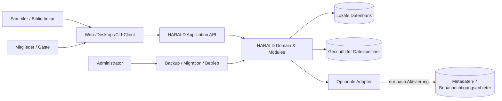
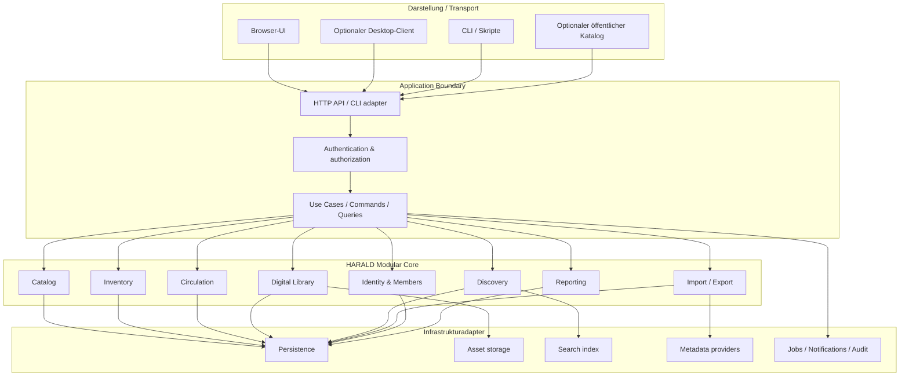
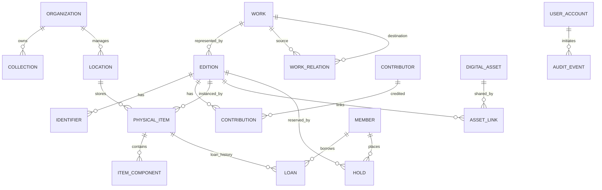
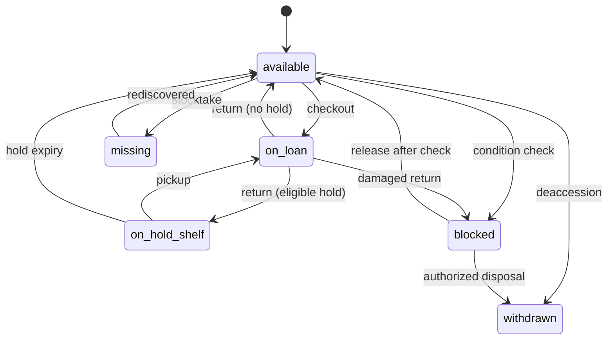
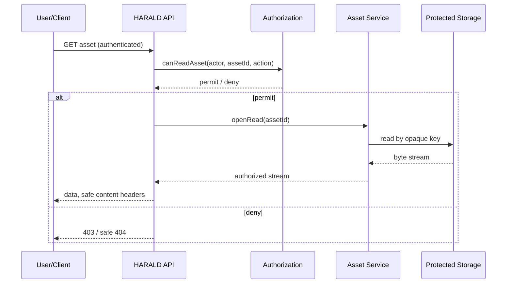

# HARALD – Softwarearchitektur und Erweiterungskonzept

> **HARALD – Open Source Library & Media Management**  
> **Dokument-ID:** HARALD-ARCH-001  
> **Version:** 0.1 (Architekturentwurf)  
> **Stand:** 17. Oktober 2026  
> **Status:** Diskussions- und Entscheidungsgrundlage, **nicht** vollständig freigegeben  
> **Repository:** https://github.com/Robin-Goerlach/SASD-Harald  
> **Lizenz des Repositorys:** MIT (`LICENSE`)  
> **Sprache:** Deutsch; öffentliche Schnittstellennamen und technische Verträge vorzugsweise Englisch

**Kurzfassung / Abstract:** HARALD soll ein modular erweiterbares, selbst betreibbares Verwaltungsprogramm für physische und digitale Medien werden. Seine langfristig stabile Grundlage ist ein fachlich korrektes Modell für Werke, Veröffentlichungen, Exemplare, Dateien, Rechte und Ausleihen. Eine modulare Monolith-Architektur mit expliziten Anwendungsschnittstellen ermöglicht später zusätzliche Medientypen, neue Benutzeroberflächen, Datenquellen, Import-/Exportformate, Datenbanksysteme und gegebenenfalls externe Erweiterungen. **Die endgültige Implementierungssprache, UI-Technologie und Plugin-Laufzeit bleiben ausdrücklich offen.**

> **Wichtige Abgrenzung:** Dieses Dokument beschreibt die *Soll-Architektur*. Das Repository enthält aktuell noch keine funktionsfähige Implementierung. UML-/Mermaid-Diagramme, API-Routen, Typnamen, Verzeichnisstrukturen und Codebeispiele sind **Entwürfe**, keine bestehenden Features. Die spätere Umsetzung muss durch Tests und Architekturentscheidungen nachgewiesen werden.

---

## Inhaltsverzeichnis

1. [Dokumentzweck und Beschlussstatus](#1-dokumentzweck-und-beschlussstatus)
2. [Architekturziele und Nichtziele](#2-architekturziele-und-nichtziele)
3. [Architekturprinzipien und verbindliche Grenzen](#3-architekturprinzipien-und-verbindliche-grenzen)
4. [Kontext, Akteure und Betriebsvarianten](#4-kontext-akteure-und-betriebsvarianten)
5. [Gesamtarchitektur](#5-gesamtarchitektur)
6. [Fachmodule und Verantwortlichkeiten](#6-fachmodule-und-verantwortlichkeiten)
7. [Domänenmodell und Identitäten](#7-domänenmodell-und-identitäten)
8. [Aggregate, Invarianten und Zustandsautomaten](#8-aggregate-invarianten-und-zustandsautomaten)
9. [Anwendungsfälle, Ports und Verträge](#9-anwendungsfälle-ports-und-verträge)
10. [Transaktionen, Nebenläufigkeit und Ereignisse](#10-transaktionen-nebenläufigkeit-und-ereignisse)
11. [Datenbank- und Speicherarchitektur](#11-datenbank--und-speicherarchitektur)
12. [Digitale Dateien, Rechte und Vorschauen](#12-digitale-dateien-rechte-und-vorschauen)
13. [Identität, Autorisierung und Datenschutz](#13-identität-autorisierung-und-datenschutz)
14. [Erweiterungsarchitektur und Plugins](#14-erweiterungsarchitektur-und-plugins)
15. [API-Architektur und Versionierung](#15-api-architektur-und-versionierung)
16. [Metadaten, externe Quellen und Provenienz](#16-metadaten-externe-quellen-und-provenienz)
17. [Suche, Indexierung und öffentliche Kataloge](#17-suche-indexierung-und-öffentliche-kataloge)
18. [Import, Export, Migration und Datenhoheit](#18-import-export-migration-und-datenhoheit)
19. [Hintergrundarbeiten und Benachrichtigungen](#19-hintergrundarbeiten-und-benachrichtigungen)
20. [Benutzeroberflächen und externe SASD-Bausteine](#20-benutzeroberflächen-und-externe-sasd-bausteine)
21. [Sicherheitsarchitektur und Bedrohungsmodell](#21-sicherheitsarchitektur-und-bedrohungsmodell)
22. [Betrieb, Backup, Restore und Updates](#22-betrieb-backup-restore-und-updates)
23. [Technologiewahl und Portabilität](#23-technologiewahl-und-portabilität)
24. [Vorgeschlagene Repository-Struktur](#24-vorgeschlagene-repository-struktur)
25. [Qualitätssicherung und Architekturtests](#25-qualitätssicherung-und-architekturtests)
26. [Qualitätsziele und Messung](#26-qualitätsziele-und-messung)
27. [Ausbauoptionen und Evolutionspfade](#27-ausbauoptionen-und-evolutionspfade)
28. [Entwicklungsstufen und erste vertikale Scheibe](#28-entwicklungsstufen-und-erste-vertikale-scheibe)
29. [Architecture Decision Records (ADR)](#29-architecture-decision-records-adr)
30. [Risiken und Gegenmaßnahmen](#30-risiken-und-gegenmaßnahmen)
31. [Abnahmekriterien und offene Fragen](#31-abnahmekriterien-und-offene-fragen)
32. [Glossar, Quellen und Referenzen](#32-glossar-quellen-und-referenzen)

---

# 1. Dokumentzweck und Beschlussstatus

Dieses Architekturpapier konkretisiert das zuvor erstellte deutsche Pflichtenheft `Pflichtenheft_Open_Source_Multimedia_Bibliotheksverwaltung_2026.md` (Dokument-ID `OMB-PFH-001`) und den Funktionskatalog mit 24 untersuchten Anwendungen. Seit der Erstellung dieser Vorarbeiten wurden **HARALD** als Projektname und die **MIT-Lizenz** des GitHub-Repositories tatsächlich festgelegt. Frühere Platzhalter wie „OMB“ und die dort noch offene Lizenzentscheidung werden für dieses Projekt daher durch `HARALD` bzw. `MIT` ersetzt.

Das Pflichtenheft enthält unter anderem die Anforderungen `CAT-*`, `LOC-*`, `VID-*`, `MUS-*`, `AUD-*`, `DIG-*`, `CIR-*`, `IAM-*`, `SEA-*`, `IMP-*`, `INV-*`, `SEC-*` und `NFR-*` sowie Abnahmeszenarien `AT-001` bis `AT-024`. Diese bleiben die **fachliche Anforderungsquelle**; diese Architektur ersetzt die Anforderungen nicht. Widersprüche müssen als Änderung oder ADR nachvollziehbar entschieden werden.

## 1.1 Verbindlichkeitsklassen

| Kennzeichnung | Aussage | Konsequenz |
|---|---|---|
| **B – Basisprinzip** | Ab jetzt beabsichtigte Architekturregel | Änderungen nur mit dokumentierter Begründung/ADR |
| **E – Entwurf** | Plausible, aber noch nicht freigegebene Detailentscheidung | Vor produktiver Umsetzung prüfen |
| **O – Offen** | Bewusst nicht getroffen | Nicht stillschweigend im Quellcode festlegen |
| **S – Später** | Vorbereitete Erweiterungsmöglichkeit | Keine verpflichtende R1-Implementierung |

**Feststehend:** Name `HARALD`; Repository `Robin-Goerlach/SASD-Harald`; Lizenz laut aktueller Repositorydatei `MIT`; Kernziel einer freien Multimedia-Bibliotheksverwaltung. **Noch offen:** Sprache/Runtime, endgültige UI, Netzwerk-/Serverform, Plugin-Laufzeit, verbindliche Verfügbarkeit von BSD-Paketen und Details der Veröffentlichung.

## 1.2 Dokumentenhierarchie

1. **Funktionskatalog:** Recherche- und Ideensammlung der 24 Referenzprogramme.
2. **Pflichtenheft:** fachliche Funktionen, Prioritäten, Abnahmebedingungen.
3. **Dieses Architekturpapier:** Bausteine, Abhängigkeiten, Datenhoheit, Evolution und technische Leitplanken.
4. **ADR-Dateien:** nachweisbar getroffene Entscheidungen in konkreten Fragen.
5. **API-/Schema-Spezifikationen:** tatsächlich versionierte, maschinenprüfbare Verträge.
6. **Implementierung und Tests:** überprüfbarer Ist-Zustand; vor jeder Releaseangabe maßgeblich.

Keine Beispielimplementierung ist automatisch normative API. Bei Konflikten gilt: **beobachtbare Produktanforderung klären, ADR entscheiden, Architektur und Tests zusammen anpassen**.

# 2. Architekturziele und Nichtziele

## 2.1 Hauptziele

- **Ein Bestand für alle Medien:** Bücher, Comics, Magazine, DVDs, Blu-rays, UHD-Blu-rays, Musik-CDs, Schallplatten, Kassetten, Hörbuch-CDs, E-Books und digitale Dateien.
- **Fachlich sauberes Identitätsmodell:** Werk, Ausgabe/Release, Exemplar, Komponenten und Datei sind unterschiedliche Objekte.
- **Offener Ausbau:** zusätzliche Medientypen und Arbeitsabläufe ohne Umbau aller bestehenden Komponenten.
- **Austauschbare Oberflächen:** Web, Desktop, CLI, Scanner- oder mobile Anwendungen nutzen dieselben Anwendungsfälle.
- **Unabhängigkeit von Herstellern:** keine zwingende Cloud, Telemetrie oder proprietäre Registrierung.
- **Überprüfbare Datenhoheit:** verlustarmer Gesamtexport, getrennte Backup- und Wiederherstellungskonzepte.
- **Wartbarkeit über viele Jahre:** nachvollziehbare Verträge, Migrationen, Tests, Dokumentation, wenige Abhängigkeiten.
- **Gute kleine Installation:** privater Rechner oder Heim-/Vereinsserver ohne komplexe Infrastruktur.
- **Professionell ausbaufähig:** neue Bibliotheksstandards, Standorte, Benutzerrollen und Integrationen bleiben möglich.

## 2.2 Explizite Nichtziele der ersten Version

- Kein vollständiges Koha-/Evergreen-/FOLIO-Ersatzsystem für Bibliotheksverbünde.
- Kein verteiltes Microservice-System und keine Kubernetes-Pflicht.
- Kein Zwang zu Internet, kommerziellen Metadatendiensten oder KI-Diensten.
- Kein universeller Video-/Audiostreamingserver und kein DRM-Umgehungswerkzeug.
- Kein automatisches Teilen urheberrechtlich geschützter digitaler Medien.
- Keine Mehrfachmaster-Replikation mit konfliktfreier Offline-Synchronisierung in R1.
- Kein beliebiger, ungeprüfter Plugin-Code im zentralen Serverprozess.
- Keine künstliche Unterstützung aller erdenklichen Datenbanken und Sprachen ab Tag 1.

**Offenheit bedeutet, Erweiterungen möglich zu machen – nicht, sie schon vor ihrem Bedarf vollständig zu implementieren.**

# 3. Architekturprinzipien und verbindliche Grenzen

## 3.1 Goldene Regeln (B)

1. **Domain first:** Fachliche Regeln befinden sich in Domänenmodellen und Anwendungsdiensten, nicht in UI-Events oder HTTP-Controllern.
2. **Dependency rule:** Abhängigkeiten zeigen von Infrastruktur und Transport **nach innen** zur Anwendung und Domäne. Das Domänenmodell importiert keine UI-, ORM-, HTTP-, Datenbank- oder Plugin-Klassen.
3. **Single source of truth:** Jeder schreibbare fachliche Zustand hat genau einen verantwortlichen Modulbesitzer. Andere Module konsumieren Verträge, nicht fremde Tabellen.
4. **Keine UI-Abhängigkeit:** Der Kern funktioniert ohne geöffnete Oberfläche; eine CLI bzw. Tests können dieselben Use Cases ausführen.
5. **Keine Plattformabhängigkeit in der Domäne:** Betriebssystem, Laufzeit und Dateisystem bleiben Randbedingungen von Adaptern.
6. **Definierte Transaktionsgrenzen:** Ausleihe, Rückgabe und Rechteänderungen müssen atomar sein; Ereignisse dürfen die Korrektheit nicht ersetzen.
7. **Erweiterbarkeit über Verträge:** Neue Funktionen erweitern bekannte Ports oder werden eigene Module; keine Reflection-/Hook-Umgehung von Fachregeln.
8. **Opt-in für externe Dienste:** Metadaten, Benachrichtigungen, Telemetrie (falls je angeboten) und KI-Integrationen sind einzeln konfigurierbar und nie Voraussetzung für den Offline-Kern.
9. **Daten gehören dem Betreiber:** Import, Export, Wiederherstellung und Zugriffskontrolle sind Produkteigenschaften.
10. **Default deny:** Gast- und Plugin-Zugriffe auf persönliche Daten und digitale Dateien sind standardmäßig verboten.
11. **Versionierte Kontrakte:** Öffentliche APIs, Export-Schemata, Plugin-Protokolle und Migrationsstände erhalten eigene Versionen.
12. **Kleine, prüfbare Änderungen:** Klare Module sind wichtiger als ein abstraktes Framework mit Dutzenden Erweiterungsschichten.

## 3.2 Zu vermeidende Antimuster

| Antimuster | Warum problematisch | Stattdessen |
|---|---|---|
| Ein gigantischer `Media`-Datensatz mit Hunderten Null-Feldern | Schwache Validierung, vermischte Bedeutungen | Gemeinsamer Kern + typisierte Medienprofile |
| Alle Eigenschaften ausschließlich als EAV/JSON ohne Schema | Unprüfbare Regeln, schlechte Indizes | Typisierte Kernfelder; validierte Erweiterungsfelder |
| Controller ruft direkt SQL auf | UI/HTTP bestimmt Fachlogik | Use-Case-Handler → Domain → Ports |
| Andere Module ändern fremde Tabellen direkt | Fragile Kopplung und versteckte Invarianten | Öffentliche Modulverträge |
| Plugin erbt intern private Framework-Klasse | Versionsabhängig und schwer isolierbar | Externes, explizit versioniertes Protokoll |
| API liefert ORM-Entitäten | Leckt DB-Schema und Sicherheitsfelder | DTOs/Contracts |
| Ereignisbus als einziges Konsistenzmittel | Ausleih-Doppelbuchungen möglich | DB-Transaktion + abgeleitete Events |
| Unveränderlicher JSON-Blob für alles | Fehlende evolutionäre Migration | Schema-Version + saubere Upcaster/Mapper |
| Fremdmetadaten überschreiben lokale Korrekturen | Datenverlust | Provenienz und Vorschau/Merge |
| Mehrmandantenbetrieb „nebenbei“ per `organization_id` | Autorisierungslücken | Eine Organisation R1; echte Isolation später entwerfen |

# 4. Kontext, Akteure und Betriebsvarianten

## 4.1 Anwendungsakteure

- **Sammler/Owner:** katalogisiert, bewertet und verwaltet den eigenen Bestand.
- **Bibliothekar/Katalogisierer:** pflegt Metadaten, Veröffentlichungen, Exemplare und Standorte.
- **Ausleihe/Mitarbeitende:** bearbeitet Leihen und Rückgaben.
- **Mitglied/Leser:** sieht eigene Leihen und freigegebene Einträge.
- **Gast:** recherchiert ausschließlich ausdrücklich öffentliche Kataloginformationen.
- **Administrator:** konfiguriert Betrieb, Sicherung, Konten und Integrationen.
- **Externe Systeme:** optionale Metadatenanbieter, Scanner, Importwerkzeuge, Reader und Benachrichtigungsdienste.

## 4.2 Kontextdiagramm (Entwurf)



## 4.3 Betriebsprofile (Entwurf)

| Profil | Beschreibung | R1-Priorität | Sicherheitsgrenze |
|---|---|---|---|
| **Personal local** | Ein Nutzer, lokale Daten und private Assets | Hoch | Authentifizierung und lokale Dateiberechtigungen trotzdem bewusst konfigurieren |
| **Small LAN server** | Ein Server, mehrere Browser/Benutzer im lokalen Netz | Hoch | Authentifizierung, HTTPS im geeigneten Deployment, RBAC |
| **Headless service** | Automatisierung über CLI/API ohne GUI | Mittel | Gleiche Auth-/Fachregeln wie UI |
| **Desktop client** | Native Oberfläche, optional eigenständiges Paket | Offen | Ruft Use Cases über stabile Verträge auf |
| **Public catalog** | Freigegebener OPAC mit anonymem Zugriff | R2 | Strenge Projektion/Auswahl freigegebener Felder |
| **Multi-site / multi-tenant** | Mehrere Einrichtungen und mögliche Mandanten | R3/Offen | Eigenes Isolation-, Rollen- und Betriebsdesign |

**Offlinefähig** bedeutet R1: Lokale Kernprozesse benötigen keine Onlineanbieter. Es bedeutet **nicht**, dass mehrere Laptops beliebig offline Daten ändern und anschließend automatisch konfliktfrei synchronisieren können.

# 5. Gesamtarchitektur

## 5.1 Entscheidungsvorschlag: modularer Monolith (B/E)

Die erste ausführbare Anwendung besteht aus **einem logisch modularisierten Backend** mit einem gemeinsam kontrollierten Transaktions- und Deploymentrahmen. Module besitzen getrennte Schnittstellen; erst später kann ein bestimmtes Modul bei nachgewiesenem Bedarf in einen eigenen Prozess ausgelagert werden. Darauf wird **nicht** optimiert, bevor reale Skalierungs- oder Isolationsgründe vorliegen.



**Diagrammhinweis:** Die zeichnerischen Pfeile zwischen Modulen und Infrastruktur zeigen *Ports*, **keine direkten SQL-/Dateisystemabhängigkeiten**. Echte Modulabhängigkeiten werden in Code und Tests begrenzt.

## 5.2 Schichtenmodell

| Schicht | Darf enthalten | Darf nicht enthalten |
|---|---|---|
| `Domain` | Aggregate, Regeln, Wertobjekte, Domänenereignisse | SQL, HTTP, ORM, ViewModels, Provider-SDKs |
| `Application` | Use Cases, Autorisierungsschnittstellen, Transaktionskoordination, DTO-Mapping | UI-Logik, konkrete Datenbankzugriffe |
| `Contracts` | Versionierte Schnittstellen, DTOs, Fehlercodes, Schemas | ORM- und private Implementierungstypen |
| `Infrastructure` | SQLite, Dateispeicher, Indizes, Adapter, Auth-Treiber, Logging | Duplizierte Fachentscheidungen |
| `Transport` | HTTP, CLI, später Desktop-Brücken, Inputvalidierung | Direkte Änderung von Domänentabellen |
| `Presentation` | Ansichten, Navigation, Lokalisierung, Interaktionen | Geschäftslogik mit eigenen, abweichenden Regeln |

**Wichtiger Unterschied:** Fachvalidierung gehört in die Domäne. Clientvalidierung ist nur Bedienkomfort und kann unabhängig vom Backend umgangen werden; deshalb **immer server-/anwendungsseitig prüfen**.

# 6. Fachmodule und Verantwortlichkeiten

| Modul | Gehört hinein | Fremder Zustand wird nur über… | R1 |
|---|---|---|---|
| `Catalog` | Werk, Ausgabe, Identifikatoren, Beteiligte, Reihen, Relationen | Catalog-Queries/Commands | Kern |
| `MediaProfiles` | Typisierte Buch-/Film-/Musik-/Hörbuchfelder, Validierung, Felddefinitionen | Catalog Contracts | Kern |
| `Inventory` | Exemplar, Standort, Komponenten, Zustand, Inventur | Inventory Contracts | Kern |
| `Circulation` | Leihen, Rückgabe, Verlängerung, Vormerkungen, Regeln | Circulation Commands | Kern |
| `Identity` | Accounts, Rollen, Scopes, Authentifizierung | Authorization Contracts | Kern |
| `Membership` | Mitglieder, Kontaktminimierung, Datenschutz | Member Contracts | Kern |
| `DigitalLibrary` | Asset, Storage, Hash, Rechteprofil, Vorschauauftrag | Asset Contracts | Basis |
| `Discovery` | Katalogsuche, Filter, sichere Suchprojektionen | Discovery Queries | Kern |
| `Metadata` | Metadatenvorschläge, Quellzuordnung, Merge/Provenienz | Provider Port | Einfach manuell; Online R2 |
| `Exchange` | Import, CSV/JSON, Gesamtexport, Validierung | Import-/Export-Port | Basis |
| `Reporting` | Bestands-, Ausleih- und Inventurberichte | Read Contracts | Basis |
| `Operations` | Migration, Health, Jobs, Backup/Restore | Admin Contracts | Basis |
| `Notifications` | E-Mail/andere Zustellung über konfigurierbare Adapter | Notification Port | Später |
| `PublicCatalog` | Öffentlich freigegebene Katalogansichten | Read-only Discovery API | R2 |
| `ReadersAndPlayers` | Legale Wiedergabe/Leser mit getrennten Rechten | DigitalLibrary Port | R2 |
| `ExternalIntegrations` | Datenquellen, Geräte, OPDS, SRU usw. | Versionierte Provider-Verträge | R2/R3 |

### Modulregeln

- Jedes Modul besitzt eine **klar verantwortliche Schnittstelle** und einen dokumentierten Besitzbereich seiner Daten.
- Die Modul-API unterscheidet **schreibende Commands** und **lesende Queries**; daraus folgt *kein* Zwang zu einem komplexen CQRS-/Event-Sourcing-Framework.
- Ein anderes Modul darf technische Projektionen lesen, wenn diese ausdrücklich freigegeben und abgesichert sind; es darf nicht direkt in fremde Tabellen schreiben.
- Gemeinsame Bibliotheken enthalten nur wirklich geteilte Grundtypen wie IDs, `Result`, Zeitabstraktion und Ereignis-Hüllen; **kein** allwissendes `Common`-Modul.
- Modulabhängigkeiten werden als gerichteter Graph dokumentiert. Zyklische Referenzen sind ein Architekturfehler.
- **Keine Plugin-API darf durch die Hintertür Transaktionen, Benutzerrechte oder Validierung umgehen.**

# 7. Domänenmodell und Identitäten

## 7.1 Werk, Ausdruck, Ausgabe und Exemplar

Die erste Ausbaustufe verwendet eine **praktische Vereinfachung** mit `Work`, `Edition` und `Item`, angelehnt an bibliothekarische Modellierung. Das IFLA Library Reference Model unterscheidet zusätzlich ausdrücklich *Expression* und *Manifestation*; HARALDs `Edition` ist **keine vollständige 1:1-Implementierung** dieses Modells. Eine spätere Einführung von `Expression` muss ohne Identitätsbruch möglich bleiben.

| Begriff | Identität | Beispiel |
|---|---|---|
| `Work` | Eigenständiger intellektueller/künstlerischer Inhalt | Roman *Dune*, Film *Dune (2021)* als verknüpftes **anderes Werk** |
| `Expression` (später) | Sprachliche/darstellerische Realisierung eines Werks | Deutsche Übersetzung der Romanfassung |
| `Edition` | Konkrete Ausgabe, Pressung, Veröffentlichung, Träger oder digitales Angebot | Taschenbuchausgabe, Blu-ray-Veröffentlichung, Hörbuchausgabe |
| `PhysicalItem` | Individuelles Exemplar mit Inventar-ID | Taschenbuch A in Regal 3; DVD B im Keller |
| `ItemComponent` | Erwarteter Bestandteil eines Exemplars | CD 2/5, Booklet, Beilage |
| `DigitalAsset` | Konkret gespeicherte Datei inkl. Hash und Rechtebezug | EPUB-Datei einer legal erworbenen Ausgabe |
| `Relationship` | Semantischer Bezug zwischen selbstständigen Einträgen | „ist Verfilmung von“, „Übersetzung von“, „begleitet“ |

**Invariante:** Produkt-ISBN/EAN/UPC sind Kennungen **einer Ausgabe**, kein garantierter Inventarschlüssel. Zwei Exemplare derselben Ausgabe können verschiedene Standorte, Schäden und Leihzustände haben. Eine Datei muss nicht einer physischen Kopie entsprechen. Auch unterschiedliche Kunstformen können verwandte, aber separate Werke sein.

## 7.2 Konzeptionelles Modell



Dies ist ein **fachliches** ER-Diagramm. Technische Details wie Fremdschlüssel in der relationalen Realisierung, Entitätsgrenzen oder die konkrete Modellierung optionaler Hold-Ziele werden erst im Schema festgelegt. Ein `WorkRelation` referenziert zwei gültige Werke; `ItemComponent` hat genau ein Besitzexemplar.

## 7.3 Identifikatoren und UUIDs (E)

- Interne fachliche IDs sind **stabil, vom Datenbankautoincrement unabhängig** und in Exporten transportierbar, z. B. UUID (Variante als ADR festzulegen).
- Eine fachliche ID wird bei einer Datenbankmigration oder Änderung der UI **nicht** neu vergeben.
- Importierte fremde IDs sind zusätzlich in einem **source-qualified namespace** zu speichern; niemals unkontrolliert als lokale IDs übernehmen.
- Kennungen besitzen mindestens `{type, raw_value, normalized_value, issuer/source}`; Validierung hängt vom Typ ab.
- ISBN-10, ISBN-13, ISSN, EAN/GTIN, UPC, ISRC, MBID und andere Kennungen sind nicht untereinander austauschbar.
- Doppelte Produkteinträge werden über **Kandidaten**, nicht über automatische destruktive Zusammenführung behandelt.
- Ein eindeutiger `inventory_code` gehört einer *einzelnen* aktiven physischen Kopie; historisierte Codes werden vor irrtümlicher Wiederverwendung geschützt.

## 7.4 Medienprofile: gemeinsamer Kern und typisierte Erweiterungen

### Gemeinsame Felder

Titel, Titelvarianten, Beschreibung, Genre, Sprache, Veröffentlichungsjahr, Beteiligte/Rollen, Identifikatoren, Cover-Referenzen, Sammlungen, Provenienz, Beziehungen, Änderungsstand. Diese Felder haben **klaren Besitzer** (`Work`, `Edition` oder `Item`).

### Typisierte Beispiele

| Profil | Veröffentlichungsspezifische Daten |
|---|---|
| `book` | ISBN, Übersetzung, Verlag, Auflage, Bindung, Seitenzahl, Reihe |
| `video` | DVD/Blu-ray/UHD, Region, Ton-/Untertitelsprachen, Regie, Laufzeit, Disc-Anzahl |
| `music` | Interpret, Komponist, Label, Pressung, Katalognummer, Medium, Trackstruktur |
| `audiobook` | Autor, Sprecher, gekürzt/ungekürzt, Laufzeit, Kapitel, Disc-Struktur |
| `periodical` | ISSN, Jahrgang, Heft, Frequenz, Einzeltitel |
| `ebook` | Format, Ausgabeinformation, zugeordnetes Datei-Asset, Zugriffsprofil |
| `comic` | Serie, Heft-/Bandnummer, Zeichner, Autor, Sonderausgabe |
| `other` | Minimales typisiertes Kernschema plus definierte benutzerdefinierte Felder |

Ein **neuer Medientyp** erhält einen registrierten `media_kind`-Schlüssel, eine deklarierte Schema-Version, Validatoren, Indexprojektionen, Detaildarstellung und Importmapping. Unbekannte Profile müssen **erhaltend** exportierbar und speicherbar sein; ein alter Client darf unbekannte Daten nicht beim Speichern löschen. In R1 bleiben Basisprofile **integriert und getestet**. Beliebige ausführbare Profil-Plugins sind kein R1-Versprechen.

## 7.5 Erweiterungsfelder ohne Datenmüll

Vorgeschlagener Feldvertrag:

```json
{
  "namespace": "org.example.collectors",
  "schema_version": 1,
  "fields": {
    "original_shop": "Example Store",
    "signed_copy": true,
    "shelf_priority": 7
  }
}
```

Diese Darstellung ist **nur ein Entwurfsbeispiel**, kein veröffentlichter Dateivertrag. Regeln:

- Namensräume verhindern Kollisionen; unbekannte Namespaces bleiben beim Roundtrip erhalten.
- Datentyp, Pflichtigkeit, Kardinalität und sensible Inhalte werden in einer Schema-Registry definiert.
- Erweiterungsfelder können indiziert werden, **aber nur explizit** und mit Kostenabschätzung.
- Für Daten mit wichtigen Beziehungen/Integritätsbedingungen entsteht ein echtes Modulmodell; keine willkürlichen „Alles-als-JSON“-Workarounds.
- Die UI zeigt unbekannte Felder gegebenenfalls lesbar an; sie erfindet ohne Schema keine fachliche Validierung.
- Datenschutzklassifikation gehört auch zu Feldern aus Erweiterungen.

# 8. Aggregate, Invarianten und Zustandsautomaten

## 8.1 Aggregate (E)

| Aggregate Root | Kontrollierte Änderungen | Zentrale Invarianten |
|---|---|---|
| `Work` | Werktitel, Verknüpfungen, Inhaltsdaten | Beziehungen konsistent; keine unbeabsichtigten Zyklen für hierarchische Relationen |
| `Edition` | Editiondetails, Beitragende, Kennungen, Medienprofil | Profil zur Medienart passend; Kennungen korrekt typisiert |
| `PhysicalItem` | Zustand, Standort, Komponenten | eindeutige Inventar-ID; Komponenten auf richtigen Besitzer bezogen |
| `Loan` / Circulation transaction | Anlegen, Verlängern, Schließen | max. **eine aktive Ausleihe je Exemplar** |
| `DigitalAsset` | Status, Hash, Rechtezuordnung | `Ready` nur nach erfolgreicher Prüfung und Vorhandensein der Datei |
| `Member` | Stammdaten, Mitgliedsstatus | definierte Lösch-/Anonymisierungsgrenzen |
| `InventoryRun` | Zählungen, Abweichungen, Abschluss | scanbare, reproduzierbare Differenz |

Eine Datenbanktransaktion kann **mehrere Aggregate koordinieren** (z. B. Rückgabe, Vormerkung, Exemplarstatus), wenn dieselbe Datenbank genutzt wird. „Ein Aggregat = genau eine Datenbanktransaktion“ wird nicht dogmatisch vorgeschrieben.

## 8.2 Ausleihzustände

- `ItemState`: `available`, `on_loan`, `on_hold_shelf`, `blocked`, `missing`, `withdrawn`.
- `LoanState`: aktiv oder zurückgegeben; **overdue ist aus Datum/Status abgeleitet**, kein unabhängiger Besitzstatus.
- `ItemCondition`: eigene Dimension, z. B. `good`, `damaged`, `incomplete`.
- `ReservationState`: `queued`, `ready`, `fulfilled`, `expired`, `cancelled`; Fairness und Priorität müssen später eindeutig definiert werden.



**R1-MUSS:** Ein zweiter paralleler Checkout desselben Exemplars darf nie einen zweiten aktiven Loan-Datensatz erzeugen. Löschung historisch referenzierter Exemplare ist durch Archivierung oder kontrollierte fachliche Migration zu ersetzen.

**HARALD-Abgleich 2026-10-29:** [Lastenheft LH-EX-01–05](../requirements/Lastenheft_HARALD_2026.md) bestätigt die bereits gewählte Identitätsgrenze: Der **physische Zustand** (Verschleiß, Defekt, Vollständigkeit, Prüfverlauf) gehört zum einzelnen `PhysicalItem` und ist von der **operativen Ausleihbarkeit** getrennt. Rückgabe mit Zustandsprüfung, gegebenenfalls Sperre und auditierter Einzelaussonderung braucht transaktionale Orchestrierung; Geschwisterexemplare dürfen nicht verändert werden. Neue Status- oder Historientabellen sind bislang **nicht** implementiert. [Detaillierte Bedingungen](../requirements/Pflichtenheft_Open_Source_Multimedia_Bibliotheksverwaltung_2026.md).

## 8.3 Digital Asset Lifecycle

`uploading → quarantine → ready / rejected / failed → restricted / archived`. Auf `ready` dürfen nur **validierte und tatsächlich gespeicherte** Assets gelangen. Bei abgebrochenen Vorgängen müssen zeitlich begrenzte temporäre Objekte automatisch auffindbar und kontrolliert aufräumbar sein.

# 9. Anwendungsfälle, Ports und Verträge

## 9.1 Aufteilung

- **Command:** Ein autorisierter, transaktionaler Wunsch zur Zustandsänderung (`RegisterEdition`, `AddItem`, `CheckoutItem`, `ReturnItem`, `ImportCatalog`, `RestrictAsset`).
- **Query:** Eine berechtigungsgefilterte Abfrage ohne Fachzustandsänderung (`FindEditions`, `GetItemAvailability`, `ListCurrentLoans`).
- **Port:** Kleine Schnittstelle, gegen die die Application-Schicht programmiert (`IItemRepository`, `IUnitOfWork`, `IClock`, `IAssetStore`).
- **Adapter:** Konkrete Implementierung für SQLite, Dateisystem, HTTP, CSV oder spätere Dienste.

### 9.1.1 Abgrenzung der späteren Self-Service- und Fremdsystemmigration (HARALD-Nachtrag 2026-10-29)

Das [Lastenheft](../requirements/Lastenheft_HARALD_2026.md) fordert zusätzlich zwei spätere Einsatzfälle:

- **Self-Service-Kanal:** Kiosk, ein möglicher mobiler/Web-Client und staff-gestützte UI benutzen **dieselben** autorisierten `Circulation`-Commands und synchronen Transaktionsinvarianten. Der authentifizierte Akteur/Member wird vertrauenswürdig abgeleitet. Eine Barcodeeingabe allein bestätigt weder den rechtmäßigen physischen Besitz noch eine reale Rückgabe. Eine Rückgabeankündigung, bestätigte Annahme und abgeschlossene Zustandssichtung können separate Zustände benötigen; angenommene, aber ungeprüfte Exemplare sind **nicht ausleihbar**. Die genaue Transaktions-/Zeitstempelsemantik ist vor Umsetzung zu spezifizieren. [SSC-Details](../requirements/SELF_SERVICE_CIRCULATION.md).
- **Migration aus anderen Bibliothekssystemen:** Ein Quellformat-Adapter in `Infrastructure` liefert typisierte, **zunächst nur gestagte** Datensätze an `Exchange`; erst `Application` führt Identitäts-/Beziehungsvalidation, Konflikterkennung, Freigabe, sichere Batches und Quell-ID-Crosswalks durch. `Domain` kennt weder Koha/MARC noch CSV. Eine Edition mit mehreren Exemplaren erzeugt **mehrere identifizierbare physische Items**. Benutzer/aktive Leihen nur über gesonderte autorisierte Verfahren. [MIG-Details](../requirements/MIGRATION_FROM_OTHER_SYSTEMS.md).

Beide Themen sind **Anforderungs-/Architekturerweiterungen**, keine Behauptung bereits implementierter REST-Endpoints, Statusmodelle oder Adapter. Das vorgeschlagene Backend-[ADR-0004](adr/0004-configurable-persistence-and-remote-api.md) wird dadurch nicht freigegeben oder verändert.

## 9.2 Beispiel: Checkout Command

```json
{
  "item_id": "4c85a465-ad4f-4a2b-a7db-a4f60a4f3377",
  "member_id": "2645eed4-3d42-4e8b-941d-0cf9e0713229",
  "idempotency_key": "3e16df2a-c90c-4115-906e-a437994494d2"
}
```

Die Application-Schicht ergänzt **vertrauenswürdig** aus dem authentifizierten Kontext: `actor`, `organization_scope`, `correlation_id`, Zeit und angewandte Regelversion. Clientdaten dürfen `actor` nicht frei fälschen.

Pseudocode (sprachneutral):

```text
CheckoutItem(command, authenticatedContext):
    authorize(authenticatedContext, "circulation.checkout")
    validate(command)
    transaction.atomic:
        previously = idempotency.find(command.key, requestFingerprint)
        if previously: return previously.outcome
        item = items.getForUpdate(command.itemId)
        member = members.get(command.memberId)
        policy = circulationPolicies.resolve(item, member)
        require(item.isLendable && member.mayBorrow(policy))
        require(loans.noActiveLoan(item.id))
        loan = Loan.start(item.id, member.id, policy, clock.now())
        loans.insert(loan)           # DB-Constraint verhindert Doppelbuchung
        items.markOnLoan(item.id)
        audit.recordChange(...)
        outbox.enqueue(LoanCreated(...))
        idempotency.store(command.key, requestFingerprint, result)
    return result
```

**Wichtig:** `getForUpdate` ist ein *fachliches* Port-Konzept, kein Versprechen, dass SQLite `SELECT FOR UPDATE` kann. Ein SQLite-Adapter verwendet eine geeignete Schreibtransaktion / Konfliktbehandlung und den passenden eindeutigen DB-Constraint. Ein späterer PostgreSQL-Adapter kann andere Locking-Strategien einsetzen. Idempotenz gilt pro eindeutigem Scope und Request-Fingerprint; gleicher Schlüssel mit anderer Anfrage ist ein **Konflikt**.

## 9.3 Fehlervertrag

Beispielcodes: `catalog.identifier.invalid`, `inventory.item.duplicate_code`, `circulation.item.unavailable`, `circulation.loan.conflict`, `digital.asset.not_authorized`, `import.mapping.invalid`, `auth.permission.denied`. Öffentliches Fehlerprotokoll: stabiler maschinenlesbarer `code`, sichere `message`, `correlation_id`, optional feldbezogene Details. Keine Secrets, SQL-Fehler oder privaten Personendaten in Fehlermeldungen.

# 10. Transaktionen, Nebenläufigkeit und Ereignisse

## 10.1 Konsistenz vor Komfort

- Katalog, Exemplare, Leihen, Benutzerrechte und fachliche Auditdatensätze sind **transaktional** zu ändern.
- Jede Schreiboperation hat klar definierte Konflikt- und Wiederholungsbedingungen.
- Statusänderungen dürfen nie allein aufgrund eines vom Client gemeldeten alten `available`-Werts erfolgen.
- Für Leihen gilt eine **Datenbank-Invariante** gegen zwei aktive Leihen desselben Exemplars (in SQLite/PostgreSQL beispielsweise geeigneter partieller Unique-Index; andere DBs durch gleichwertigen Mechanismus).
- Optimistische `version`-Prüfungen verhindern unbeabsichtigtes Überschreiben bei paralleler Bearbeitung bibliografischer Datensätze.
- Schreibtransaktionen bleiben kurz; Netzwerk- und Fremddienstaufrufe liegen **außerhalb** der DB-Transaktion.

## 10.2 Domänenereignisse und Outbox

Fachliche Ereignisse sind nach einem Commit wertvolle Erweiterungspunkte: `EditionCreated`, `ItemRelocated`, `LoanCreated`, `LoanClosed`, `AssetReady`, `MetadataSuggestionCreated`, `InventoryRunClosed`.

Vorgeschlagenes Event-Envelope:

```json
{
  "event_id": "c35f8c17-1f09-4389-a44b-b60999af7661",
  "event_type": "harald.circulation.loan-created",
  "schema_version": 1,
  "occurred_at": "2026-10-17T17:10:00Z",
  "aggregate_id": "e2e70d49-09f1-456b-bd7a-c02837d0a9de",
  "correlation_id": "0de8cba0-7ddb-462f-a139-b93dc25d13b6",
  "tenant_scope": "local-default",
  "data": { "item_id": "4c85a465-ad4f-4a2b-a7db-a4f60a4f3377" }
}
```

- **R0/R1:** Ein einfacher **transaktionaler Outbox-Mechanismus** ist ausreichend, sofern für Jobs erforderlich: Domainänderung + Outbox-Eintrag in *einem* DB-Commit; Worker publiziert danach.
- **Liefersemantik:** höchstens **at-least-once** mit möglichen Duplikaten, nicht „exactly once“. Consumer müssen idempotent sein.
- **Reihenfolge:** nicht global garantiert; pro Aggregate können Sequenznummern/Versionen nötig werden.
- **Datenschutz:** Events an externe Erweiterungen enthalten nur freigegebene, notwendige Felder; persönliche Daten nicht ungeprüft replizieren.
- **Sicherheitsrelevante Commands bleiben synchron autorisiert**, auch wenn Folgeaktionen via Events laufen.
- **Kein zwingendes Kafka/RabbitMQ** für lokale Installationen.

## 10.3 Outbox-Recovery

Ein Worker zeichnet Versuch, nächsten Zeitpunkt, Fehlerart und begrenzte Retries auf. Nach Abbruch dürfen Events erneut verarbeitet werden. Eine fehlgeschlagene Benachrichtigung **rollt keine bereits gebuchte Ausleihe zurück**. Dead-letter-/Fehlerlisten gehören zur Administration.

# 11. Datenbank- und Speicherarchitektur

## 11.1 Vorschlag R1: SQLite (E)

SQLite erfüllt die Anforderungen kleiner lokaler und LAN-Installationen gut, solange Schreibparallelität und Betriebsprofile getestet werden. **Seit dem Nutzerwunsch einer per UI/Datei konfigurierbaren Datenhaltung ist SQLite nicht mehr die einzige vorgesehene Implementierungsform, sondern ein möglicher Referenzadapter.** Die gewünschte Auswahl umfasst lokale JSON-Dateien, lokale SQLite-Datenbanken, entfernte MySQL-/MariaDB-, PostgreSQL- und Oracle-Datenbanken sowie einen entfernten HARALD-REST-Dienst. Vollständige Details stehen in [STORAGE_PROVIDERS.md](STORAGE_PROVIDERS.md) und der noch vorgeschlagenen [ADR-0004](adr/0004-configurable-persistence-and-remote-api.md). Zielparameter als Ausgangspunkt: Foreign Keys aktiv, Transaktionen, Busy-Timeout, für geeignete lokale Dateisysteme WAL-Modus, klar dokumentierte Sicherungsverfahren. **SQLite über gewöhnliche Netzwerkdateifreigaben ist nicht der empfohlene zentrale Betriebsmodus**; im LAN greift nur der Serverprozess auf die lokale DB zu.

Datenbank-Bausteine:

- Katalogtabellen mit Fremdschlüsseln und eindeutig definierten Integritätsregeln.
- `migration_history` für Version, Prüfsumme, Zeitpunkt und Ergebnis.
- `idempotency_record` für schreibende, wiederholbare Anfragen.
- `outbox_event` für zuverlässige Folgeaktionen.
- `audit_event` als zugriffsgeschützte, revisionsgeeignete Historie (mit klaren Aufbewahrungsregeln).
- Getrennt vom autoritativen Katalog: FTS-/Suchindex und Cachetabellen, rekonstruierbar.
- Optimistische Versionsspalten und notwendige Unique-Indizes.

## 11.2 Alternative: PostgreSQL (S)

PostgreSQL ist **kein** verdeckt eingebautes R1-Pflichtmerkmal. Ein späterer Adapter soll durch identische Contract-Tests beweisen, dass Kerngeschäftsvorgänge, Fehlercodes und Exporte gleich bleiben. SQL-Dialekte, Volltextindex, `RETURNING`-Verhalten, Sperren, Datumsformate und Migrationen sind konkrete Portierungsstellen; „Datenbankunabhängigkeit“ ohne Testadapter ist bloß eine Behauptung.

## 11.3 Keine verteilten Transaktionen über DB und Dateisystem

DB-Commit und Dateisystem-Umbenennung lassen sich üblicherweise **nicht** in einer gemeinsamen ACID-Transaktion ausführen. Daher ein gestuftes Protokoll:

1. Upload landet unter zufälligem Schlüssel im temporären, nicht öffentlich auslieferbaren Bereich.
2. Streamend Hash, Länge und deklarierter Medientyp geprüft; Quarantäne/optionaler Scan.
3. DB speichert kontrollierten Eintrag `pending_finalize` inklusive Objekt-Manifest.
4. Datei wird atomar in den finalen Speicher bewegt, soweit Dateisystem das erlaubt; sonst kontrolliert kopiert und erneut geprüft.
5. Ein transaktionaler Statuswechsel zu `ready` erfolgt **erst nach** bestätigter Existenz/Integrität; Fehler bleiben recoverable.
6. Ein Reconciliation-Job erkennt verwaiste temporäre Dateien und DB-Referenzen auf fehlende Assets; sicherer Garbage-Collection-Prozess.

**Garantie:** Ein zu früh sichtbares `ready`-Asset ist ein Fehler. Perfekte physische Atomarität von DB und Dateisystem wird nicht behauptet.

## 11.4 Datei- und Storage-Abstraktion

`IAssetStore` liefert Operationen für temporären Upload, Commit/Finalize, Read-Streaming, Existenz- und Integritätsprüfung sowie kontrolliertes Löschen. Keine Fachlogik verwendet konkrete Verzeichnispfade. Späterer S3-kompatibler Speicher ist ein **eigener, separat zu testender Adapter**; Remote-Storage darf den Offline-Kern nicht zur Pflicht machen.

## 11.5 Nutzerkonfigurierbare Backend-Vermittlungsschicht (neue Anforderung)

Der Nutzer verlangt **eine explizite Vermittlung zwischen Oberfläche und Datenhaltung**, über die er den aktiven Speicherort **in der Oberfläche oder in einer Konfigurationsdatei** wählen kann. Die Backends umfassen lokale **JSON**- und **SQLite**-Speicherung, entfernte **MySQL/MariaDB**, **PostgreSQL**, **Oracle** und eine entfernte **REST-API**; weitere Provider müssen später ergänzbar bleiben. Der genaue V1-Umfang ist noch nicht freigegeben.

**Verbindliche Zieltrennung der Entwurfsarchitektur:**

- **Oberfläche** → einheitliche fachliche `IHaraldApplication`-Use-Cases; keine SQL-/Dateiformat-Details.
- **BackendProfileManager/BackendResolver** → Profile, sichere Konfigurationsquelle, Connection-Test, Capability-/Schema-Prüfung, kontrollierter Aktivierungswechsel.
- **Lokale/spezialisierte SQL-Provider** → HARALD führt Geschäftsregeln selbst aus und nutzt konkrete JSON-/SQLite-/SQL-Adapter hinter Persistence-Ports.
- **Remote-REST-Provider** → Client sendet **fachliche Befehle** an den HARALD-Server; der Server prüft Rechte, gewährleistet Transaktionen und behält die Datenhoheit. REST ist nicht nur ein austauschbarer SQL-Treiber.
- **Wechsel != Migration** → Profile öffnen bestehende Bibliotheken; vollständige Umzüge erfolgen über getrennte, geprüfte Export-/Import- und Backup-/Restore-Abläufe.
- **Sicherheitsgrenze** → DB-Credentials nicht an Webbrowser ausliefern; Remote-Verbindungen mit TLS, minimalen Rechten, Secret-Store; Profileinstellung im Mehrbenutzerserver nur durch berechtigte Administratoren.
- **Keine falsche Backendequivalenz** → JSON benötigt Crash-sicheres Locking/Snapshot/Journal und ggf. Einzelschreibergrenzen; jede Serverdatenbank benötigt eigene Transaktions-/SQL-Dialekt- und Migrationstests.

Die ausführliche technische Spezifikation mit Mermaid-Gesamtdiagramm, Provider-Matrix, Beispielkonfiguration, UI-Konzept, Migration, Sicherheitsregeln und **BACK-AT-001 bis BACK-AT-020** ist in **[STORAGE_PROVIDERS.md](STORAGE_PROVIDERS.md)** hinterlegt. Die Entscheidung wird in [ADR-0004](adr/0004-configurable-persistence-and-remote-api.md) vorbereitet, aber noch nicht als akzeptiert ausgegeben.

# 12. Digitale Dateien, Rechte und Vorschauen

## 12.1 Identitäten auseinanderhalten

- `DigitalAsset`: Speicherobjekt mit Hash, Länge, Medientyp, Zustand.
- `AssetLink`: Zuordnung zu Edition oder später weiteren Entitäten; erlaubt mehrere semantische Verwendungen.
- `RightsProfile`: Herkunft, Besitzer-/Lizenzhinweise, erlaubte Aktionen, Sichtbarkeit, Gültigkeit.
- `Preview`: abgeleitetes und rekonstruktierbares Vorschaubild; eventuell eigenständiger rechtlicher Status.
- `ReadingProgress`: benutzerbezogene Position/Markierung, **nicht** bibliografische Eigenschaft.
- `LicenseEntitlement` (S): spätere, anspruchsvollere Rechtemodelle für digitale Lizenzierung; **nicht** aus der bloßen Dateiexistenz ableiten.

## 12.2 Zugriffsvorgang



- Keine beliebigen Dateipfade oder dauerhaften öffentlichen URLs.
- Download und Stream können **unterschiedliche** Berechtigungen sein.
- HTTP-Range-Anfragen müssen jede angefragte Ressource vollständig autorisieren.
- Erzeugte Vorschaubilder dürfen nicht mehr preisgeben als das freigegebene Original.
- Externe Cover/Metadaten unterliegen zusätzlich den Lizenz- und Herkunftsbedingungen.
- Integrierter Reader/Player ist R2, sicherer Asset-Speicher bereits R1.

# 13. Identität, Autorisierung und Datenschutz

## 13.1 Unterscheidung von Account und Mitglied

`UserAccount` dient Anmeldung und Rollen. `Member` repräsentiert einen Ausleihberechtigten und kann auch ohne Login existieren. Eine optionale Zuordnung verbindet beide; **kein** Zwang, jeden Bibliotheksausweis als Anmeldekonto anzulegen. Gastzugriff auf öffentliche Daten wird getrennt behandelt.

## 13.2 Rollen und Scopes (E)

| Rolle | Typische Rechte | Grenzen |
|---|---|---|
| `owner` / `administrator` | Konfiguration, Benutzerrollen, Backups | Kein ungeprüfter Zugriff auf Drittinhalte außerhalb des Lizenzrechts |
| `cataloger` | Katalogdaten und Metadaten bearbeiten | Keine Benutzer- oder Systemverwaltung |
| `circulation_operator` | Ausleihe, Rückgabe, Vormerkungen | Nur notwendige Mitgliedsdaten |
| `inventory_operator` | Standorte/Exemplare zählen und bearbeiten | Keine Rechte auf Digitaldownloads |
| `member` | eigener Status, erlaubte Katalogdaten | Kein Einblick in fremde Ausleihen |
| `guest` | explizit öffentliche Kataloginformationen | Keine privaten Sammlungen/Dateien |
| `integration` | streng definierte API-Funktionen | Kein pauschaler Admin-Zugriff |

Die Berechtigung ergibt sich aus **Aktion × Ressource × Scope × Besitzerbeziehung**, nicht bloß aus Sichtbarkeit einer UI-Schaltfläche. Bei einer späteren Mandantenfähigkeit sind alle Beziehungen scope-sicher zu validieren. `organization_id` als einzelne Spalte ist keine ausreichende Mandantentrennung.

## 13.3 Datenschutzregeln

- Eigene Ausleihdaten sind für den betroffenen Nutzer sichtbar, fremde nicht.
- Leihhistorie ist nicht beliebig lange aufzubewahren; Dauer und Rechtsgrundlage hängen vom Betreiberkontext ab.
- Personenbezogene Exporte sind getrennt von öffentlichen Katalogexporten.
- Ändern/Löschen/Anonymisieren von Mitgliedern berücksichtigt referenzierte Leihen, Aufbewahrungsfristen und Auditpflichten.
- Für den lokalen Einzelbenutzermodus gilt nicht „Sicherheit abgeschaltet“, sondern ein explizit reduziertes Deploymentprofil.
- E-Mail-/Metadatenprovider erhalten nie stillschweigend die gesamte Bibliothek oder den Nutzerbestand.

# 14. Erweiterungsarchitektur und Plugins

**Dieser Abschnitt ist für HARALDs Zukunft besonders wichtig.** Erweiterbarkeit wird in mehreren *Risikostufen* entworfen. Ein neues Regalfeld benötigt keine Plugin-Engine; ein neuer Online-Metadatenanbieter braucht keine Änderung der Domain; ein nicht vertrauenswürdiges Plugin darf keinen Datenbank-Direktzugriff erhalten.

## 14.1 Fünf Erweiterungsstufen

| Stufe | Technik | Beispiele | Zeitplan |
|---|---|---|---|
| **L0: Konfiguration** | Einstellungen, Felddefinitionen, Regeln | Eigene Sammlung, zusätzlicher Standort, Ausleihfrist | R1 |
| **L1: Deklarative Profile** | Versionierte Datenfeldschemas ohne ausführbaren Code | Neue Filmauflage, spezielle Pressungsmerkmale | R1/R2 |
| **L2: Integrierte Adapter** | Im Kern gebaute und getestete Portimplementierungen | Open Library, MusicBrainz, CSV, anderes Storage | R2 |
| **L3: Externe Integrationsprozesse** | API + Webhooks/Events + beschränkte Token | Hausautomatisierung, Inventur-App, eigenes Dashboard | R2/R3 |
| **L4: Plugin SDK** | Versioniertes Manifest und kontrollierte Laufzeit | Unabhängiges Erweiterungspaket mit Aktionen/Ansichten | Erst nach Sicherheits-ADR |

**Wichtig:** `L4` ist **keine** Voraussetzung für R1. Eine voreilige, ungesicherte Plugin-Engine würde mehr Architekturkosten und Sicherheitsrisiken verursachen als Nutzen bringen.

## 14.2 Erweiterungspunkte nach Aufgaben

- **Media profile provider:** Feldgruppen, Validierung, Detailansicht/Renderdeskriptor, Suchprojektion.
- **Metadata source provider:** Suche, Abruf, Mapping, Provenienz, optionale Coverrechte.
- **Import/export provider:** Dateitypen, Schema-Version, Dry-run, Fehlerbericht, Roundtrip.
- **Asset provider:** Storage, Integritätsprüfung und kontrolliertes Streaming.
- **Notification provider:** SMTP oder andere Kanäle; R1 nicht notwendig.
- **Search provider:** lokale FTS-Implementierung und später größere Indizes.
- **UI contribution:** Navigationspunkt, Listenfeld, Detailtab; nur mit dokumentiertem UI-Vertrag.
- **Device adapter:** Barcode-Lesegerät, Labeldrucker, RFID-Schnittstelle (später).
- **Bibliographic standards adapter:** MARC21/MARCXML, SRU, Z39.50, Dublin Core, OPDS 2.0.
- **Reporting provider:** Neue statistische Auswertung nur über berechtigte Queries.

## 14.3 Beispiel eines **zukünftigen** Plugin-Manifests

```json
{
  "manifest_schema": 1,
  "id": "org.example.harald.musicbrainz",
  "version": "0.1.0",
  "name": "Example Music Metadata Provider",
  "license": "MIT",
  "host_api": ">=1.0 <2.0",
  "entry_protocol": "harald-provider-rpc-v1",
  "capabilities": ["metadata.search.music", "metadata.fetch.music"],
  "permissions": ["network:musicbrainz.org"],
  "configuration_schema": "config.schema.json"
}
```

**Beispiel – noch kein registrierbares Manifest.** Feste externe Domainnamen, API-Scopes, Paketidentitäten und Laufzeitdetails müssen später per ADR geprüft werden. Keine stille Paketinstallation und keine automatisch eingeräumten Administratorrechte.

## 14.4 Sicherheitsgrenzen für Erweiterungen

- **Bevorzugt:** externe Prozesse über versioniertes RPC/HTTP-Protokoll; Betriebssystemrechte begrenzen Dateisystem und Netzwerk.
- **Nicht versprechen:** Ein externer Prozess sei automatisch sandboxed. Ohne nachweisbare OS-Isolation ist jede Erweiterung weiterhin vertrauenswürdiger Code des Betreibers.
- Plugin-Manifest nennt Name, Hersteller/Quelle, Lizenz, Version, API-Kompatibilität, Permissions und Konfigurationsschema.
- Rechte werden pro Integration explizit genehmigt; Tokens sind widerrufbar und begrenzt.
- Timeouts, Ressourcengrenzen, Retry-Budgets und Deaktivierbarkeit sind erforderlich.
- Ein nicht erreichbarer Plugin-Prozess blockiert **nicht** Katalog/Checkout/Restore.
- Kein direktes Schreiben in Kern-DB, kein Zugriff auf `users`, `loans` oder Dateispeicher ohne explizite freigegebene API.
- Eine Erweiterung kann eigene *privat verwaltete* Daten führen; ihr Datenvertrag für Export, Migration, Löschung und Deinstallation ist nachzuweisen.
- Ein Plugin darf interne Objekte nicht über private Reflection oder globale Hooks verändern.
- Signaturen/Hashes der Pakete und Updatevertrauen müssen vor einem öffentlichen Plugin-Marktplatz geklärt sein.

## 14.5 Konkrete Erweiterungsbeispiele

### Neuer Medientyp „Videospiel“

1. `media_kind=game` deklarieren; typisiertes Profil mit Plattform, Publisher, Altersfreigabe, Region.
2. Zusätzlichen Editionvalidator registrieren.
3. Optionaler Metadatenadapter erhält nur `MetadataProvider`-Rechte.
4. Neue Darstellung nutzt beschriebene Felder/Contracts.
5. `Work`, `Edition`, `Item`, Ausleihe, Barcode und Backups müssen **nicht** ersetzt werden.
6. Neue Daten durch Export/Import und Migrationstests absichern.

### Neuer Katalogclient in anderer Programmiersprache

1. Neue UI kommuniziert über dokumentierte HTTP-API/DTOs.
2. Auth-/Autorisierungsregeln bleiben im Backend.
3. Versionierte Contract-Tests prüfen den Client unabhängig von HARALDs Umsetzungssprache.
4. Kein Einbinden von Kern-Assemblies, DLLs oder ORM-Modellen nötig.

### Späterer PostgreSQL-Betrieb

1. `PersistencePort`-Adapter implementieren.
2. Migrations- und Indexstrategie dokumentieren.
3. Dieselben Fach- und Concurrency-Contract-Tests ausführen.
4. Datenmigration über verlustarmen Export/Import testen.
5. Erst danach „unterstützt“ in Dokumentation schreiben.

### Zusätzliche KI-/OCR-Funktion (opt-in, später)

1. Eigener Adapter; keine AI-Abhängigkeit im Katalogkern.
2. Datenübermittlung nur nach klarer Freigabe und Sichtbarkeit.
3. Vorschläge statt automatischer unwiderruflicher Stammdatenänderung.
4. Quelle, Modell/Version und Bearbeiter dokumentieren.
5. Funktion muss abschaltbar sein, ohne Datenverlust oder eingeschränkte Grundbedienung.

# 15. API-Architektur und Versionierung

## 15.1 API als echte Integrationsgrenze

Ziel ist ein dokumentiertes, versioniertes HTTP-API mit transportneutralen Use Cases im Anwendungskern. Beispielpfade (nur Entwurf):

```text
GET    /api/v1/works
POST   /api/v1/works
GET    /api/v1/editions/{id}
POST   /api/v1/editions
GET    /api/v1/items/{id}
POST   /api/v1/items
POST   /api/v1/loans
POST   /api/v1/loans/{id}/return
POST   /api/v1/loans/{id}/renew
GET    /api/v1/catalog/search
POST   /api/v1/imports/dry-run
POST   /api/v1/exports
GET    /api/v1/admin/health
```

**Nicht implementiert.** Pfade, Payloads und HTTP-Statuscodes werden erst durch eine versionierte OpenAPI-Spezifikation zum Vertrag.

## 15.2 API-Konventionen

- Schemas als OpenAPI/JSON Schema; generierte Clients nur falls hilfreich.
- Schreibende Anfragen validieren Authentifizierung, fachliche Rechte und Eingabedaten.
- Einheitliche, maschinenlesbare Fehlerstruktur, optional an RFC 9457 (*Problem Details*) angelehnt.
- Pagination statt unbegrenzter Listen, stabile Filterfelder, deterministische Sortierung.
- ETag/Versionsfeld für konkurrierende Datensatzänderungen.
- Idempotenzschlüssel bei kritischen Commands wie Checkout und wiederholtem Import.
- Rate Limits für zugängliche Endpunkte; zusätzliche Schutzmechanismen für Uploads.
- Separate Dateistreaming- und Metadaten-Endpunkte.
- Öffentliche DTOs enthalten **keine** internen Datenbank- oder Dateisystemfelder.
- Kompatibilitätstests als Freigabekriterium; Breaking Changes nur über formale Migration/Versionierung.

## 15.3 Öffentliche vs. private API

`public_catalog` ist eine explizite, berechtigungsgefilterte Projektion; nicht eine normale Admin-API mit unsichtbaren Buttons. Private Datensätze dürfen weder durch Fehlermeldungen noch durch ID-Enumeration/Autocomplete sichtbar werden. Maschinenzugriff erhält einzeln widerrufbare Scope-Tokens.

# 16. Metadaten, externe Quellen und Provenienz

## 16.1 Providerarchitektur

`IMetadataProvider` liefert **Vorschläge**, keine autonom ausgeführten DB-Änderungen. Ein Adapter definiert Suchparameter, unterstützte Medientypen, externe Kennungen, API-Limits, Felder, Quellenbedingungen und Fehlerklassen.

### Beispielablauf

```text
search provider → candidate records → normalize identifiers → map to HARALD DTO
→ show field-level differences → user approves → validate → persist with provenance
```

- Manuelle Katalogisierung muss jederzeit funktionieren.
- Provider können abgestellt oder ausgetauscht werden, ohne lokale Daten zu verlieren.
- Verbindungsfehler, Throttling, Lizenzverstöße und ungültige Antworten sind unterscheidbare Diagnosen.
- Quellfelder erhalten `source_id`, `retrieved_at`, Lizenz-/Attributionshinweis und Bearbeitungshistorie soweit erforderlich.
- Lokale Benutzeränderungen haben Vorrang vor erneut abgerufenen Daten, solange kein bewusster Merge erfolgt.
- Personen-/Nutzerdaten werden nicht für Metadatensuchen an Anbieter übertragen.
- Coverbilder bedürfen separater Lizenz- und Speicherrichtlinien.

## 16.2 Datenqualität

Dublettenprüfung ist ein **hinweisender Dienst**. Automatische Zusammenführung kann Ausgaben, Pressungen und Inventarnummern beschädigen. Ein Merge braucht Vorschau, Rechteprüfung, Protokollierung und definierte Behandlung aller referenzierenden Objekte.

# 17. Suche, Indexierung und öffentliche Kataloge

## 17.1 Leseprojektionen

- Autoritative Daten bleiben in Fachmodulen.
- Ein Suchindex wird daraus **abgeleitet** und kann vollständig neu aufgebaut werden.
- Indexfelder pro Medienprofil werden deklariert statt implizit alles zu durchsuchen.
- Filter: Medientyp, Ausgabeformat, Autor/Beteiligte, Sprache, Jahr, Standort, Sammlung, Verfügbarkeit.
- Keine Volltextindexierung privater Mitglieder-, Kredit-/Ausleih- oder unveröffentlichter Assetinhalte ohne fachlich begründete Freigabe.

## 17.2 Sichtbarkeit und Aktualisierung

Beim Lesen muss die **tatsächliche Berechtigung** geprüft werden, auch wenn der Index eine ältere Projektion enthält. Änderungen sensibler Sichtbarkeitsattribute müssen vor Auslieferung wirken; ein alter Index ist keine Autorität über Freigaben. Indexpflege nach Datencommits per Job/Outbox; Diagnose für Verzögerung und Neuaufbau.

## 17.3 OPAC und Empfehlungen (später)

Öffentlicher OPAC ist eine eigene Oberfläche mit eigenen DTOs und überprüfbaren Veröffentlichungsregeln. Ein optionaler Empfehlungsalgorithmus darf ohne Nutzungsprofiling auskommen und soll lokal/lizenzkonform betreibbar sein; keine verdeckte Übertragung privater Leselisten.

# 18. Import, Export, Migration und Datenhoheit

## 18.1 Zwei unterschiedliche Produkte: Austausch und Backup

| Zweck | Inhalt | Besondere Anforderungen |
|---|---|---|
| `public_catalog` | Freigegebene Werke/Ausgaben | Keine Mitgliederdaten oder privaten Assetpfade |
| `collection_transfer` | Katalog, Kopien, Beziehungen, Standorte, erlaubte Assets | Verlustbericht für nicht unterstützte Felder |
| `full_private_backup` | Konsistenter Systemzustand inkl. DB, Assets, ggf. Geheimnis-/Schlüsselstrategie | Verschlüsselt/zugriffsgeschützt, Restore-Test |

CSV ist für Listen und Teilimporte geeignet; **nicht** für vollständigen verlustfreien Rückimport einer komplexen Bibliothek. Das versionierte JSON/JSONL-Paket soll alle Beziehungen, Typen und unbekannten Erweiterungsfelder erhalten.

## 18.2 Austauschpaket (Entwurf)

```text
harald-export/
├── manifest.json         # schema_version, profile, product_version, export scope
├── checksums.sha256      # Dateiintegrität
├── works.jsonl
├── editions.jsonl
├── items.jsonl
├── contributors.jsonl
├── identifiers.jsonl
├── relationships.jsonl
├── collections.jsonl
├── locations.jsonl
├── media_profiles.jsonl
├── asset_links.jsonl
├── assets.jsonl          # Metadaten; Dateien nur für zulässige Exportprofile
├── extension_schemas/
└── objects/              # nur nach Berechtigungs-/Lizenzprüfung
```

Vollständige private Backups besitzen zusätzliche notwendige Sicherungsdaten; personenbezogene Tabellen sind **nicht** im öffentlichen Export. Sie werden bei einem Private-Backup nur entsprechend Datenschutz-, Zugriffsschutz- und Wiederherstellungskonzept aufgenommen.

## 18.3 Migrationsstrategie

- Jede veröffentlichte Schemaänderung erhält eine Migrationsnummer und Prüfsumme.
- R1-Upgrades werden auf alten repräsentativen Datenständen getestet.
- Umfangreiche Migrationen zuerst mit Backup und Prüfmöglichkeiten; keine stillen destruktiven Änderungen.
- Unbekannte Erweiterungsfelder und externe IDs bleiben bei Ex-/Import nach Möglichkeit unverändert.
- Downgrade wird **nicht** pauschal garantiert; Restore vor Migration ist der dokumentierte Rückweg.
- Import erstellt Validierungsreport und Dry-run-Plan mit konflikthaften Objekten.
- Bestehende Bibliotheken aus Calibre, Tellico oder Koha werden über eigene, später priorisierte Adapter migriert; deren Formate werden nicht in den Kern eingebrannt.

## 18.4 Roundtrip-Test

`export(source) → import(clean_instance) → canonical_compare` prüft IDs, referenzielle Beziehungen, Exemplare, Medienprofile, Unicode, Dateien, Hashes und erlaubte Erweiterungsfelder. Als Verlust ist nicht nur ein fehlender Titel, sondern auch eine verlorene Beziehung oder Inventarnummer zu werten.

# 19. Hintergrundarbeiten und Benachrichtigungen

## 19.1 Aufgaben

Index-Neuaufbau, Importjobs, Storage-Integritätschecks, Outbox-Zustellung, Vormerkungsablauf, geplante Backups und optional Benachrichtigungen. Jobs sind **unterbrechbar und wiederaufnehmbar**; sie dürfen nicht ohne Kennzeichnung halb fertige Datensätze freischalten.

## 19.2 Jobzustand

`queued → running → succeeded / failed / cancelled` mit begrenzten Retries, Lease/Heartbeat bei längeren Jobs, Eingabefingerprint, Cursor/Fortschritt, Statusbericht und eindeutiger Ownership. Keine gleichzeitige doppelte Ausführung einer destruktiven Aufgabe.

## 19.3 Zeit und Zeitzonen

Alle gespeicherten Zeitpunkte in UTC/Offset-fähiger Form; lokale Öffnungs-/Fälligkeitsregeln werden in der **konfigurierten Organisationszeitzone** ausgewertet. Sommer-/Winterzeitgrenzen sind Testfälle. Benachrichtigungen gehen nur an berechtigte, zustimmende Empfänger und müssen abschaltbar sein.

# 20. Benutzeroberflächen und externe SASD-Bausteine

## 20.1 UI-Strategie

- Eine **webfähige Oberfläche** ist die präferierte R1-Richtung; ob SPA, serverseitig gerenderte UI oder Hybrid wird als ADR bewertet.
- Ein späterer **nativer Desktop-Client** kann dieselben Contracts über eine lokale/API-basierte Anbindung nutzen.
- Eine **CLI** für Import, Sicherung und Diagnose ist erwünscht; der Kern bleibt ohne UI testbar.
- Scanner sollten über tastaturkompatible Eingabe funktionieren; weitere Gerätetreiber sind Adapter.
- Responsive Layouts für Recherche und Reader; Desktop bleibt bevorzugte Form für komplexe Inventur/Erfassung.

## 20.2 UI unabhängig von der Anwendungsdomäne

Das bestehende bzw. geplante **SASD UI Toolkit** kann künftig *optional* als UI-Baustein dienen. Es darf weder HARALDs Domänenobjekte kennen noch darf HARALDs Fachkern von UI-Klassen abhängen. Ein dünner **Presentation Adapter** übersetzt zwischen HARALD DTOs und UI-ViewModels.

Gleiches gilt für ein mögliches späteres **SASD Editor Toolkit** (z. B. komfortable Text-/Metadatenbearbeitung): Integration optional, über klaren Adapter, **keine Pflichtabhängigkeit** und keine Kopplung seiner Releasezyklen an HARALD. Eine konkrete Übernahme wird erst entschieden, wenn ein echter Anwendungsfall und eine passende stabile API existieren.

```text
HARALD Domain <- HARALD Application <- API/DTOs <- UI adapter -> SASD UI Toolkit
                                             ^
                                             |
                                     Web / Desktop / CLI
```

Die Darstellung zeigt Abhängigkeitsrichtungen konzeptionell; es ist keine sofort zu implementierende Toolkit-Integration.

## 20.3 Design und Barrierefreiheit

Der bestehende Screenshot im Repository ist ein **Konzeptbild**, keine implementierte Oberfläche. Benutzerführung soll die Trennung Werk/Ausgabe/Exemplar sichtbar machen, ohne normale Anwender zu überfordern. Konfigurierbare Detailansichten, schnelle Barcodesuche und differenzierte Rückmeldungen werden priorisiert. Ziel für browserbasierte Oberflächen: **WCAG 2.2 AA** gemäß Pflichtenheft, tatsächliche Konformität erst durch Tests. Deutsche UI für R1 vorgesehen, weitere Sprachen aus ressourcenseitig neutralen Textschlüsseln.

# 21. Sicherheitsarchitektur und Bedrohungsmodell

## 21.1 Zu schützende Güter

- Privat- und Mitgliederdaten (Namen, Kontakte, Ausleihverhältnisse).
- Authentifizierungsdaten und API-Tokens.
- Private Digitalkopien, Cover mit Zugangsbeschränkung und Lizenzinformationen.
- Bestands- und Ausleihintegrität (keine Doppelbuchungen oder Manipulationen).
- Integrität von Backup, Importen und Erweiterungspaketen.

## 21.2 Bedrohungen und Maßnahmen

| Risiko | Grenze | Gegenmaßnahme / Prüfung |
|---|---|---|
| Fremde Ausleihen lesen | API/OPAC | Objektbezogene Autorisierung, Query-Filter, Negativtests |
| Ungeschützte EPUB-Datei | Storage/Download | Opaque Asset-ID, Auth bei jeder Anfrage, keine Webroot-Dateien |
| Path Traversal / Symlinks | Upload/Import | Path- und File-Handle-Validierung, sichere temporäre Verzeichnisse |
| ZIP-Bomb/Parser-Falle | Import und Vorschau | Limits, Streaming, Quarantäne, sichere Parser, Ressourcengrenzen |
| Passwortdiebstahl | IAM | Etabliertes Passwort-Hashing, Session-Schutz, Secret-Rotation |
| CSRF/XSS | Web-UI | Plattformgerechte CSRF/CSP/Encoding-Regeln, Cookie-Konfiguration |
| SSRF | Metadatenadapter/Webhooks | Domain- bzw. Ziel-Policy, Blockierung interner Adressen, Timeouts |
| Schadhaftes Plugin | Erweiterung | Keine DB-/Admin-Rechte, abgesonderte Prozesse/OS-Grenzen wenn verfügbar |
| Supply-Chain-Angriff | Dependencies | Lockfiles, Lizenzprüfung, SBOM, reproduzierbarer Build soweit möglich |
| Verlust/Manipulation | DB/Assets | Integritätscheck, Audit, konsistente Backups und Restore-Übungen |
| Datenabfluss durch Logs | Betrieb | Strukturiertes Redacting, rollenbegrenzte Einsicht, Rotation |
| Crossover zwischen Sammlungen | Berechtigungen | Scope-Validierung an jedem Zugriff, keine versteckten Adminpfade |
| Externe Dienste erhalten Bestand | Provider | Opt-in, sparsame Requests, Datenschutzhinweis, Transparenz |

## 21.3 Security Gates

- OWASP ASVS als Prüfkatalog heranziehen und zum eigenen Bedrohungsmodell passende Kontrollstufen wählen.
- Kein Datenbank-/Asset-Download ohne autorisierte Anwendungsschnittstelle.
- Authentifizierung und Benutzerrollen in Tests einschließlich `guest`, `member`, `operator`, `admin`.
- Sicherheitsrelevante Ereignisse nachvollziehbar protokollieren, aber **nicht** personenbezogene Rohdaten duplizieren.
- Public exposure benötigt TLS/HTTPS, sichere Reverse-Proxy-Konfiguration und Hardening-Checkliste.
- Third-party Code, Provider-SDKs und Parser gehören in Dependency-/Vulnerability-Checks.
- Ein lokaler Server darf nicht unbemerkt mit unsicherem Default auf `0.0.0.0` öffentlich lauschen.

# 22. Betrieb, Backup, Restore und Updates

## 22.1 Betriebskonzept

Ein einfacher LAN-/Privatbetrieb soll ohne Containerorchestrator möglich sein. **Optionen**: Dienst/Daemon, native Pakete, später Container-Image; genaue Form abhängig von ADR-Technologiewahl. Eine zentrale Konfiguration enthält DB-/Storagepfade, Hostbindung, Auth-, Backup-, Locale-/Zeitzonen- und Integrationsoptionen. **Keine Geheimnisse in Git**.

## 22.2 Backups bei SQLite + Dateien

- SQLite im Live-Betrieb nur mit unterstütztem Backup-/Snapshot-Verfahren sichern (nicht blind DB-Datei ohne Journal/WAL kopieren).
- Dateimanifest und DB-Snapshot müssen **denselben logisch konsistenten Sicherungspunkt** repräsentieren; dafür Jobs koordinieren, Writes kurz pausieren oder ein getestetes Snapshot-/Generationsverfahren verwenden.
- Sicherung erstellt nach Abschluss eine Manifest-/Hashliste und markiert sich **erst danach** als erfolgreich.
- Restore wird auf einer **anderen** Maschine/Installation geübt; Referenzen, Asset-Hashes, Zugriffsregeln und Mitgliederbezüge kontrollieren.
- Aufbewahrung, Verschlüsselung, Offsite-Kopie und Sicherungsfrequenz sind Betreiber-/Administrationsentscheidungen mit sicheren Voreinstellungen.
- Fehlerhafte Backups dürfen existierende gute Sicherungen nicht überschreiben.

## 22.3 Updates und Rollback

1. Anwendungsversion und Schemaanforderung vor Update prüfen.
2. Backup erstellen und auf Plausibilität kontrollieren.
3. Migration in klarer Reihenfolge ausführen und protokollieren.
4. Healthchecks, Datenintegrität und Smoke-Test durchführen.
5. Bei Fehlschlag auf **vorherige Sicherung** zurückkehren, nicht ungeprüft rückwärts migrieren.

## 22.4 Diagnose

Strukturierte Logs mit `correlation_id`, Jobstatus, sichere Health-Endpunkte, optionale Metriken, Warnung bei fehlenden Assets, überschrittenem Speichervolumen oder gescheitertem Backup. Öffentliche Health-Endpunkte dürfen keine Passwörter, Dateipfade oder Mitgliederdaten preisgeben.

# 23. Technologiewahl und Portabilität

## 23.1 Sprach- und Runtimeentscheidung bleibt offen (O)

Eine Implementierungssprache wäre jetzt eine **zu frühe Bindung**, solange Erweiterungsideen und Zielbetriebssysteme nicht finalisiert sind. Der Architekturvertrag ist deshalb **sprachneutral**. Ein späterer Stack-ADR bewertet die realen Konsequenzen.

| Kandidat | Chancen | Klärungsbedarf |
|---|---|---|
| **C#/.NET** | Starkes Typensystem, ausgereifte Web-/Testwerkzeuge, gute Entwicklungsgeschwindigkeit, self-contained Distribution auf geeigneten Plattformen | BSD-Build/Runtime und native Restabhängigkeiten tatsächlich testen; web/UI-Frage |
| **C++/Qt** | Native Desktop-Clients, lange Laufzeitoptionen, BSD-/Linux-Ausrichtung möglich | Qt-Lizenzen, UI/Server-Entkopplung, sichere HTTP-/Parserbibliotheken, höhere Entwicklungskosten |
| **Go** | Server-/CLI-Binaries, gute Cross-Compilation je Zielplattform | UI-Ökosystem, native Spezialbibliotheken, Asset-/Reader-Integration |
| **Rust** | Typsicherheit und portable Komponenten, optionale einzelne Bibliotheken | Entwicklungskomplexität, UI-/Build-Ökosystem, Fremdbibliotheken |
| **Java/Kotlin** | Plattformübergreifende Server- und Desktopoptionen | JVM-Abhängigkeit, Distribution, BSD-Unterstützung und Betriebsumfang |

**Entscheidungskriterien:** reproduzierbare Builds, getestete Zielbetriebssysteme, Wartbarkeit, Geschwindigkeit für das kleine Team, Sicherheit/Ökosystem, geringe Installationslast, Lizenzkompatibilität, FFI-Aufwand, RAM-/CPU-Profil, Unterstützung alter x86-64-Rechner und native UI-Optionen.

**Wichtig für Windows:** „Self-contained“ heißt nicht automatisch „ohne jegliche Betriebssystembibliotheken oder Laufzeitabhängigkeit“; dies ist pro Release auf einer sauberen Windows-Installation nachzuprüfen. Auf FreeBSD/OpenBSD wird Support **nicht** behauptet, bevor Build, Installation und Funktionstests erfolgreich sind.

## 23.2 Entscheidungen, die *jetzt* stabil sein können

- Einheitlicher Fachkern und getrennte Präsentation.
- Datenmodell mit Edition und Exemplar.
- Versionierte Import-/Exportverträge.
- Transaktionsinvarianten und deterministische Fehlertypen.
- Modulbesitz von Daten, kontrollierte Events und Ports.
- Keine Pflichtcloud; klare Sicherheitsgrenzen.

## 23.3 Entscheidungen, die später getroffen werden müssen

- Konkrete Programmiersprache/Runtime/Framework.
- Webtechnologie und Paketierungsform.
- SQLite R1 bestätigen oder anhand konkreter Tests neu bewerten.
- Native/Desktop-Strategie, insbesondere BSD- und Windows-Runtime.
- Plugin-Protokoll und Prozessisolierung.
- Daten-/Asset-Backupimplementation und Indextechnik.

## 23.4 Erweiterung: Beschaffung und Klassifikationssignaturen (Entwurf)

Der neue [Anforderungsnachtrag HARALD-REQ-ADD-001](../requirements/ACQUISITIONS_AND_SHELVING.md) beschreibt zwei zusätzliche Fachthemen: **zu beschaffende Bücher** und **systematische Aufstellung (optional DDC wie in *Person of Interest*)**.

- Beschaffungswünsche/Bestellungen gehören nicht zum vorhandenen physischen Bestand. Ein `PhysicalItem` wird **erst bei tatsächlichem, akzeptiertem Wareneingang** erzeugt. Vorgeschlagene Modulverantwortung: separates `Acquisitions`-/`PlannedCollection`-Anwendungsmodul mit Referenzen auf vorhandene `Work`-/`Edition`-Objekte oder vorläufige bibliografische Daten. Professionelle Erwerbung bleibt später optional.
- Fachliche **Klassifikationsnotation** (z. B. benutzereingegebene DDC-Nummer) und **Signatur** sind von der **physischen Standort-Hierarchie** zu trennen. Ein Exemplar kann umziehen, ohne dass seine Sachklassifikation wechselt; mehrere Exemplare können dieselbe Signatur haben, aber benötigen eigene Inventar-IDs.
- Kommerzielle Klassifikationstabellen werden nicht ohne verifizierte Lizenz gebündelt. Benutzerdefinierte Signaturen und alternative Aufstellungssysteme müssen möglich bleiben.
- Status, Bestell- und Wareneingangsabläufe, Lieferanten-/Preisinformationen und Klassifikationsquellen erfordern Rechteprüfung, verlustarmen Export, Restore und negative Tests.
- **Verbindlicher Zielrelease, Felder, UI, automatische DDC-Anbindung und zweite spätere Wunschfunktion bleiben offen.** Es gibt hierzu noch keinen ausführbaren Code.

# 24. Repository-Struktur und mehrere Programmiersprachen

Für die zukünftige Entwicklung wurden tatsächlich **drei Sprachverzeichnisse** sowie eine neutrale Austausch-/Teststruktur angelegt. Diese Verzeichnisse haben noch **keine Implementierung**, keinen festgelegten Buildprozess und keine getestete Laufzeit. Sie bedeuten **nicht**, dass alle drei Sprachen parallel produktiv umgesetzt werden müssen.

Die getrennte Anleitung [MULTI_LANGUAGE.md](MULTI_LANGUAGE.md) erläutert die beiden Alternativen: **ein autoritativer HARALD-Kern mit fremdsprachigen Clients** oder **mehrere vollständige Implementierungen mit gemeinsamen Verträgen und Konformitätstests**. Die endgültige Entscheidung bleibt in [ADR-0001](adr/0001-technology-stack-and-platforms.md) offen.

```text
SASD-Harald/
├── README.md, ROADMAP.md, AGENTS.md, LICENSE
├── implementations/
│   ├── csharp/
│   │   ├── README.md
│   │   ├── src/                 # leer; .gitkeep
│   │   ├── tests/               # leer; .gitkeep
│   │   └── examples/            # leer; .gitkeep
│   ├── cpp/
│   │   ├── README.md
│   │   ├── include/             # leer; .gitkeep
│   │   ├── src/                 # leer; .gitkeep
│   │   ├── tests/               # leer; .gitkeep
│   │   └── examples/            # leer; .gitkeep
│   └── java/
│       ├── README.md
│       ├── src/                 # leer; .gitkeep
│       ├── tests/               # leer; .gitkeep
│       └── examples/            # leer; .gitkeep
├── shared/
│   ├── contracts/               # README, noch keine freigegebenen Protokolle
│   ├── fixtures/                # README, noch keine Testdatensätze
│   └── conformance/             # README, noch kein ausführbarer Testtreiber
└── docs/
    ├── architecture/
    │   ├── ARCHITECTURE.md
    │   ├── MULTI_LANGUAGE.md
    │   └── adr/
    ├── requirements/, research/, testing/, operations/
    └── api/, migration/, development/, user-guide/, admin-guide/, images/
```

Die ursprüngliche sprachneutrale Unterteilung `domain/application/contracts/modules/infrastructure/api/cli/ui` bleibt ein **logisches Schichtenmodell**; sie muss nicht mechanisch in jeder Sprache als identischer Verzeichnisbaum abgebildet werden. Später verwenden wir möglichst idiomatische Projektstrukturen, ohne ihre Architekturgrenzen aufzugeben.

**Integrationsregel:** Keine parallelen, unabhängigen Anwendungsserver dürfen die interne Datenbank eines anderen HARALD-Backends ohne definierte Transaktions-/Synchronisationsarchitektur direkt beschreiben. Sprachübergreifender Zugriff erfolgt über autorisierte, versionierte Anwendungsschnittstellen und geprüfte Austauschformate.

# 25. Qualitätssicherung und Architekturtests

## 25.1 Testpyramide

1. **Domänentests:** Identifikatorvalidierung, Profile, Leihregeln, Zustandsübergänge, Berechtigungsregeln.
2. **Applicationtests:** Commands/Queries mit Fake-Ports, Idempotenz, Konfliktfehler, Joborchestrierung.
3. **DB-Integrationstests:** Foreign Keys, Unique Constraints, Migrationen, Transaktionsgrenzen, Backup-API.
4. **Contract-Tests:** SQLite/PostgreSQL-Persistenz, AssetStores, Provider, JSON/CSV, OpenAPI, spätere Plugins.
5. **Architekturtests:** Referenzgraph, verbotene Paketabhängigkeiten, keine ORM-Typen in Domain/Contracts.
6. **API- und Security-Tests:** AuthZ-Matrix, private Suche, Datei-Download, Traversal, CSRF/XSS und SSRF wo anwendbar.
7. **End-to-End:** Installation, Katalogeintrag, Ausleihe, Inventur, Ex-/Import, Backup/Restore.
8. **Performance/Fault Injection:** konkurrierende Checkout-Clients, abgebrochener Upload, volles Dateisystem, Indexwiederaufbau.

## 25.2 Verbindliche Beispieltests

| Fall | Was beweist er? | Pflichtenheft-Bezug |
|---|---|---|
| Buch mit zwei Inventarexemplaren | Werk/Ausgabe/Kopie sauber getrennt | AT-002 |
| DVD und Blu-ray desselben Films | Zwei Veröffentlichungen, gemeinsame Werkbeziehung | AT-003 |
| Hörbuchbox ohne Disc 3 | Komponenten und Rückgabeprüfung | AT-005 |
| Geheimes EPUB als Gast | Autorisierung über Asset-API | AT-006 |
| 100 parallele Checkout-Versuche auf dieselbe Kopie | **Genau ein** erfolgreicher Checkout; kein Duplikat | AT-008, NFR-005 |
| Kollision eines Inventarcodes | Keine doppelte aktive Identität | AT-014 |
| CSV-Migration mit fehlerhaften Zeilen | Dry-run, Fehlerreport, keine partielle Datenkorruption | AT-015 |
| JSON-Roundtrip inkl. Erweiterungsdaten | Datenhoheit ohne Verlust | AT-016, NFR-020 |
| Vollständiger Restore auf Ersatzmaschine | Datenbank + Asset-Konsistenz | AT-019 |
| Provider nicht erreichbar | Offline-Kern bleibt benutzbar | AT-020 |
| Rechteänderung bei altem Suchindex | Keine Offenlegung über stale projection | AT-012, NFR-012 |
| Absturz nach Assetupload/vor Finalisierung | Kein `ready`-Asset ohne Datei | NFR-008 |
| defekter Plugin-/Adapterprozess | Checkout/Katalog/Backup funktionieren | NFR-021 (R2) |
| Unbekanntes zukünftiges Medienprofil | Roundtrip erhält alle Felder | NFR-020 |

**Testdisziplin:** Eine neue Funktion ohne dokumentierten Vertrag und Test der negativen Fälle erfüllt das Architekturziel **nicht**. Codekommentare sollen Entscheidungen, Grenzen und schwierige Invarianten erklären, nicht Offensichtliches wiederholen.

# 26. Qualitätsziele und Messung

Das Pflichtenheft schlägt konkrete **nicht erreichte, sondern zu messende** NFR-Ziele vor. Für die Architektur ist folgende Matrix maßgeblich:

| Eigenschaft | Vorschlag / Ziel | Prüfmethode |
|---|---|---|
| Offline | Kern-Workflows ohne Netz/Herstellerkonto | Netz aus; E2E Katalog + Leihe + Backup |
| Testdaten L | 100.000 Werke, 200.000 Ausgaben, 300.000 Exemplare | synthetischer Korpus auf Referenzhardware |
| Suche | p95 ≤ 750 ms bei 20 Leseclients | reproduzierbarer Lasttest |
| Barcode-Auflösung | p95 ≤ 300 ms | 10.000 Scans |
| Checkout/Return | p95 ≤ 750 ms bei fünf Schreibclients | Nebenläufigkeits-/Lasttest |
| Datenintegrität | Keine doppelte aktive Leihe | DB-Constraint + konkurrierende Tests |
| Migrationsqualität | Versioniert und vollständig testbar | Upgrade + Restore + Roundtrip |
| Datensicherheit | Keine fremden Medienassets oder Leihdaten öffentlich | objektbezogene AuthZ-Negativtests |
| Backup | dokumentierter vollständiger Restore | Clean-Install-Restore mit Hashprüfung |
| Lokalisierung | Unicode vollständig, DE-R1-UI | Unicode-/Locale-Tests |
| Barrierefreiheit | WCAG 2.2 AA als R2-Soll | automatisiert + manuelle Tests |
| FreeBSD/OpenBSD | Zukunftsziel, noch keine Zusage | reale Build-/Install-/Smoke-Tests |

Die konkreten Zielwerte stammen aus `OMB-PFH-001`, Abschnitt 13; sie können vor Freigabe eines Releases kontrolliert geändert werden, müssen dann aber in Pflichtenheft, Benchmarks und ADR konsistent sein. Leistungsversprechen ohne getestete Zielhardware sind ausdrücklich unzulässig.

# 27. Ausbauoptionen und Evolutionspfade

Diese Möglichkeiten sind **bewusst nicht alle Teil von R1**, aber das Domänen-/Schnittstellenmodell soll sie nicht blockieren.

| Denkbare Zukunftsfunktion | Bereits jetzt sinnvoller Architekturvorbehalt | Wann nötig? |
|---|---|---|
| Videospiele, Brettspiele, Geräteausleihe | Profilregistry und Item-/Component-Konzept | Auf konkreten Medienbedarf |
| Archivgut, Fotografien, Handschriften | Provenienz, Rechte, flexible Beziehungen | Spezialmodul |
| Professionelle Zeitschriftenverwaltung | Periodical-Profil und Editions-/Issue-Modell | R3 |
| Reader, Musik-/Hörbuchplayer | Asset-Rechte, Streaming-Port und Fortschrittsmodell | R2 |
| OPDS 2.0 und andere Lesegeräte | Berechtigungsgefilterter Publikations-/Feedadapter | R2 |
| MARC21, BIBFRAME, GND, SRU, Z39.50 | Identifikatoren und Mapping/Authority-Adapterschicht | R3 |
| QR, RFID, Labeldrucker, mobile Inventur | Scanner-/Device-Port; idempotente Commands | Gerätebedarf |
| PostgreSQL und größere Einrichtungen | Persistence-Ports + Contract-Tests | Nach Last-/Betriebsbedarf |
| Mehrere echte Mandanten | Durchgängiges Security- und Data-Isolation-Design | Eigenes Großprojekt/ADR |
| Replikation oder Mobile Offline Editing | Sync-Protokoll, Konfliktstrategie, Tombstones, Sicherheit | Erst nach Bedarf, nicht R1 |
| Mehrere Oberflächen / alternative Clients | API-Verträge, unabhängige Domain | Sobald Client entsteht |
| SASD UI Toolkit | Adaptergrenze, keine Domainabhängigkeit | Toolkit reif und UI-Bedarf geklärt |
| KI-Metadatenerkennung/OCR | Optionaler Provider mit Datenschutz/Provenienz | Nur nach Zustimmung/Prüfung |
| Empfehlungsengine | Eigene Query-Projektion, Privatsphäre | Optional |
| Öffentliche Gemeinschaftskataloge | Publikationsscope, Export, föderierte Identitäten | Späterer Vorschlag |
| Content-addressed Storage / Dedupe | Hash und Asset-Identität unabhängig vom Pfad | Bei größeren Dateien |
| Home-Automation/Webhooks | Ereignisverträge und beschränkte API-Tokens | Integration auf Wunsch |

## 27.1 Klare Evolution statt Überengineering

**Schritt 1:** Stabiler fachlicher Kern; **Schritt 2:** zwei konkrete Adapter je kritischer Port als Machbarkeitsnachweis (mindestens Fake/In-Memory + R1-Infrastruktur); **Schritt 3:** formale externe Erweiterungspunkte nur aus echten Anwendungsfällen ableiten. Eine vollständige Hot-Swap-Plugin-Landschaft, globale Eventplattform oder dynamische SQL-Provider-Fabrik ist **keine Voraussetzung** für eine gute R1-Architektur.

## 27.2 Grenze zukünftiger Umbauten

Ein ganz neues fachliches Konzept (z. B. Echtzeitlizenzabrechnung, institutionelle Fernleihe, verteilte Offline-Synchronisation) kann **echte neue Domänenaggregate und Migrationen** erfordern. Die Architektur soll solche Änderungen *kontrollierbar* machen, nicht vortäuschen, beliebige Funktionen seien „nur ein Plugin“.

# 28. Entwicklungsstufen und erste vertikale Scheibe

## 28.1 R0 – Fundament

- ADRs zu Stack, Deployment und DB beginnen.
- Lauffähiger, minimaler Application-Core; Modulabhängigkeitsregeln automatisiert prüfen.
- `Work`, `Edition`, `PhysicalItem` mit IDs, Validation und Persistenz.
- Erste SQLite-Migration, `IClock`, `IIdGenerator`, Repository-Ports.
- Minimaler REST-/CLI-Zugang und automatisierte Tests.
- CI-Lauf auf mindestens einer Referenzplattform, dann Windows/Linux-Zielmatrix.

**R0-Abnahmekriterium:** Ein Werk, eine Ausgabe und zwei verschiedene Exemplare können erstellt, gespeichert, wieder geladen, exportiert und unverändert zugeordnet werden. **Kein** UI-Prototyp gilt als Ersatz für diesen Test.

## 28.2 R1 – Benutzbare Multimedia-Bibliothek

- Medienprofile, Kennungen, Suche, Standorte und Komponenten.
- Ausleihe/Rückgabe/Vormerkungen, Rollen und Mitglieder.
- Geschützte Dateianhänge und validierter Asset-Speicher.
- CSV/JSON-Import/Export, Backup/Restore und Inventur.
- Bedienbare lokale/Web-UI und ausführliche Test-/Betriebsdokumentation.
- Sicherheits-, Konkurrenz- und Roundtrip-Abnahme gemäß Pflichtenheft.

## 28.3 R2 – Komfort und digitale Nutzung

Metadatenprovider, fortgeschrittene Suche, OPAC, E-Book-Reader, Hörbuchplayer, Benachrichtigungen, OPDS, wiederverwendbare Integrationsverträge und gegebenenfalls ein erster isolierter Plugin-Prototyp.

## 28.4 R3 – Institutionelle Integration

Bibliografische Industriestandards, Normdaten, zusätzliche Datenbanken, große Standortorganisation, externe Identität, Spezialgeräte und – nur bei fachlichem Bedarf – anspruchsvollere Organisationsisolation.

# 29. Architecture Decision Records (ADR)

## 29.1 Warum ADRs?

Entscheidungen werden in kleinen, eigenständigen Markdown-Dateien unter `docs/architecture/adr/` dokumentiert, statt auf einen bestimmten Entwickler oder Chat zu vertrauen. Ein ADR ist **nach Freigabe unveränderlich im historischen Sinn**: Neue Entscheidungen ersetzen ihn durch einen neuen ADR mit Verweis, nicht durch stille Umarbeitung der Vergangenheit.

## 29.2 Priorisierte Entscheidungsübersicht

| ADR-Kennung (Vorschlag) | Thema | Jetztiger Status | Vorbedingung |
|---|---|---|---|
| `ADR-0001` | Technologiestack: Sprache/Runtime | **O** | Windows/Linux; BSD-/Runtime-Präferenz klären |
| `ADR-0002` | Modularer Monolith und Modulgrenzen | **B, formalisieren** | Architekturtests |
| `ADR-0003` | Work/Edition/Item + mögliche Expression | **E** | Testfall mit übersetztem Buch/Hörbuch/Film |
| `ADR-0004` | SQLite R1 und Transaktionsstrategie | **E** | konkurrierender Checkout und Backupnachweis |
| `ADR-0005` | API-Stil und Authentifizierung | **O/E** | UI- und Deploymententscheid |
| `ADR-0006` | MediaProfiles + Erweiterungsfelder | **E** | neues Profil ohne Schemaänderung testbar |
| `ADR-0007` | DigitalAsset-Lifecycle und lokale Speicherung | **E** | Fault-Injection und Restore |
| `ADR-0008` | Plugin-/Prozessisolation | **O** | Bedrohungsmodell und Plattformtest |
| `ADR-0009` | Web-/Desktop-UI und SASD UI Toolkit | **O** | Reife, Deploymentkosten, UX-Prototyp |
| `ADR-0010` | Exportformat, Schema und Migration | **E** | Roundtrip / Legacy-Import |
| `ADR-0011` | Single-Organization vs. Multi-Tenant | **E** | Zugriffsmatrix und spätere Isolation |
| `ADR-0012` | Ereignisse, Outbox und Jobausführung | **E** | Abbruch-/Retry-/Idempotenztests |
| `ADR-0013` | Sicherheits- und Backup-Referenzprofil | **E** | Threat Model / Clean Restore |
| `ADR-0014` | Lizenzstrategie für externe Assets/Provider | **O** | Provider-/Contentbedingungen |

## 29.3 ADR-Template

```markdown
# ADR-000X: Kurztitel

- Status: Proposed | Accepted | Superseded | Rejected
- Datum: YYYY-MM-DD
- Entscheider / Beteiligte: ...

## Kontext
Welches konkrete Problem lösen wir? Welche Anforderungen gelten?

## Entscheidung
Welche Variante wählen wir? Welche Grenzen gelten?

## Alternativen
Was wurde geprüft und warum verworfen?

## Konsequenzen
Vorteile, Nachteile, Portierungskosten, Sicherheitsfolgen.

## Verifikation
Welche Tests / Benchmarks beweisen die Aussage?

## Ablösung / Migration
Wie können wir die Entscheidung später ändern?
```

# 30. Risiken und Gegenmaßnahmen

| Risiko | Auswirkung | Gegenmaßnahme |
|---|---|---|
| Zu frühe Festlegung auf UI/Runtime | Kosten bei späterer BSD-/Desktop-Erweiterung | ADR mit POC, Portabilitätsmatrix |
| Universelles „Alles-in-einem“-Datenmodell | unprüfbare Media-Spezifika | typisierte Profile + getrennte Identitäten |
| Abhängigkeiten zwischen Modulen wachsen | Big Ball of Mud | Architekturtests + Code Review |
| Plugin-System vor dem Kern | Sicherheits-/Wartungsaufwand | externe Adapter zunächst klein und geprüft |
| Externe Cover/Metadaten ohne Rechteprüfung | Lizenz-/Rechtsrisiken | Provenienz und Provider-Policy |
| Digitale Assets liegen im Webroot | Datenabfluss | privater Speicher + Assetservice |
| SQLite auf ungeeignetem Network Share | Inkonsistenz/Betriebsfehler | serverlokale DB, dokumentierte Topologie |
| Ausleihe nur durch UI-Status geschützt | Doppelbuchung | Transaktions-/DB-Constraint |
| Dateien/DB nicht zusammen gesichert | Verlust von Daten/Assets | konsistente Snapshotstrategie + Restore |
| Mehrmandantenfähigkeit nur durch Filter | Datenabfluss | R1 Single-Org; R3 formale Isolation |
| Änderung inkompatibler Export-Schemas | Lock-in oder Datenverlust | Versionierung und Roundtrip-Tests |
| Provider-Ausfall blockiert Erfassung | Offlineziel verfehlt | Provider nur optional |
| Suchindex gibt vertrauliche Daten preis | Datenschutzvorfall | Query-Time AuthZ und private Projektionen |
| Ungeprüfte OS-/Runtime-Aussagen | Nicht installierbare Releases | reale Zielsystem-Tests |
| Scope Creep vor R1 | Anwendung bleibt Konzept | vertikale Scheibe, dokumentiertes Backlog |

# 31. Abnahmekriterien und offene Fragen

## 31.1 Architektur-Gates vor dem ersten großen Implementierungsschritt

- [ ] **GATE-01:** Technologiestack über `ADR-0001` entschieden; Zielsysteme und Runtimebedingungen beschrieben.
- [ ] **GATE-02:** Domain-Projekt kompiliert ohne UI-/DB-/HTTP-Referenzen; Architekturtest schlägt bei verbotener Referenz fehl.
- [ ] **GATE-03:** Werk → Ausgabe → zwei physische Exemplare mit stabilen IDs und unterschiedlichen Inventarcodes funktioniert.
- [ ] **GATE-04:** Mindestens zwei Medienprofile mit verschiedenen Feldern über dasselbe Editionsinterface verwendbar.
- [ ] **GATE-05:** Zwei gleichzeitige Checkout-Versuche können keine zwei aktiven Loans anlegen.
- [ ] **GATE-06:** Fremde Kennungen, unbekannte Erweiterungsfelder und Unicode bleiben beim Export/Import erhalten.
- [ ] **GATE-07:** Kein direkter DB-Zugriff aus UI/HTTP-Transport.
- [ ] **GATE-08:** Assets ohne Berechtigung nicht abrufbar; Fehler bei defektem Upload landet nicht in `ready`.
- [ ] **GATE-09:** Eine neue Metadatenquelle kann ohne Domainänderung als Adapter eingebunden und bei Ausfall deaktiviert werden.
- [ ] **GATE-10:** Ein fremder UI-Client kann über ausschließlich dokumentierte Contracts katalogisieren.
- [ ] **GATE-11:** Vollständiger Backup-/Restore-Test auf einer neuen Installation.
- [ ] **GATE-12:** Alle wesentlichen Modulgrenzen und ADRs haben maschinenlesbare/automatisierte Qualitätsnachweise.

## 31.2 Bewusst offene Produktfragen

1. Soll der erste echte Client **Web-first**, ein nativer Desktopclient oder beides sein?
2. Ist eine **möglichst runtime-freie Windows-Installation** ein hartes Kriterium oder nur eine starke Präferenz?
3. Müssen **FreeBSD/OpenBSD** bereits R1-Zielplattformen sein oder bleiben sie spätere Validierungsziele?
4. Soll HARALD zu Beginn **privat und lokal** oder bereits für kleine Vereins-/Schulbibliotheken optimiert werden?
5. Werden **eigene Medientypen ohne Programmieren** in R1 benötigt? Wenn ja: welche Feldtypen und Validierungen?
6. Benötigen externe Erweiterungen **vollständige Ansichten** oder reichen Konfiguration, Events und API?
7. Soll R1 einen **lokalen Service** nutzen oder eine eingebettete Datenbank direkt in einer Desktop-App? (Kein ungeschützter DB-Zugriff durch mehrere Clients.)
8. Sind **mehrere Standorte** innerhalb einer Organisation genug, oder besteht echter Mandantenbedarf?
9. Wie streng sollen Medienrechte und die Trennung von privaten/öffentlichen Katalogen anfangs ausgeprägt sein?
10. Welche der 24 Referenzsysteme müssen wir **zuerst importieren können**?

**Empfehlung:** Für R0 werden nur Antworten benötigt, die eine technische Implementierung **unmittelbar blockieren**. Nicht entschiedene Erweiterungen bleiben dokumentierte Optionen, kein Anlass zum Stillstand.

# 32. Glossar, Quellen und Referenzen

## 32.1 Begriffe

| Begriff | Bedeutung |
|---|---|
| **ILS** | Integrated Library System |
| **OPAC** | Online Public Access Catalog |
| **ADR** | Architecture Decision Record |
| **Domain** | Fachmodell, unabhängig von Infrastruktur |
| **Port/Adapter** | Austauschbare Schnittstelle und Implementierung |
| **Modularer Monolith** | Ein Deployment mit streng begrenzten internen Fachmodulen |
| **Aggregate** | Konsistenz- und Änderungsgrenze einer Fachobjektgruppe |
| **CQRS** | Trennung von Commands/Queries; hier nicht zwingend separates Data Warehouse |
| **Outbox** | Transaktional gespeicherte, später auszuliefernde Ereignisse |
| **OPDS** | Standard für die Entdeckung/Verteilung digitaler Publikationen |
| **MARC21/SRU/Z39.50** | Bibliografische Datenformate/-protokolle |
| **RPO/RTO** | Maximal angestrebter Datenverlust bzw. Wiederherstellungszeit |
| **RBAC** | Rollenbasierte Rechte, ergänzt um Ressource und Scope |
| **Provenienz** | Herkunft und Änderungs-/Lizenzkontext von Daten |
| **DTO** | Data Transfer Object, von DB-/Domain-Implementierung getrennt |

## 32.2 Projektgrundlagen

- HARALD Repository und README: <https://github.com/Robin-Goerlach/SASD-Harald>
- Bisheriges Pflichtenheft: [Originalentwurf OMB-PFH-001](../requirements/Pflichtenheft_Open_Source_Multimedia_Bibliotheksverwaltung_2026.md) (unveränderte historische Vorlage; Projektname HARALD und bestehende MIT-Lizenz gelten).
- Vorangegangener Funktionskatalog: [Originalrecherche mit 24 Programmen](../research/Open_Source_Bibliotheksverwaltung_Vollstaendiger_Funktionskatalog_2026.md) (Stand Oktober 2026).
- MIT-Lizenz: [`LICENSE`](../../LICENSE).
- Bestehender Entwurfsscreenshot: [`docs/images/harald-ui-concept.webp`](../images/harald-ui-concept.webp).

## 32.3 Externe Referenzen (Orientierung, keine automatische Konformitätszusage)

- IFLA Library Reference Model (Work/Expression/Manifestation/Item): <https://repository.ifla.org/bitstreams/7d23aa55-1f85-490f-b500-6170285585a6/download>
- OpenAPI Specification: <https://spec.openapis.org/oas/latest.html>
- OPDS 2.0 Specification: <https://specs.opds.io/opds-2.0>
- OWASP Application Security Verification Standard: <https://owasp.org/www-project-application-security-verification-standard/>
- WCAG 2.2: <https://www.w3.org/TR/WCAG22/>
- RFC 9457 HTTP Problem Details: <https://www.rfc-editor.org/rfc/rfc9457>
- SemVer 2.0.0 (Versionierungsorientierung): <https://semver.org/>
- SQLite Backup API: <https://www.sqlite.org/backup.html>

---

## Schlussfolgerung

HARALD soll **kein starres Bibliotheksprogramm mit nachträglich angehängten Plugins** werden, sondern eine **klar definierte Fachplattform mit austauschbaren Rändern**: stabile Datenidentitäten, isolierte Domänenregeln, versionierte Verträge, kontrollierte Ereignisse, nachprüfbare Migrationen und eigenständige Clients. Gleichzeitig bleibt der erste Schritt bewusst klein: **ein testbarer modularer Monolith, ein konsistenter Medienkatalog und eine echte Ausleihe**. Alles Weitere kann darauf aufbauen, sobald der Bedarf konkret ist.

**Nächste sinnvolle Umsetzung:** `ADR-0001` (Stack und Zielplattformen), `ADR-0002` (Modulgrenzen) und anschließend **R0: Work + Edition + zwei Items + Persistenz + API/CLI + Tests**.
