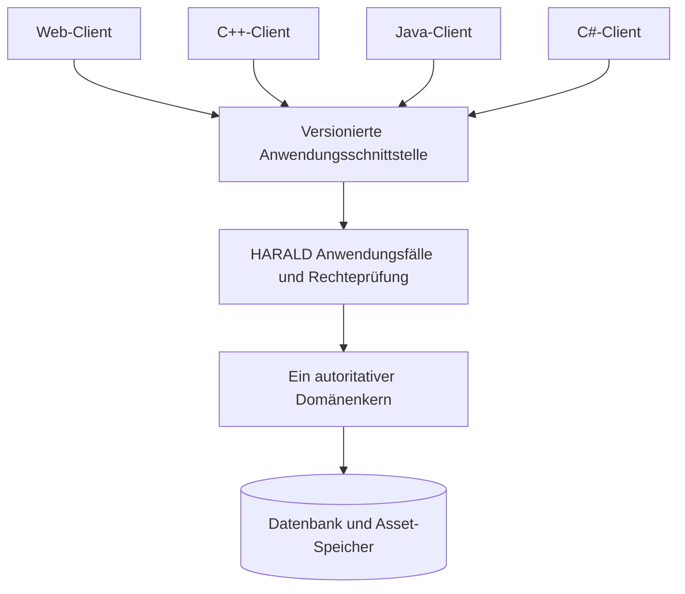
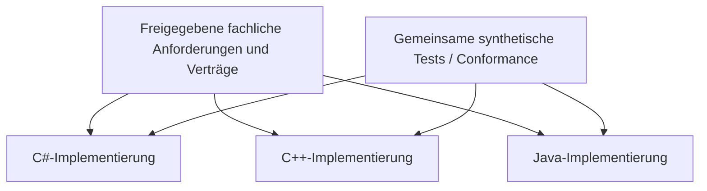

# HARALD — Mehrsprachen- und Mehrimplementierungsarchitektur

> **Dokument:** HARALD-ARCH-LANG-001  
> **Version:** 0.1 — Architekturentwurf  
> **Datum:** 17. Oktober 2026  
> **Status:** Vorbereitete Verzeichnisstruktur; **keine** Freigabe für eine verbindliche Technologie oder parallele Produktimplementierungen.  
> **Verwandte Unterlagen:** [Gesamtarchitektur](ARCHITECTURE.md), [ADR-0001](adr/0001-technology-stack-and-platforms.md), [Roadmap](../../ROADMAP.md), [AGENTS.md](../../AGENTS.md).

## 1. Zweck

HARALD soll langfristig erweiterbar bleiben. Dazu gehört die Option, Komponenten oder ganze Varianten in **C#**, **C++**, **Java** und gegebenenfalls später weiteren Programmiersprachen zu entwickeln. Die Verzeichnisse werden bereits jetzt vorbereitet, damit diese Sprachen **nebeneinander bestehen können**, ohne dass das Projekt frühzeitig eine einzige sprachspezifische Struktur aufzwingt.

**Wichtig:** Drei vorhandene Sprachverzeichnisse bedeuten nicht, dass drei HARALD-Produkte implementiert, parallel gepflegt oder ausgeliefert werden sollen. Welche Sprache zuerst verwendet wird, ob eine Sprache nur für einen Client dient oder ob mehrere vollständige Implementierungen entstehen, entscheiden wir **später bewusst anhand des konkreten Bedarfs**.

## 2. Tatsächlich vorhandene Verzeichnisse

```text
SASD-Harald/
├── implementations/
│   ├── README.md
│   ├── csharp/
│   │   ├── README.md
│   │   ├── src/
│   │   ├── tests/
│   │   └── examples/
│   ├── cpp/
│   │   ├── README.md
│   │   ├── include/
│   │   ├── src/
│   │   ├── tests/
│   │   └── examples/
│   └── java/
│       ├── README.md
│       ├── src/
│       ├── tests/
│       └── examples/
├── shared/
│   ├── README.md
│   ├── contracts/
│   ├── fixtures/
│   └── conformance/
└── docs/
    └── architecture/
        ├── ARCHITECTURE.md
        ├── MULTI_LANGUAGE.md
        └── adr/
```

**Git-Hinweis:** Leere Unterverzeichnisse werden durch `.gitkeep` versioniert. Dieser Dateiname ist nur ein Platzhalter; daraus folgt **kein** fertiger Test, Build oder Quellcode. Das Repository enthält in diesen Pfaden aktuell ausschließlich Dokumentation und Platzhalter.

## 3. Zwei verschiedene Architekturvarianten

### Variante A: Ein gemeinsamer HARALD-Kern, Clients in anderen Sprachen

Ein Backend bzw. eine Kernanwendung besitzt den autoritativen Medienbestand und setzt Fach- und Sicherheitsregeln durch. Weitere Anwendungen können z. B. in C++, Java oder C# als native Desktopclients, CLI oder spezielle Importoberflächen über eine **versionierte API** angebunden werden.



**Vorteile:** Eine Quelle der Wahrheit, einmalige Implementierung kritischer Ausleihregeln, geringere Paritätskosten. **Nachteile:** Ein eigenständiger lokaler Client braucht eine geeignete Server-/Dienstarchitektur oder lokale Protokolle. Auch der erste Kern muss solide gewählt werden.

### Variante B: Vollständig unabhängige HARALD-Implementierungen

Mehrere Sprachversionen bilden dieselben definierten Fachabläufe nach, können eigene Speicheradapter und Oberflächen verwenden und werden gegen **gemeinsame Verhaltens- und Datenaustauschtests** geprüft.



**Vorteile:** Sprachwahl und Portierung bleiben langfristig unabhängig; Plattformziele sind flexibel. **Nachteile:** Erheblicher zusätzlicher Wartungs-, Sicherheits-, Test- und Veröffentlichungsaufwand; keine automatische Laufzeitkompatibilität allein aufgrund gleicher Fachbegriffe.

**Bis zur Entscheidung:** Die Verzeichnisstruktur soll **beide Optionen zulassen**, aber weder von allen Sprachen denselben Code verlangen noch einen gemeinsamen Datenbankzugriff suggerieren.

## 4. Was geteilt wird und was nicht

| Bereich | Zentral / sprachneutral? | Begründung |
|---|---|---|
| Anforderungen und Akzeptanzkriterien | **Ja** | Dieselbe fachliche Zielsetzung und Invarianten |
| ADRs und Architekturprinzipien | **Ja** | Nachvollziehbare Entscheidungen |
| Work/Edition/Item/Asset-Begriffe | **Ja, semantisch** | Domänenidentitäten müssen dieselbe Bedeutung behalten |
| Austauschformate und API-Schemata | **Nach Freigabe** | Versionierung statt SDK-Abhängigkeit |
| Synthetische Referenzdatensätze | **Ja, künftig** | Sprachübergreifende Testfälle |
| Verhaltens-/Conformance-Tests | **Ja, künftig** | Vergleichbare Ergebnisse bei parallelen Implementierungen |
| C#-Klassen und .NET-Assemblies | **Nein** | Kein portables Fachprotokoll |
| C++-Header, ABI und Speicherlayout | **Nein** | Compiler-/Plattformabhängigkeit |
| Java-Klassen und JVM-Serialisierung | **Nein** | JDK- und Bibliothekskopplung |
| ORM-Datenbanktabellen | **Nein** | Interne Details; keine öffentlichen Verträge |
| Build-, Paket- und Laufzeitabhängigkeiten | **Je Implementierung** | Unterschiedliche Toolchains/Plattformen |
| CLI/Web/Desktop-Oberflächen | **Je Implementierung/Client** | Fachlogik bleibt unabhängig |

`shared/contracts/` enthält zunächst **keinen** frei erfundenen JSON-Standard. Ein Schema wird erst nach einer konkreten Nutzeranforderung, einer Architekturentscheidung, Schema-Versionierung und Tests öffentlich stabil.

## 5. Klare Architekturgrenzen in jeder Sprache

Die fachlichen Bestandteile müssen unabhängig von Frameworks sein:

```text
Oberflächen, Transport und fremde Clients
                |
       Anwendungsfälle / Services
                |
       Domänenmodelle und Regeln
                ^
          Ports / Verträge
                ^
   Datenbanken, Dateien, Provider, UI-Adapter
```

1. **Domäne ohne UI/HTTP/ORM:** C#-Domänenklassen importieren kein WinForms/WPF/EF Core; C++-Domänenregeln hängen nicht von Qt-Widgets ab; Java-Domänenmodelle verwenden keine Web-/JPA-Entitäten.
2. **Eindeutige Verantwortung:** Jedes Fachmodul besitzt seinen schreibenden Zustand und schützt seine Invarianten.
3. **Ausleihe atomar:** Ein physisches Exemplar besitzt zu einem Zeitpunkt höchstens eine aktive Ausleihe — auch bei konkurrierenden Requests.
4. **Keine private DB als Integrationsschnittstelle:** Ein Client in Sprache X schreibt niemals direkt in interne Tabellen einer Serverimplementierung in Sprache Y.
5. **Kein Dateiformat als Rechtseinräumung:** EPUB/PDF/MP3-Registrierung bedeutet nicht automatisch Download- oder Verleihberechtigung.
6. **Adapter ersetzen, nicht Domain umbauen:** Metadatenquellen, Datenbanken, Suche, Export und UI sind austauschbare Randkomponenten.
7. **Keine versteckte Runtime-Pflicht:** Systemanforderungen werden pro tatsächlichem Build dokumentiert, nicht aus dem Sprachnamen geraten.

## 6. Vertrags- und Datenmodellregeln

### 6.1 Unverwechselbare Identitäten

Eine Sprache darf `Work`, `Edition`, `PhysicalItem`, `Component`, `DigitalAsset`, `Identifier`, `Rights` und `Loan` anders benennen, **nicht** ihre Semantik vermischen. Besonders:

- ISBN/EAN/UPC identifizieren i. d. R. Produkt-/Ausgabemerkmale, nicht ein konkretes Bibliotheksexemplar.
- Exemplar-IDs sind intern stabil und unabhängig vom angezeigten Barcode.
- Ein Werk kann mehrere Ausgaben haben, jede Ausgabe mehrere Exemplare und/oder digitale Dateien.
- Eigentum, Ausleihe, öffentliche Sichtbarkeit, Dateien und digitale Nutzungsrechte sind getrennt.
- Beziehungen, Zeichensätze und Berechtigungen müssen bei einem Export erhalten bleiben.

### 6.2 Gemeinsame Vertragsgestaltung

Ein späteres Austauschformat benötigt:
- **Eigenständige Schema-Version** (nicht einfach identisch mit HARALD-Releaseversion).
- UTF-8, definierte Unicode-, Datum-, Zeit-, Währungs- und Null-Wert-Konventionen.
- Stabile IDs, Typ- und Namensräume für externe Kennungen.
- Erweiterungsmechanismus mit klar definiertem Verhalten bei unbekannten Feldern.
- Fehlerkategorien für nicht verarbeitbare oder unzulässige Datensätze.
- Sicherheitsregeln für private Daten und vertrauliche Assets.
- Rückwärtskompatibilitäts- und Migrationsrichtlinien.
- Tests: Export → Import → Vergleich der Beziehungen und Daten.

**Wichtig:** Eine interne SQLite-Datei ist **kein** sprachübergreifendes Austauschformat. Ebenso ist die Binär-ABI einer C++-Klasse kein neutraler Pluginkontrakt.

## 7. Parallelität und Datenhoheit

Der kritischste Fehler in einer sprachübergreifenden Architektur wäre, zwei unabhängige Programme ohne koordinierende Fachlogik gleichzeitig auf **dieselbe schreibbare Datenbank** zugreifen zu lassen. Dadurch ließen sich Ausleihsperren oder Referenzintegrität umgehen.

**Regel:** Für einen produktiven Bestand gibt es genau einen autoritativen schreibenden Anwendungsdienst (oder eine später ausdrücklich entworfene Synchronisations-/Transaktionsarchitektur). Andere Sprachen verwenden dessen Anwendungs-API oder ein versioniertes, kontrolliertes Austauschverfahren.

Ein reiner Import/Export ersetzt kein konfliktfreies Mehrmaster-Synchronisationssystem. Eine solche Funktion wäre eine eigenständige, spätere Architekturentscheidung.

## 8. Teststrategie und Konformität

`shared/fixtures/` soll repräsentative, synthetische Beispiele enthalten, `shared/conformance/` langfristig sprachneutrale Verhaltensfälle:

- Eine Buchausgabe mit zwei getrennten Exemplaren.
- Dieselbe Filmhandlung als DVD und Blu-ray mit verschiedenen Ausgaben.
- Hörbuchbox mit sechs Komponenten und unvollständiger Rückgabe.
- Digitale Datei mit expliziten Rechten und geschützter Bereitstellung.
- Ungültige Identifikatoren und konfliktbehaftete Barcode-Eingaben.
- Unicode-Titel, mehrere Sprachen, Serien und Adaptionen.
- Zwei konkurrierende Ausleihversuche für dasselbe Exemplar.
- Sicherer Importabbruch und vollständiger Export-/Restore-Roundtrip.

**Keine Testbehauptung ohne echte Ausführung.** Sprachversionen werden nicht als funktional äquivalent bezeichnet, nur weil sie dieselben Fixture-Dateien lesen können. Unterschiedliche Laufzeit-, Rechte- und Nebenläufigkeitsmodelle erfordern weitere Integrationsprüfungen.

## 9. Anforderungen für einzelne Implementierungen

| Sprache | Vorbereiteter Pfad | Prüfgegenstände vor Produktionscode |
|---|---|---|
| C# | [implementations/csharp](../../implementations/csharp/README.md) | .NET-Version; WinForms/WPF/Web/CLI; portable Domänenschichten; Windows-Runtime/NativeAOT |
| C++ | [implementations/cpp](../../implementations/cpp/README.md) | C++-Standard; Compiler/Qt/CMake nach Entscheidung; ABI; Speicher- und Dependency-Sicherheit; BSD-Eignung |
| Java | [implementations/java](../../implementations/java/README.md) | JDK; Maven/Gradle erst nach Entscheidung; Swing/JavaFX/Web; Paketierung; Rolle als Client oder Backend |

**Keine Sprache gewinnt die Erstimplementierung automatisch** durch ihre Position in der Tabelle.

### Erweiterung auf zusätzliche Sprachen

Bei einem nachgewiesenen Bedarf:
1. Use Case, Art der Implementierung (voller Kern oder nur Client), Plattformen und Betreuungsaufwand beschreiben.
2. Bestehende Verträge und Conformance-Anforderungen prüfen.
3. Einen aussagekräftigen ADR oder eine dokumentierte Erweiterungsentscheidung vorlegen.
4. Einen neuen Sprachordner mit README, minimaler Quellcode-/Teststruktur und überprüfbaren Build-Anweisungen anlegen.
5. Erst danach produktive Features ankündigen; Funktions- und Sicherheitsparität nachweisen.

## 10. Versions- und Releasekonzept (Vorschlag)

Unterschiedliche Implementierungen benötigen **eigene Pakete und Versionsstände**. Eine gemeinsame HARALD-Marke darf nicht suggerieren, dass C# 1.0, C++ 1.0 und Java 1.0 alle identische Produktfunktionen besitzen.

Mögliche zukünftige Kennzeichnungen:
- HARALD-Produktanforderungsstand: z. B. `HARALD-REQ-001` (noch nicht freigegeben).
- Schema/Protokoll: z. B. `catalog-exchange/1` (noch nicht definiert).
- C#-Implementierung: eigene SemVer-Releases nach erstem echten Release.
- C++-Implementierung: eigene Versions-/Kompatibilitätsmatrix.
- Java-Implementierung: nur bei tatsächlich begonnener Entwicklung.
- Konformitätsprofil: definierte Menge verpflichtender Tests (noch nicht veröffentlicht).

Dabei gilt: **Keine Versionsnummer für ein nicht vorhandenes Produkt als Release ausgeben.**

## 11. Zu vermeidende Fehlentwicklungen

- Kopieren ganzer Quellcodebäume zwischen Sprachen statt Dokumentation gemeinsamer Fachregeln.
- Erzeugen eines riesigen plattformabhängigen `common`-Pakets mit sprachspezifischen Imports.
- Fälschlich behauptete Sprach- oder Betriebssystemunterstützung wegen vorhandener Verzeichnisse.
- Nicht versionierte öffentliche Klassen-Serialisierung zwischen unterschiedlichen Laufzeiten.
- Mehrfacher direkter Datenbankzugriff verschiedener Implementierungen auf aktive Bestände.
- Verfrühte generische Plugin-Frameworks, Reflection-Hacks, FFI-ABI-Versprechen.
- Anlegen leerer "grüner" Tests oder CI-Jobs, die nichts Wirkliches prüfen.
- Zwangsabhängigkeit von SASD-Komponenten, ohne dass deren Schnittstelle und Version entschieden sind.
- Parallelentwicklung jeder Funktion in jeder Sprache, bevor R0 in **einer** gewählten Laufzeit funktioniert.

## 12. Empfohlene nächsten Schritte

1. **ADR-0001 evaluieren:** C#/.NET vs C++/Qt vs mögliche Alternative; Java ist zunächst optional.
2. Mini-Prototypen mit **demselben fachlichen Modell** vergleichen: Work → Edition → zwei physische Exemplare, Persistenz und Test.
3. Windows-/Linux-Builds und optionale FreeBSD-/OpenBSD-Erprobung wirklich ausführen; Laufzeitbedarf, Paketgrößen und Wartungsaufwand festhalten.
4. Entscheiden, welche Sprache den **ersten produktiven Kern** liefert — andere Implementierungen erst bei Bedarf.
5. Nur **konkret benötigte** sprachneutrale Verträge in `shared/contracts/` publizieren.
6. Bei späteren Sprachclients eine stabile API mit Rechten, Versionierung, Fehlern, Pagination und Konfliktsemantik definieren.
7. ROADMAP, AGENTS.md und README mit realen Fortschritten aktualisieren.

## 13. Abnahmekriterien für diese Vorbereitung

- [x] Sprachordner C#, C++ und Java sind im Repository vorhanden.
- [x] Source-/Test-/Beispielordner sind versioniert und dokumentiert.
- [x] C++ besitzt Platz für öffentliche Header, ohne bereits eine ABI zuzusagen.
- [x] Gemeinsame Sprach- und Vertragsverzeichnisse sind angelegt und abgegrenzt.
- [x] Die Regeln verhindern stillschweigende Wahl einer Hauptsprache.
- [ ] ADR-0001 ist entschieden (**noch offen**).
- [ ] Ein ausführbares Projekt und echte Tests existieren (**noch offen**).
- [ ] Es gibt eine publizierte sprachübergreifende API (**noch offen**).
- [ ] Eine zweite Implementierung hat nachgewiesene Funktionsparität (**noch offen**).

---

**Leitgedanke:** Die Sprachwahl soll HARALD erweitern können, ohne den Medienbestand, seine Fachregeln oder die Datenhoheit an eine Programmiersprache zu binden.
