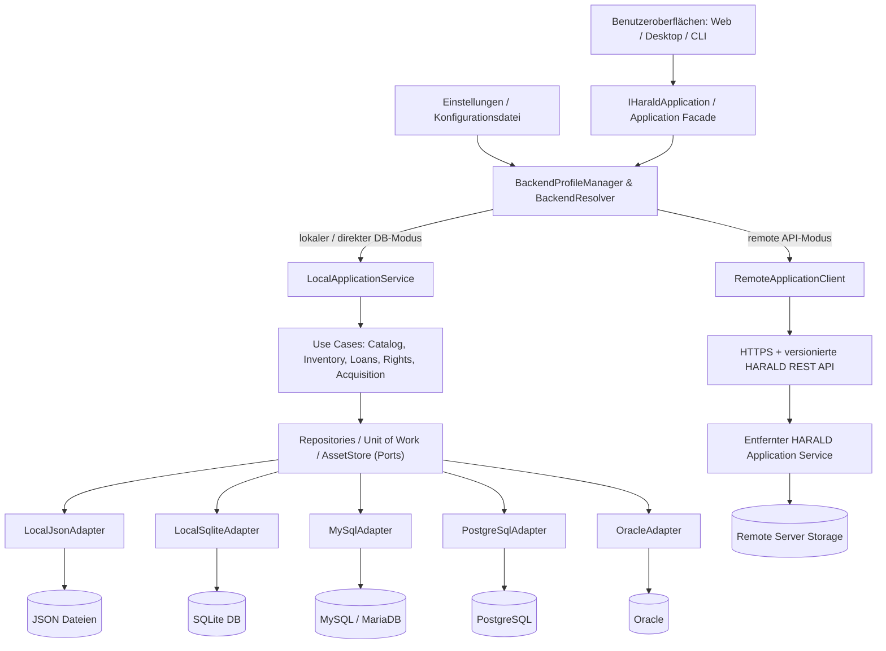

# HARALD — Konfigurierbare Datenhaltung und Vermittlungsschicht

> **Dokument-ID:** HARALD-ARCH-STORAGE-001  
> **Version:** 0.1 — ausführlicher Architekturentwurf  
> **Stand:** 17. Oktober 2026  
> **Status:** Nutzerwunsch aufgenommen; konkrete Implementierungs- und Releaseentscheidungen noch nicht freigegeben  
> **Repository:** https://github.com/Robin-Goerlach/SASD-Harald  
> **Referenzen:** [Gesamtarchitektur](ARCHITECTURE.md), [ADR-0004](adr/0004-configurable-persistence-and-remote-api.md), [Roadmap](../../ROADMAP.md), [Betrieb](../operations/OPERATIONS.md)

## 1. Ziel und Motivation

Die Benutzeroberfläche von HARALD soll **nicht wissen**, ob Bibliotheksdaten in lokalen JSON-Dateien, einer lokalen SQLite-Datenbank, einer entfernten SQL-Datenbank oder über eine entfernte REST-API verwaltet werden.

Der Anwender soll den Datenhaltungsort und die Art des Zugriffs **über die Oberfläche oder eine Konfigurationsdatei** auswählen und konfigurieren können. Die Architektur muss dazu verschiedene Backends sicher einbinden, ohne für jedes Backend Katalog, Ausleihe, Benutzerrechte oder die Benutzeroberfläche neu zu schreiben.

Die gewünschte Auswahl umfasst:

1. **Lokale JSON-Dateien** — einfacher, dateibasierter Bestand, ohne dedizierte Datenbankinstallation.
2. **Lokales SQLite** — eingebettete relationale Datenbank auf einem lokalen Dateisystem.
3. **Entfernte MySQL- oder MariaDB-Datenbank** — über einen geeigneten SQL-Treiber, bevorzugt aus einem vertrauenswürdigen Backendprozess.
4. **Entfernte PostgreSQL-Datenbank** — gleiches fachliches Verhalten über einen unabhängigen Adapter.
5. **Entfernte Oracle-Datenbank** — optionaler, gesondert zu qualifizierender Adapter, Lizenz-/Treiberbedingungen prüfen.
6. **Entfernter REST-Dienst** — idealerweise ein HARALD-kompatibler Server mit versionierter Anwendungsschnittstelle, Authentifizierung und zentral durchgesetzter Fachlogik.
7. **Später erweiterbare Provider**, z. B. weitere SQL-Engines oder verteilte Speicher-Services, sobald Bedarf, Treiber und Tests vorhanden sind.

**Wichtig:** Diese Liste ist ein gewünschtes Architekturziel, **keine Behauptung bereits implementierter Unterstützung**. Jede technische Variante erhält erst dann den Status „supported“, wenn es einen realen Adapter, echte Integrations- und Sicherheitstests, Backup-/Restoreverfahren und dokumentierte Einschränkungen gibt.

## 2. Grundregel: nicht nur UI und Datenbank

Eine naive Architektur `UI → Datenbankadapter → Datenbank` wäre für HARALD gefährlich: Ausleihregeln, Zugriffsrechte und die Zuordnung Werk/Ausgabe/Exemplar könnten dann je nach Backend unterschiedlich wirken. Die Vermittlungsschicht muss deshalb **aus mehreren klar abgegrenzten Verantwortlichkeiten bestehen**.

Vorgeschlagene Struktur:



**Diagrammhinweis:** Die Pfeile beschreiben Verantwortlichkeiten und logische Aufrufe, keine zwingenden Klassen oder einen festen Prozesszuschnitt. `BackendResolver` wählt **genau einen autoritativen aktiven Backendmodus pro Bestand**, nicht mehrere gleichzeitige Schreib-Master.

### Die vier unterschiedlichen Ebenen

| Ebene | Funktion | Kennt sie SQL/Dateisystem? |
| --- | --- | --- |
| **UI/Presentation** | Listen, Masken, Suche, Einstellungen, Fehlermeldungen | **Nein.** |
| **Application Facade** | Einheitliche Funktionen wie `FindBooks`, `SaveEdition`, `CheckoutItem` | **Nein.** |
| **Backend-Vermittlung** | Konfiguriert Verbindung, aktiviert LocalApplication/RemoteApplication, verhandelt Fähigkeiten, überwacht Zustand | Kennt Backendtypen, **nicht** die fachlichen Tabellen |
| **Storage-/Transportadapter** | JSON, SQLite, MySQL, PostgreSQL, Oracle oder REST-Protokoll | Nur Adapter kennen technische Details |

Die **Domain** (Werk, Ausgabe, Exemplar, Ausleihe, Rechte) bleibt unabhängig von SQL, JSON und HTTP.

## 3. Zwei unterschiedliche Backendmodi

### 3.1 Lokaler beziehungsweise SQL-gestützter Anwendungsmodus

Bei JSON/SQLite oder einem direkten SQL-Backend gilt:

`UI → Application Facade → lokale HARALD-Use-Cases → Persistence Ports → gewählter Adapter → Datenhaltung`

- Die Anwendung führt **genau einen Satz fachlicher Regeln** aus.
- Der Persistenzadapter speichert und lädt Daten, er trifft **keine eigenen Ausleihentscheidungen**.
- Transaktionen und Nebenläufigkeit werden entsprechend den Fähigkeiten des Adapters zuverlässig umgesetzt.
- Der Betreiber der Anwendung muss Zugriff auf die gewählte Datenbank und ihre Credentials besitzen.
- Bei einem Browser befindet sich der Datenbanktreiber **serverseitig**; die Browser-Oberfläche bekommt niemals MySQL-/Oracle-/PostgreSQL-Verbindungsdaten.
- Ein direkter SQL-Modus vom Desktop über das Netzwerk ist ein **separat zu bewertendes Vertrauens-/Sicherheitsprofil**, nicht automatisch die Empfehlung für öffentliche Netze.

### 3.2 Entfernte HARALD-REST-API

`UI → Application Facade → RemoteApplicationClient → HTTPS → HARALD Server → serverseitige Use-Cases → Server-Speicher`

- Der Client sendet **fachliche Commands und Queries**, z. B. `CheckoutItem`, **nicht SQL-Statements** oder ungeschützte generische CRUD-Aufrufe.
- Der Server prüft Benutzer, Berechtigungen, Transaktionsregeln, Verfügbarkeit und Konsistenz autoritativ.
- Die UI kann denselben sichtbaren Workflow nutzen, aber Fehlerzustände/Capabilities müssen im Remoteclient sinnvoll abgebildet werden.
- Transaktionen erfolgen vollständig **auf dem Server**; Client und Server bilden **keine verteilte ACID-Transaktion**.
- Ein beliebiger fremder REST-Endpunkt ist nicht automatisch kompatibel. Andere Systeme benötigen einen benannten, getesteten Protokolladapter oder eine Gateway-Integration.
- Als sichere Standardeinstellung sind HTTPS, Zertifikatsprüfung, restriktive Tokens/Scopes und Timeout-/Retryregeln erforderlich.

**Diese Unterscheidung ist wesentlich:** Eine REST-API ist auf fachlicher Ebene ein **entfernter Anwendungsdienst**, nicht bloß eine weitere SQL-Datenbank. Ein einheitlicher UI-Vertrag darf das nicht verschleiern.

## 4. Vorgeschlagene Schnittstellen und Verantwortlichkeiten

Die folgenden Bezeichnungen sind **Pseudocode/Entwurf**, keine bereits veröffentlichte C#/C++/Java-API:

```text
IHaraldApplication
  Catalog:
    SearchCatalog(query, context)
    CreateWork(command, context)
    SaveEdition(command, context)
  Inventory:
    AddPhysicalItem(command, context)
    MoveItem(command, context)
  Circulation:
    CheckoutItem(command, context)
    ReturnItem(command, context)
  Acquisitions:
    RegisterRequest(command, context)
    ReceiveRequest(command, context)
  Diagnostics:
    GetCapabilities(context)

IBackendProfileManager
  ListProfiles(actor)
  ValidateProfile(candidate, actor)
  TestConnection(candidate, actor)
  ActivateProfile(profileId, actor, expectedRevision)
  GetActiveProfile(actor)

IBackendResolver
  ResolveApplication(profile) -> IHaraldApplication

IUnitOfWork / IRepository<T> / IAssetStore
  Nur interne Verträge der lokal/serverseitig ausgeführten
  Anwendungsfälle, nicht öffentliche Browser-API
```

**Entscheidungsvorschlag:** Das fachliche UI spricht **immer** `IHaraldApplication` an. Der `BackendResolver` liefert entweder eine lokale Implementierung, die dieselben Use Cases ausführt, oder einen `RemoteHaraldApplicationClient` gegen den Server.

### 4.1 Transparenz ohne falsche Gleichheit

Die Backendabstraktion soll 80–90 % alltäglicher Abläufe vereinheitlichen, **ohne** spezielle Fähigkeiten oder Fehlermodi vorzutäuschen. Ein JSON-Backend und ein zentraler Oracle-Server unterscheiden sich hinsichtlich Transaktionen, gleichzeitiger Benutzer, Backup, Suche, Administration und Netzwerkausfällen.

Ein Capability-Vertrag sollte z. B. melden:

| Capability | Bedeutung |
| --- | --- |
| `canRead` | Datenquelle verfügbar und lesbar |
| `canWrite` | Schreibzugriff möglich |
| `supportsConcurrentWriters` | Gleichzeitige Schreibaktionen unter getroffenen Garantien getestet |
| `supportsTransactions` | Atomare Mehr-Objekt-Änderungen nach dokumentiertem Modell |
| `supportsFullTextSearch` | Volltextindex oder serverseitiges Volltextverfahren verfügbar |
| `supportsAssetStorage` | Dateien können geschützt abgelegt/abgerufen werden |
| `supportsBackup` | Konsistenter Backup-Mechanismus vorhanden |
| `schemaVersion` | Kompatible HARALD-Datenmodellversion |
| `apiVersion` | Version der Remote-Schnittstelle (nur Remote) |
| `readOnlyReason` | Klarer Grund für eventuellen eingeschränkten Betrieb |

Capabilities werden **tatsächlich geprüft**, nicht ausschließlich aus einer statischen Anbieterbezeichnung geraten.

## 5. Adapterkatalog und geplante Einsatzprofile

| Backend | Einsatzprofil | Risiken/technische Besonderheiten | Vorgeschlagene Reihenfolge |
| --- | --- | --- | --- |
| **JSON lokal** | Sehr kleine Einzelnutzerbibliothek, portable Datendateien | Konsistenz, atomarer Schreibersatz, Dateisperren, keine Mehrschreiber; nicht JSON-Export mit Produktionsspeicher verwechseln | Frühe Evaluation, mögliches R1 |
| **SQLite lokal** | Persönlicher Rechner / lokaler kleiner HARALD-Dienst | WAL, Foreign Keys, Locking, WAL-/Backup-Verfahren; keine unkontrollierten Netzwerkfreigaben | R0/R1-Kandidat |
| **MySQL / MariaDB remote** | Vertrauenswürdiger zentraler Datenbankbetrieb | SQL-Dialekt, Isolation, DDL, Treiber, TLS, Transaktionen, Upsert, Deadlocks | Nach erstem belastbaren Backend |
| **PostgreSQL remote** | Mehrbenutzer-/Serverinstallation | Isolation, Locking, Migrationen, Suchintegration, Rollen/TLS | Nach erstem belastbaren Backend |
| **Oracle remote** | Institutionelle Umgebung | Proprietärer Server, Treiber-/Redistributions-/Lizenzprüfung, Datentypen, Sequenzen, Schema/DDL und Locking | Gesondertes späteres Profil |
| **HARALD REST remote** | Zentrale Bibliothek mit Desktop-/Web-/CLI-Clients | API-Version, AuthZ, HTTPS, Retry, Offline-Verhalten, Konflikte, Asset-Streaming | Architektur von Beginn an, Implementierung releaseabhängig |

Reihenfolge ist **nicht verbindlich**. Sollte der Nutzer Remote-Datenbanken oder REST zwingend für HARALD V1.0 verlangen, müssen Roadmap und Testumfang entsprechend angepasst werden. Das ist eine explizite Produktpriorisierung, keine technische Nebenbemerkung.

## 6. JSON als lokale Datenhaltung — besondere Regeln

**JSON als Austauschformat ist einfach; JSON als produktive Datenbank ist eine eigene Aufgabe.** Sie darf nicht mit `load JSON; modify object; write file` ohne Schutzmechanismus umgesetzt werden.

Für einen Schreibbetrieb sind erforderlich:

- **Ein autoritativer Writer** pro Bestand (z. B. exklusiver Prozess-Lock); kein gleichzeitiger Mehrbenutzerzugriff über gemeinsame Dateien.
- Ein **transaktionaler Gesamtsnapshot** oder eine robuste Journal-/Copy-on-Write-Strategie; Katalog und Ausleihe dürfen nach einem Crash nicht auseinanderlaufen.
- Temporäre Dateien auf demselben Volume, atomarer Ersetzungsversuch, geeignetes Flush/fsync-Verfahren und Plattformtests. Atomare Dateiumbenennung garantiert **nicht** automatisch Crash-Dauerhaftigkeit auf jedem Dateisystem.
- Versionierte Dokument-/Schemaformate; stabiles Mapping und referenzielle Validierung beim Laden.
- Größen-/Performancegrenzen und nachvollziehbare Fehler bei ungültigen/korrupten Dateien.
- Keine automatische Übernahme willkürlich manipulierter JSON-Dateien ohne Integritäts- und Schema-Prüfung.
- Separater Dateispeicher für größere EPUB-/Audio-Assets; keine Base64-Megadateien als universelle JSON-Datenbank.
- Schutz vertraulicher Daten über Betriebssystemrechte und gegebenenfalls verschlüsselte Backups.
- Einfache Rücksicherung mit korrekter Snapshot-Version und Assetmanifest.

**Mögliche Vereinfachung:** Ein einzelnes konsistentes Snapshot-Dokument für kleine lokale Datenmengen ist denkbar. Bei größeren Bibliotheken oder parallelen Nutzern ist eine echte Datenbank bzw. ein Server sinnvoller.

**Freigabekriterium:** Prozessabbruch während Checkout/Save/Replace darf keine doppelte Ausleihe oder inkonsistente Beziehungen hinterlassen.

## 7. SQL-Backends und Datenbankportabilität

### 7.1 Nicht nur ein anderer Connection String

Ein Adapter muss folgende Unterschiede adressieren:

- Typ- und Zeichensatzabbildung; `UUID`/GUID, Datum/Zeit/Zeitzone, boolesche Werte, BLOBs.
- Automatische IDs vs HARALD-stabile, DB-unabhängige IDs.
- Syntax/DDL/Migrationen, Fremdschlüssel und Indizes.
- Transaktionsisolierung, Deadlock-/Busy-/Retryverhalten, Optimistic Concurrency.
- Gleichwertige Gewährleistung: **höchstens ein aktiver Loan je PhysicalItem**.
- UPSERT/RETURNING, Pagination, Sortier-/Collation- und Null-Semantik.
- Suche/FTS: entweder gemeinsame Suchprojektion oder abgegrenzter Suchadapter.
- Privilegien und Zugriffstrennung; keine pauschalen Datenbank-Administrator-Zugangsdaten.
- Kompatible Export-/Restore- und Upgradeprozesse.
- Verbindungspool, Limits, Timeouts, Logredaktion und Credential-Rotation.

Eine generische SQL-Schnittstelle ist **keine Garantie** für fehlerfreie Unterstützung aller genannten Server. Jeder Datenbanktyp benötigt eine eigene **Capability-/Conformance-Suite** auf echten Versionen.

### 7.2 MySQL und MariaDB

Beide gehören zu einer Treiberfamilie, können sich aber insbesondere in SQL-Features, DDL/Versionen und Konfigurationsverhalten unterscheiden. Eine erfolgreiche MySQL-Prüfung gilt **nicht** automatisch als Freigabe für jede MariaDB-Version (und umgekehrt).

### 7.3 PostgreSQL

PostgreSQL eignet sich als relationaler Serveradapter, sofern HARALD-Transaktionssemantik, Indizes, Migrationen und minimale Treiber-/Server-Versionen ausdrücklich getestet sind.

### 7.4 Oracle

Die Oracle-Unterstützung muss in einer eigenen ADR bzw. Supportmatrix behandelt werden: Welche Oracle-Version? Welche Treiber-/Clientbibliothek? Welche Lizenzen für die Weitergabe? Welcher CI-/Testzugang? Wie werden Sequenzen, `MERGE`, Sperren und Fehlertypen zuverlässig abgebildet?

**Kein Versprechen:** Dass HARALD MIT-lizenziert ist, bedeutet nicht, dass Oracle-Datenbankprodukte oder alle Oracle-Treiber frei distributierbar sind.

## 8. Remote REST — fachliche und technische Vertragsregeln

Der erste Zielvertrag sollte **HARALD Server API** heißen und die autorisierten Use Cases anbieten. Externe Systeme (Koha, Shelf, Calibre, eigene APIs) brauchen jeweils einen spezifischen, dokumentierten Adapter oder Gateway, weil ihre Objektmodelle/Fehlercodes unterschiedlich sind.

Erforderlich:

1. **API-Versionierung und Discovery:** Client erfährt Protokollversion, kompatible Fähigkeiten und Mindestversion.
2. **Authentifizierung:** Geeigneter Token-/Sessionmechanismus; Secrets in OS-Secretspeicher oder sicherem Konfigurationspfad, nicht ungeprüft im Klartext.
3. **Autorisierung:** Der Server entscheidet pro Befehl/Ressource; ein Frontend-Role-Flag ist kein Sicherheitsmechanismus.
4. **HTTPS und Hostprüfung:** Kein automatisches Umgehen von Zertifikatsfehlern. SSRF-Schutz bei administrativ eingetragenen Endpunkten erwägen.
5. **Idempotenz/Konflikte:** Checkout/Wareneingang brauchen Request-ID oder gleichwertigen sicheren Retry; bei Timeout niemals blind ein zweites Mal buchen.
6. **Fehlervertrag:** `unauthorized`, `forbidden`, `conflict`, `unavailable`, `schema_incompatible`, `rate_limited`, `timeout`, `partial_failure` mit stabilen Codes.
7. **Paging/Filtering:** Bounded Queries, keine unbegrenzten Exporte über normale Suchendpunkte.
8. **Asset-Zugriff:** Authentifizierte Bereitstellung/Streaming, keine ungeschützten privaten Dateipfade.
9. **Datenschutz:** Keine personenbezogenen Inhalte in ungeschützten URL-Querystrings oder Logs.
10. **Server als Quelle der Wahrheit:** Client-Caches sind nur temporär; keine unbeaufsichtigten Offline-Schreibqueues ohne gesondertes Synchronisationsdesign.

Ein fehlgeschlagener Verbindungsversuch zeigt einen **klaren Status**; die Oberfläche muss zwischen offline/unreachable, Login abgelaufen, fehlenden Rechten und inkompatibler API unterscheiden.

## 9. Nutzerkonfiguration: Oberfläche und Datei

Die Konfiguration ist ein **Betriebs- und Sicherheitsobjekt**, nicht lediglich ein Dropdown.

### 9.1 Speicherprofile

Ein Nutzer/Administrator kann mehrere benannte Profile verwalten, z. B.:

- `Meine Bibliothek (lokal)` — SQLite in einem Benutzerverzeichnis.
- `Testbestand (JSON)` — lokaler Snapshot, z. B. für eine portable Testinstallation.
- `Vereinsbibliothek` — HARALD REST-Server per HTTPS.
- `Serverbetrieb` — PostgreSQL/MySQL über einen vertrauenswürdigen HARALD-Backendprozess.
- `Oracle-Integration` — nur nach verfügbarem, getesteten Treiber.

**Genau ein Profil ist für einen aktiven Bestand autoritativ.** Mehrere Profildefinitionen in einer Datei bedeuten nicht automatische Replikation oder einen gemeinsamen Datenbestand.

### 9.2 Vorgeschlagene Einstellungen-Ansicht

\`\`\`text
HARALD — Settings > Data Storage

  Active profile:  [ My Library (local SQLite)           v ]

  Available profiles:
    ● My Library            SQLite / Local
      Portable archive      JSON / Local
      Club library          HARALD REST / Remote
      Database server       PostgreSQL / Remote
      Legacy system         Oracle / Remote (not installed)

  [Add profile] [Edit] [Test connection] [Verify schema]
  [Export profile (without secrets)]
  [Activate] [Migrate data...] [Cancel]

  Status: Connected · Schema compatible · Read/write permitted

  ⚠ Changing the profile does not copy catalog data.
    Data migration is a separate, explicit operation.
\`\`\`

Die UI darf **nur tatsächlich installierte, funktionsfähige Provider als verwendbar anbieten**. Nicht implementierte Provider können allenfalls als Informations-/Planungsziel angezeigt werden, niemals als erfolgreicher Verbindungsmodus.

### 9.3 Beispiel einer Konfigurationsdatei (illustrativ)

**Dieses Beispiel ist bewusst noch kein offizielles Parser-Schema.** Feldnamen und Pfade können sich nach einer ADR ändern. Keine echten Passwörter oder Tokens in Dateien mit ungeschütztem Zugriff!

\`\`\`json
{
  "configVersion": 1,
  "activeProfileId": "local-main",
  "profiles": [
    {
      "id": "local-main",
      "name": "My Library",
      "kind": "sqlite",
      "location": "${HARALD_DATA_DIR}/harald.sqlite",
      "readOnly": false
    },
    {
      "id": "portable-sample",
      "name": "Portable JSON",
      "kind": "json",
      "location": "${HARALD_DATA_DIR}/catalog.json",
      "readOnly": false
    },
    {
      "id": "club-api",
      "name": "Club Library Server",
      "kind": "harald-rest",
      "baseUrl": "https://library.example.org/api/",
      "credentialRef": "os-secret-store:club-library"
    },
    {
      "id": "office-postgres",
      "name": "Office Database",
      "kind": "postgresql",
      "host": "db.example.org",
      "port": 5432,
      "database": "harald",
      "username": "harald_app",
      "credentialRef": "os-secret-store:office-postgres",
      "requireTls": true
    },
    {
      "id": "office-mysql",
      "name": "Office MySQL",
      "kind": "mysql",
      "host": "db.example.org",
      "port": 3306,
      "database": "harald",
      "username": "harald_app",
      "credentialRef": "os-secret-store:office-mysql",
      "requireTls": true
    },
    {
      "id": "enterprise-oracle",
      "name": "Enterprise Oracle",
      "kind": "oracle",
      "serviceName": "harald.example.org",
      "credentialRef": "os-secret-store:enterprise-oracle",
      "requireTls": true
    }
  ]
}
\`\`\`

Die `${HARALD_DATA_DIR}`-Schreibweise ist **eine vorgeschlagene** Laufzeitauflösung. Konkrete Pfadregeln, Portdefaults, TLS-Optionen, Zertifikate und Secretspeicher werden erst durch die Implementierung festgelegt und mit Tests verifiziert.

### 9.4 Prioritäten und sichere Konfiguration

Vorschlag für die **konfigurierbare Reihenfolge der Quellen**:

1. Sichere Betreiber-Overrides für dedizierte Serverinstallationen (z. B. geschützte Umgebungsvariablen/Startparameter); **explizit** und in Diagnosen sichtbar.
2. Administrativ verwaltete aktive Konfigurationsdatei.
3. Benutzeroberfläche, welche diese Konfiguration über einen autorisierten Einstellungsdienst **validiert und atomar aktualisiert**.
4. Programminterne, sichere lokale Defaults, wenn noch keine Konfiguration existiert.

**Wichtig:** Die UI ist keine zusätzliche unabhängige "höhere" Quelle, die auf jedem Bildschirmstart andere Werte überschreibt. Sie ist nur ein **Editor** für die konfigurierte Quelle. Bei fest gesetztem Betreiber-Override muss die UI dies anzeigen und keine unwirksame Änderung vortäuschen.

Auf Mehrbenutzerservern sind Verbindungsprofile **Instanzeinstellungen**, keine frei für jedes Mitglied änderbare persönliche Präferenz. Nur administrative Benutzer dürfen sie ändern. Ein Desktop-Sammler darf in seinem eigenen lokalen Profil selbst Administrator sein.

### 9.5 Konfigurationsvalidierung

Beim Speichern und Aktivieren werden geprüft:

- Schema-/Konfigurationsversion und erforderliche Felder.
- Erlaubter Typ und tatsächlich installierter Provider.
- Gültiger und erlaubter lokaler Speicherpfad bzw. Remote-Host/Port/URL.
- Zugriff/Schreibrechte; freie Kapazität, Verzeichnisschutz.
- Sichere TLS- und Authentifizierungsoptionen.
- `TestConnection` / Testdatei-Zugriff (ohne destruktive Migration).
- HARALD-Datenmodell-/API-Version und notwendige Migrationsschritte.
- Berechtigung des handelnden Nutzers.
- Durchgängige referenzierte Asset-Speicherprofile.
- Rückgabefehler ohne Leaking von Benutzername/Passwort/SQL-Serverdetails.

**Erfolgreiche Verbindung ≠ kompatibles HARALD-Schema.** Die Statusanzeige muss beides getrennt ausweisen.

## 10. Konfiguration ändern und Datenbestand wechseln

**Den Backendtyp ändern heißt nicht automatisch, die Daten zu migrieren.** Drei getrennte Vorgänge sind erforderlich:

| Vorgang | Bedeutung | Erwartetes Verhalten |
| --- | --- | --- |
| **Edit profile** | Host/Pfad/Anmeldedaten ändern | Nur Konfiguration; noch kein Bestandswechsel |
| **Activate profile** | Ab jetzt einen bereits vorhandenen Bestand öffnen | Verbindung und Schema prüfen; es erfolgt **keine** stille Kopie |
| **Migrate data** | Bestehenden Bestand in andere Datenhaltung übertragen | Export, kontrollierter Import, Assets, Rechte, Audit, Vergleich, Freigabe |

### 10.1 Umschalten ohne Datenverlust

Ablauf für einen Profilwechsel:

1. Bearbeiter ist autorisiert; aktuelle Konfiguration und aktiver Datenbestand werden angezeigt.
2. Neues Profil wird in einer **Vorschau** validiert; nur ein Ziel ist autoritativer Writer.
3. Netzwerkverbindung, Authentifizierung, kompatible Schema-/API-Version, Asset-Zugriff und Berechtigungen werden geprüft.
4. Bei Wechsel während des Betriebs: neue Schreibvorgänge pausieren/ablehnen, laufende Use Cases abschließen, gültige Sitzungen/Abfragen entkoppeln.
5. Profilumschaltung als eigene versionierte Konfigurationsänderung **atomar und auditierbar** speichern.
6. Clients verbinden sich neu, Caches/Abonnements werden neu initialisiert; Fehlermeldungen nennen das aktive Profil.
7. Bei Fehler vor Freigabe **altes Profil erhalten**; bei Teilfehler definierte Recovery, niemals stilles Schreiben in beide Datenbanken.
8. Ein Wechsel kann serverseitig Wartungsmodus/Neustart erfordern. Kein Versprechen für unterbrechungsfreien Betrieb.

Eine Umstellung von JSON/SQLite auf MySQL/PostgreSQL/Oracle oder REST braucht zudem eine **eigene Migration** mit Zeitstempeln, Inventar-IDs, Leihen, Rechten und Dateimanifesten.

### 10.2 Migration und Restore

- Vorher konsistentes Backup des Ausgangsbestands erstellen und erfolgreichen **Test-Restore** ermöglichen.
- Zielpfad/Datenbank über Versions-/Schema-Handshake validieren; nie ungefragt Tabellen zerstören.
- Katalogidentitäten Work/Edition/PhysicalItem/DigitalAsset, aktuelle Loans, Beschaffungswünsche, Klassifikationen, Rechte, Audit- und Migrationszustand vollständig berücksichtigen.
- Digitale Originaldateien getrennt von Datenbankmetadaten übertragen; keine Asset-Referenzen ohne nutzbaren Zielstorage.
- Umwandlungen dokumentieren, Verlustberichte erstellen, Nutzerfreigabe einholen.
- Checksummen und Datensatz-/Beziehungszählungen mit Golden Samples und echten Vergleichstests nachweisen.
- Quelle erst deaktivieren, wenn Ziel vollständig verifiziert ist; Rollback erfordert passenden Daten-/Konfigurationsstand.
- Migration ist **kein automatisches bi-direktionales Synchronisieren**.

## 11. Sicherheit und Credentials

1. **Kein DB-Passwort im Browser:** Browser spricht mit lokalem/entferntem HARALD-Appdienst; DB-Connection-Strings leben nur serverseitig.
2. **Secrets nicht in Git oder allgemeine UI-Exports:** Konfigurationsdatei enthält nach Möglichkeit Referenzen auf OS-Keychain/Secret Store, nicht Klartextpasswörter.
3. **Lokale JSON/SQLite-Dateien:** Pfadbeschränkung, sichere Betriebssystemrechte, kein unkontrollierter Netzwerkshare.
4. **Remote SQL:** TLS mit Serveridentitätsprüfung, minimal privilegierte DB-Accounts und sicherer Connection-Pool; nicht per Default ins Internet exponieren.
5. **REST:** HTTPS, Host-/Zertifikatsprüfung, sichere Token-/Session-Verwaltung, serverseitige Ressourcenautorisierung.
6. **Konfigurationsänderung:** Adminrecht, Audit, CSRF-/Injection-Schutz im Web, keine ungeprüften Dateipfade oder URL/SSRF.
7. **Mehrbenutzerbetrieb:** Backendwahl im Server ist zentrale Betriebseinstellung. Ein nicht administrativer Nutzer darf nicht auf einen anderen Datenbestand umschalten.
8. **Provider-Plug-ins:** Kein Zugriff auf alle Secrets, rohe DB-/Dateigriffe oder persönliche Ausleihhistorie ohne explizite Capabilities.
9. **Profilexport:** Sensible Felder standardmäßig maskieren; Logs/Fehler enthalten keine Credential-Werte.
10. **Versionierung:** Unsichere Konfigurationsfelder oder unbekannte Provider werden verworfen bzw. mit sicherem Fehler abgelehnt; keine improvisierten Fallbacks.

## 12. Test- und Konformitätsmatrix

Jeder freigegebene Backendadapter muss dieselben relevanten **fachlichen Tests** erfüllen, wobei nicht unterstützte Funktionen nur mit einer ausdrücklich genehmigten Einschränkung deaktiviert werden dürfen.

| Test-ID | Testfall | Muss-Ergebnis |
| --- | --- | --- |
| `BACK-AT-001` | JSON mit Work, Edition und zwei Items | Persistenter Roundtrip, eindeutige IDs |
| `BACK-AT-002` | SQLite mit denselben Datensätzen | Identisches fachliches Ergebnis |
| `BACK-AT-003` | Zwei konkurrierende Checkout-Requests | Höchstens **ein** aktiver Loan, auch nach Neustart |
| `BACK-AT-004` | Prozessabbruch bei JSON-Schreiboperation | Alter oder neuer konsistenter Snapshot, kein halb gültiger Katalog |
| `BACK-AT-005` | Verbindungsabbruch remote SQL | Transaktions-/Retry-Semantik klar, keine doppelte Buchung |
| `BACK-AT-006` | REST Checkout Timeout und Wiederholung | Keine zweite Ausleihe, definierter Idempotenz-/Konfliktstatus |
| `BACK-AT-007` | Ungültige TLS-Zertifikatskette/Token | Verbindung sicher abgelehnt |
| `BACK-AT-008` | Profil aus UI editieren, validieren, übernehmen | Gleiche versionierte Konfiguration wie Dateibetrieb |
| `BACK-AT-009` | Konfigurationsdatei mit unbekanntem Provider | Verständliche Ablehnung, keine stillschweigende Ersatz-Datenbank |
| `BACK-AT-010` | Konfigurations-Override gegen UI-Änderung | UI zeigt Sperre/effektiven Wert korrekt |
| `BACK-AT-011` | Aktivieren eines leeren Zielprofils | Keine stille Datenmigration; ausdrücklich leerer Bestand |
| `BACK-AT-012` | Migration SQLite → PostgreSQL | Beziehungen, Rechte, Loans und Assets erhalten |
| `BACK-AT-013` | Migration JSON → SQLite | Versionierter Export/Import ohne Phantom-Exemplare |
| `BACK-AT-014` | Backups/Restores jedes unterstützten Backends | Referenzen, Checksummen, Sicherheit geprüft |
| `BACK-AT-015` | ORM-/SQL-Treiber-Dialektunterschiede | Gleiche fachliche Fehlercodes und Constraints |
| `BACK-AT-016` | Nichtadmin ändert Backendprofil | Zugriff verweigert und protokolliert |
| `BACK-AT-017` | Browser versucht Remote-SQL-Passwort zu lesen | Credentials werden nicht an Client geliefert |
| `BACK-AT-018` | REST-Server mit inkompatibler API-Version | Verständliche Inkompatibilitätsmeldung, keine destruktiven Writes |
| `BACK-AT-019` | Upload und Remote-Assetdownload | Rechteprüfung, korrekter Asset-Speicher, kein öffentlicher Pfad |
| `BACK-AT-020` | Ausfall während Profilwechsel | Alter oder neuer eindeutig aktiver Zustand, keine Dual-Master |

Die Testimplementierung ist **noch nicht vorhanden**. Jeder Adapter erhält einen eigenen ausführbaren Integrationstest-Job mit tatsächlicher Datenbank-/Serverversion und dokumentiertem Setup. Ein einzelner Unit-Test mit Mock ist **kein Nachweis** für PostgreSQL, MySQL, Oracle oder REST.

## 13. Vorschlag für die Entwicklungsreihenfolge

Diese Reihenfolge hält die erste Version nutzbar, ohne Remote-Backends aus der Architektur zu verbannen:

| Phase | Architekturaufgabe | Freigabe |
| --- | --- | --- |
| **R0/M1–M2** | `IHaraldApplication`, lokale Use Cases, ProfileManager, Resolver, Port-/Adaptergrenzen; ADR und Schemaentwurf | Boundary-/Config-Tests |
| **R0/M3** | SQLite als frühe Referenz **falls gewählt**, Work/Edition/2 Items | Vertikaler Durchstich |
| **R1** | Lokale JSON-Unterstützung **nach Aufwand-/Konsistenzprüfung**; GUI/Datei-Konfiguration; Sicherung, Profilvalidierung, bewusster Profilwechsel | Backend-Konformität und Restore |
| **R1 oder R2 (Entscheidung offen)** | HARALD-REST-Zugriff als Clientmodus; sicherer zentraler Server | AuthZ-, API-, Idempotenztests |
| **R2/R3 (Priorisierung offen)** | PostgreSQL, MySQL/MariaDB als alternative Serveradapter | Echte DB-Integrationstests, Migrationen |
| **R3/optional** | Oracle und weitere spezialisierte DBs | Treiber-/Lizenzprüfung, QA-Matrix, Betreiberbedarf |

**Keine dieser Zeilen ist bereits erledigt.** Wenn alle Varianten für V1 nötig sind, muss der Aufwand und Release-Schnitt explizit angepasst werden.

## 14. Architekturentscheidungen, die wir noch treffen müssen

1. **V1-Umfang:** Lokales JSON und SQLite beide verpflichtend? Remote HARALD-REST bereits in V1?
2. **SQL-Provider:** PostgreSQL/MySQL/Oracle in V1 oder nachgelagert?
3. **Betriebsform:** Desktop mit eingebettetem Anwendungsdienst, Webserver oder kombinierbarer Client/Server-Modus?
4. **Einzelner Bestand oder mehrere parallel geöffnete Bibliotheken?** Profile sind hierfür nicht automatisch Multitenancy.
5. **Lokaler JSON-Speicher:** Ein Snapshot oder Journal? Größen-/Leistungsgrenzen? Multischreiber ausdrücklich ausgeschlossen?
6. **Remote-REST:** Nur eigene HARALD-API oder zusätzlich fremde REST-Systeme als Adapter?
7. **GUI-Konfiguration:** Welche Einstellungen darf der einzelne Nutzer ändern, welche nur ein Administrator?
8. **Asset-Speicher:** Lokale Dateien im Desktop, Remote-Assetdienst bzw. Objektstorage bei DB-/REST-Betrieb?
9. **Secret-Management:** OS-Keychain bei Desktop, Secret-Provider bzw. geschützte Umgebungsvariablen auf Server?
10. **Wechselbarkeit:** Umzug/Migration, Backup, Datenintegrität und Sicherheitsprofile als verbindliche Abnahmekriterien?

Bis zur Freigabe gelten `SQLite`, `JSON`, `PostgreSQL`, `MySQL/MariaDB`, `Oracle` und `REST` als **geplante Optionen**, nicht als fertig unterstützte Backends.

## 15. Definition of Ready / Done

### Architekturgate

- [ ] Nutzer bestätigt das gewünschte Minimalziel (welche Provider müssen bereits V1 funktionieren?).
- [ ] ADR-0004 wurde nach Review **Accepted**.
- [ ] Backendprofil-Konfiguration, UI-Rechte und Secretspeicher sind festgelegt.
- [ ] Ein JSON-/SQL-/REST-Kontrakt ist ausreichend spezifiziert, ohne interne DB-Schemata öffentlich zu machen.
- [ ] Fachinvarianten und Ausleih-Transaktionsstrategie sind für jeden gewählten Modus beweisbar.
- [ ] Profilwechsel ist ausdrücklich von Migration unterschieden.
- [ ] CI-/Integrationstest- und Restore-Konzept ist für den tatsächlich gewählten Provider ausgearbeitet.

### Implementierungsabschluss pro Provider

- [ ] Treiber bzw. Dateiadapter implementiert.
- [ ] Schema/Migrationspfad real und dokumentiert.
- [ ] TestConnection und Capability-/Health-Abfrage real.
- [ ] Konformitäts-/Sicherheits-/Crash-/Paralleltests bestanden.
- [ ] Benutzerkonfiguration per UI und/oder Datei überprüft.
- [ ] Backup und Restore für dieses Backend auf unterstützter Plattform nachgewiesen.
- [ ] Dokumentierter Supportstatus, Versionen, Einschränkungen und Release-Artefakte vorhanden.

---

**Kurzform:** Der Nutzer legt über ein HARALD-Speicherprofil fest, **wo** seine Bibliothek liegt. Die Oberfläche spricht mit einer einheitlichen **Anwendungsschnittstelle**; die Vermittlungsschicht verbindet sie mit **lokalen Use Cases und Speicheradaptern** oder einem **entfernten HARALD-Anwendungsserver**. Fachlogik, Sicherheit und Datenintegrität bleiben dabei unabhängig vom gewählten Ort der Datenhaltung.
