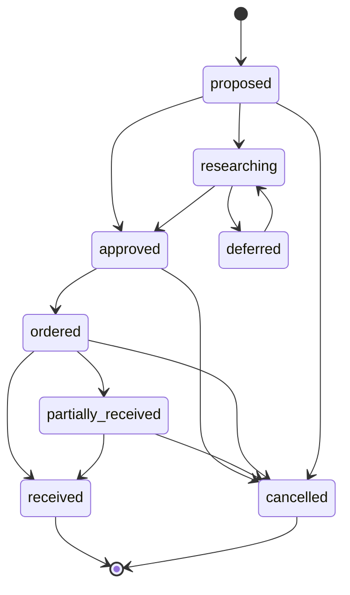

# HARALD — Neue Anforderungen: Beschaffungsvormerkungen und systematische Buchaufstellung

> **Dokument-ID:** HARALD-REQ-ADD-001  
> **Datum:** 17. Oktober 2026  
> **Status:** Nutzerwunsch erfasst, **fachlicher Entwurf / Release-Priorität noch nicht verbindlich freigegeben**  
> **Geltungsbereich:** Bücher zuerst; konzeptionell auch andere Medien  
> **Bezug:** [Pflichtenheft](Pflichtenheft_Open_Source_Multimedia_Bibliotheksverwaltung_2026.md), [Architektur](../architecture/ARCHITECTURE.md), [Roadmap](../../ROADMAP.md)  
> **Hinweis:** Die vom Nutzer erwähnte **zweite zusätzliche Funktion** ist ausdrücklich **noch nicht spezifiziert** und wird nicht erraten.

## 1. Anlass und Ziel

Der Nutzer möchte **Bücher verwalten, die erst künftig beschafft werden sollen**. Diese Verwaltung ist eine eigenständige Funktion und geht über die bisherigen einfachen Wunschlisten hinaus: Ein Wunsch kann recherchiert, bewertet, bestellt, geliefert und schließlich als tatsächlich vorhandenes Exemplar inventarisiert werden. Es muss möglich sein, Titel vorab zu katalogisieren, ohne den realen Bestand oder die Verfügbarkeitsanzeige zu verfälschen.

Zusätzlich wurde gefragt, ob Bücher wie in der Bibliothek aus *Person of Interest* aufgestellt werden. Das Vorbild verwendet das **Dewey-Dezimalklassifikationssystem (DDC)**, das auch für die Codes der Maschine relevant ist. Für HARALD soll eine **DDC-artige fachliche Aufstellung mit Signatur** möglich werden, ohne die normale Standorthierarchie zu ersetzen und ohne proprietäre Klassifikationstabellen ungeprüft zu übernehmen.

Das sind **zwei zusammenhängende Betrachtungen**, aber keine Festlegung zur vom Nutzer auf später vertagten "zweiten Funktion".

## 2. Fachlicher Umfang A: Zu beschaffende Bücher

### 2.1 Abgrenzung zu bisheriger Wunschliste und professioneller Erwerbung

| Begriff | Zweck | Ergebnis |
| --- | --- | --- |
| Persönliche Wunschliste | "Interessiert mich", eventuell ohne konkreten Kauf | Ein Merklisteneintrag, **kein** Bestand |
| **Beschaffungswunsch / Bedarf** | Konkreter Titel soll möglicherweise beschafft werden | Nachverfolgbarer Plan mit Status und Priorität |
| Bestellung | Tatsächlich ausgelöste Bestellung, ggf. mehrere Positionen | Menge, Bestelldatum, Händler, Kosten |
| Wareneingang / Inventarisierung | Lieferung wird physisch geprüft und übernommen | Neue **Physical Items** mit Inventar-IDs |
| Professionelle Erwerbung (später) | Haushalt, Kontingente, Genehmigungsstufen, Rechnungen, Lieferantenverwaltung | Separates optionales Modul; **kein Muss für einfache Beschaffungswünsche** |

**Wichtig:** "Buch bestellt" heißt weder "Buch angekommen" noch "Buch ausleihbar". Solange ein Exemplar nicht tatsächlich vorhanden und inventarisiert ist, darf es die Bestandszahlen, die Ausleihe und die Suche nach **sofort verfügbaren** Exemplaren nicht erhöhen.

### 2.2 Zielablauf

1. Bibliografische Angaben erfassen: Titel, Autor, ISBN (falls vorhanden), gewünschte Ausgabe, Sprache, Verlagsangaben.
2. Sofort prüfen, ob Werk/Ausgabe bereits erfasst oder physische Exemplare schon vorhanden sind; bewusst doppelt gewünschte Exemplare bleiben erlaubt.
3. Beschaffungswunsch anlegen: Menge, Priorität, Begründung, gewünschtes Datum, verantwortliche Person oder Sammlung.
4. Optional Bezugsquellen, Links, Angebote und unverbindliche Preisschätzung hinterlegen.
5. Wunsch genehmigen oder zunächst auf später verschieben; Bestellvorgang dokumentieren.
6. Bei (Teil-)Lieferung Stückzahl, Zustand, Rechnung/Belegreferenz und tatsächlichen Preis erfassen.
7. Für die tatsächlich erhaltenen und angenommenen Bücher je eine eindeutige **Physical Item**-Identität und einen Inventarbarcode erzeugen bzw. übernehmen.
8. Klassifikation und Signatur vorschlagen, tatsächlichen physischen Platz zuweisen.
9. Wunsch und Bestellung mit den entstandenen Exemplaren nachvollziehbar verknüpfen; Restmenge offen lassen.
10. Bei Storno, Nichtverfügbarkeit, Fehl- oder Teillieferung keinen Phantom-Bestand erzeugen.

### 2.3 Vorgeschlagene Anforderungen

| Kennung | Priorität / Ziel | Beschreibung | Prüfkriterium |
| --- | --- | --- | --- |
| **ACQ-001** | M, Freigabe für frühes Release zu entscheiden | Geplantes Buch unabhängig vom Bestand erfassen | Kein `PhysicalItem` durch bloßes Vormerken |
| **ACQ-002** | M, frühes Release zu entscheiden | Vorhandenes `Work`/`Edition` zuordnen oder Bibliografieentwurf speichern | Keine impliziten Dubletten/Verfügbarkeiten |
| **ACQ-003** | M | Status, Menge, Priorität und Notizen verwalten | Statuswechsel nach prüfbaren Regeln |
| **ACQ-004** | M | Abgleich gegen bereits vorhandene Titel und laufende Beschaffung | Dublettenhinweis; bewusste Wiederbestellung zulässig |
| **ACQ-005** | S | Händler, Angebots-URL, geschätzter und tatsächlich bezahlter Preis | Unbekannter Preis bleibt leer, keine implizite Währung |
| **ACQ-006** | S | Bestellung und Teillieferung mit Mengen und Datum nachhalten | `receivedQuantity <= orderedQuantity` ohne autorisierte Anpassung |
| **ACQ-007** | M | Angekommene Stücke einzeln inventarisieren und referenzieren | 2 bestellte, 1 geliefert = genau 1 neues Item |
| **ACQ-008** | M | Beschaffungsübersicht, Filter, Suche und Markierung der offenen Wünsche | Kein offenstehender Bedarf verschwindet lautlos |
| **ACQ-009** | M | Beschaffungsdaten exportieren/importieren und in Backup/Restore integrieren | Ausstehende Positionen überstehen Roundtrip |
| **ACQ-010** | M | Berechtigungen: privat/organisatorisch, keine unbefugten Käufe oder Datenoffenlegung | Negative Rollen-/Exporttests bestehen |
| **ACQ-011** | K, später | Preisbeobachtung, Budgetplan, Erinnerungen, Dublettenempfehlungen | Provider deaktivierbar; keine Cloud-Pflicht |
| **ACQ-012** | K, später | Mehrstufige Freigabe, Bestellpositionen, Rechnungen und Erwerbungsetat | Eigenständiges professionelles Erwerbungsmodul |

`M/S/K` kennzeichnet hier den **fachlichen Priorisierungsvorschlag**, keine bereits angenommene Release-Verpflichtung. Zu klären: Muss die erste funktionsfähige Version nur die einfache Beschaffungsliste oder bereits Bestell-/Wareneingangsfunktionen umfassen?

### 2.4 Status und Übergänge (Entwurf)

Die Bestellung und einzelne Lieferpositionen können später separate Zustandsautomaten benötigen. `received` bedeutet **Wareneingang vollständig**, nicht automatisch ausleihbereit. Damit Buchbesitzer nicht zu einem komplexen Bibliotheksetat gezwungen werden, darf ein kleiner Modus die Genehmigung/Bestellung als einfachen Statusübergang führen.

### 2.5 Datenmodell (konzeptionell, keine bestehende Tabelle)

- `AcquisitionRequest`: stabiler Schlüssel, Eigentümer/Organisation, beantragender Akteur, Erstellungsdatum, Status, Priorität, Notiz, gewünschte Menge und optional gewünschtes Lieferdatum.
- `AcquisitionTarget`: optional vorhandene `WorkId`/`EditionId` oder gültiger vorläufiger Bibliografiesnapshot inkl. Referenz/ISBN.
- `PurchaseReference`: Händler/Quelle, Bestellung, Preisangebot, Währung, Bestelldatum und externe Referenz. Später in `PurchaseOrder` auslagerbar.
- `AcquisitionReceipt`: tatsächlich gelieferte/angenommene Menge, Zeit, Zustand, Kosten und Verknüpfungen zu neu angelegten `PhysicalItemId`s.
- `AcquisitionEvent`: dokumentierter Zustandswechsel, Akteur, Zeit, Ursache, Änderung. Datenschutz, Lösch- und Aufbewahrungsfristen beachten.

**Integritätsregeln:** Ein Beschaffungswunsch erzeugt keine physische Bestandsmenge. Wareneingang und Item-Anlage erfolgen atomar oder per prüfbarer, idempotenter Workflow-/Kompensationslogik. Gutschrift/Rückgabe nach Wareneingang erfordert explizite fachliche Zustände; nicht einfach Item löschen.

### 2.6 Abnahmeszenarien

- **ACQ-AT-01:** ISBN wird für einen noch nicht vorhandenen Titel erfasst; Bestand bleibt null, Wunsch erscheint in offener Liste.
- **ACQ-AT-02:** Dasselbe Buch ist bereits vorhanden; HARALD weist darauf hin, lässt aber beabsichtigt eine zusätzliche Kopie bestellen.
- **ACQ-AT-03:** Zwei Bücher werden bestellt; eines kommt an; genau ein Exemplar erhält Barcode und Standort; der Rest bleibt offen.
- **ACQ-AT-04:** Bestellung wird storniert; keine Ausleihe und kein Bestand werden erzeugt.
- **ACQ-AT-05:** Export, Backup und Restore erhalten alle offenen Bedarfe, Positionen, Status und Verknüpfungen.
- **ACQ-AT-06:** Ein nicht berechtigter Benutzer kann weder Bestellung ändern noch private Beschaffungsnotizen exportieren.
- **ACQ-AT-07:** Zwei gleichzeitige Wareneingangsversuche dürfen nicht zu doppelten Inventar-Items führen.

## 3. Fachlicher Umfang B: Aufstellung wie bei Finch

### 3.1 Welches System zeigt *Person of Interest*?

Die Serie verwendet das **Dewey-Dezimalklassifikationssystem**, um Bücher nach Wissensgebieten zu organisieren. In Staffel 2, Episode 1 (*The Contingency*), erkennt Reese, dass die von der Maschine erhaltenen Buchhinweise auf Dewey-Signaturen in Finchs Bibliothek verweisen. **Die geheime Zahlenübermittlung ist Serienhandlung und keine notwendige Eigenschaft realer DDC-Bibliothekssoftware.**

Quellen zur Serieninterpretation:
- TVLine-Interview mit Jonathan Nolan und Michael Emerson: <https://www.tvline.com/previews/person-of-interest-season-2-episode-2-preview-368466/>
- Folgenbeschreibung *The Contingency*: <https://personofinterest.fandom.com/wiki/The_Contingency>
- NYPL zu DDC: <https://www.nypl.org/help/dewey-decimal-system>

### 3.2 Trennung von Klassifikation, Signatur und Standort

| Feld | Bedeutung | Beispiel (illustrativ, keine automatische Klassifikationszusage) |
| --- | --- | --- |
| **Klassifikationssystem** | Nach welchem Ordnungsschema? | DDC, eigene Sachgruppen, später LCC/RVK |
| **Klassifikationsnotation** | Thematischer Ordnungswert | `005.1` als exemplarische DDC-artige Nummer |
| **Signatur / Shelfmark** | Zusammengesetzte Aufstellungskennung, ggf. Autor-Kürzel | `005.1 GOE` |
| **Physischer Standort** | Wo steht das jeweilige Exemplar? | `Wohnung / Arbeitszimmer / Regal 2 / Fach 4` |
| **Inventarbarcode** | Eindeutige Kopiekennung | `HAR-ITEM-000042` |
| **Sortierregel** | Wie sortiert man im Fach? | Nach DDC-Zahl, dann Autorenkürzel und ggf. Band |

**Signatur ist nicht Standort:** Ein Buch kann die Signatur `005.1 GOE` haben, aber von Regal A zu Regal B umziehen, ohne dass seine fachliche Klassifikation geändert wird. Mehrere Exemplare dürfen identische Signatur, aber müssen unterschiedliche Inventar-IDs haben.

### 3.3 Funktionale Anforderungen

| Kennung | Priorität / Ziel | Beschreibung | Prüfkriterium |
| --- | --- | --- | --- |
| **SHELF-001** | M, Zielrelease zu entscheiden | Klassifikationssystem pro Bibliothek/Sammlung wählen | Mindestens eigener Schlüssel und manuelle DDC-Notation |
| **SHELF-002** | M | Klassifikationsnotation getrennt vom physischen Standort speichern | Standortwechsel ändert Notation nicht |
| **SHELF-003** | M | Standortbaum Gebäude/Raum/Regal/Fach und Inventar-ID unabhängig halten | Zwei Kopien an unterschiedlichen Plätzen |
| **SHELF-004** | M | Sortierung numerisch-hierarchisch nach DDC-artiger Notation, nicht lexikografisch | `005.1` vor `005.12` vor `006`; führende Nullen bleiben erhalten |
| **SHELF-005** | S | Signatur aus Klassifikation + Cutter-/Autorenkürzel oder eigenen Regeln bilden bzw. bearbeiten | Vorschlag bleibt editierbar und nachvollziehbar |
| **SHELF-006** | S | Buch im Katalog finden, Signatur und tatsächlichen Regalplatz anzeigen | Direkte Auffindbarkeit |
| **SHELF-007** | S | Regallisten, Etiketten und Platzierungshinweise exportieren/drucken | Etikett enthält Signatur, nicht ungeschützt private Daten |
| **SHELF-008** | M | Auch private/alphabetische oder frei definierte Ordnung unterstützen | Keine Verpflichtung, alle Medien nach DDC aufzustellen |
| **SHELF-009** | S | Fachsystem-Versionsangabe und Herkunft einer importierten DDC-Notation erfassen | Migration ändert keine Notation ohne Freigabe |
| **SHELF-010** | K, später | Online-Klassifikationsquellen als optionale Adapter | Lizenzbedingungen/Provenienz nachgewiesen |

Ein Nutzer sollte eine einfache alphabetische Ordnung oder eine manuelle Regal-ID verwenden können, wenn DDC für die eigene Sammlung zu aufwendig ist. DDC ist also **eine Option**, nicht der zwangsläufige Standard für jedes Medium.

### 3.4 Fachlogische Einordnung

- **Edition/Bibliografie** kann eine oder mehrere Klassifikationszuordnungen tragen (`scheme`, `notation`, `source`, `version`, `confidence/reviewed`).
- **PhysicalItem** besitzt Standort sowie optional eine lokale Aufstellungssignatur. Ein Exemplar darf in einer anderen Standortsystematik stehen als ein zweites Exemplar derselben Ausgabe.
- **ClassificationScheme** und lokale **ShelvingPolicy** sind eigene Konzepte, dürfen aber für R1 ohne umfangreiche zusätzliche Infrastruktur mit begrenzten, typisierten Einstellungen realisiert werden.
- Benutzerdefinierte Klassifikationssysteme sind zu unterstützen, ohne die Produktlogik oder alle Katalogdatensätze umzubauen.
- Die korrekte DDC-Dezimalklassifikation darf **nicht** als Stringvergleich implementiert werden (sofern numerische Notationen verwendet werden). Sortierkomponenten müssen eindeutig definiert sein.
- Fehlende oder unplausible Signaturen dürfen nicht zu Verlust oder unbemerkter Umordnung führen.

### 3.5 Lizenz- und Markenhinweis zur DDC

Die **Dewey Decimal Classification®** und ihre vollständigen Klassifikationstabellen werden von **OCLC** verwaltet; Name und Daten unterliegen Lizenz-/Markenbedingungen. HARALD kann eine vom Nutzer eingegebene, vorhandene Klassifikationsnummer als Metadatum behandeln, ohne damit eine Lizenz zum **gebündelten Vertrieb vollständiger DDC-Tabellen** oder zu WebDewey-Daten zu erhalten.

- OCLC-Lizenzressourcen: <https://www.oclc.org/de/dewey/resources.html>
- OCLC-WebDewey: <https://www.oclc.org/de/dewey/webdewey.html>
- OCLC-Angebot/Urheberrecht: <https://www.oclc.org/de/dewey.html>

**Umsetzungsregel:** Zunächst manuelle Notation und generische Klassifikations-/Signaturfunktion planen; keine vollständigen fremden Systematiken, Notationstexte oder Online-Datenbanken ohne gesonderte Nutzungsrechte in den MIT-Quellcode kopieren.

### 3.6 Abnahmeszenarien

- **SHELF-AT-01:** Eine Ausgabe mit DDC-artiger Notation wird angelegt; zwei Exemplare haben verschiedene Regalstandorte und Barcodes.
- **SHELF-AT-02:** Ein Exemplar wird in ein anderes Zimmer umgestellt; seine Signatur bleibt erhalten; Suchergebnis zeigt neuen Standort.
- **SHELF-AT-03:** Numerische Sortierung `005.1`, `005.12`, `006` funktioniert (keine stringbasierte Fehlordnung).
- **SHELF-AT-04:** Ein zweites Klassifikationssystem wird ergänzt, ohne das erste umzunummerieren.
- **SHELF-AT-05:** Ein Nutzer ohne Rechte kann keine Signaturen manipulieren; private Standorte bleiben für Gäste verborgen.
- **SHELF-AT-06:** DDC-Import ohne lizenzierte Fachdatentabellen ist optional/deaktivierbar; lokale Erfassung bleibt funktionsfähig.

## 4. Integration in Roadmap und vorhandene Module

**Beschaffungsvormerkung:** Vorschlag für einen **frühen, schlanken Funktionskern** neben R1 (Bedarf, Status, Dublettenprüfung, Übergang zum inventarisierten Exemplar). Ein komplexer Etat-, Genehmigungs- und Rechnungskreislauf verbleibt optional in **R3**. Die endgültige Zuordnung insbesondere von `ACQ-006` bis `ACQ-012` wird vor Implementierung entschieden.

**DDC-kompatible Aufstellung:** Vorschlag, bereits im R1-Datenmodell **Klassifikationsnotation, Signatur und physischen Standort zu trennen**. Detaillierte automatische Nummernermittlung/Etikettendruck kann später erfolgen. Auch hier ist die verbindliche Priorisierung noch zu bestätigen.

| Bereits vorgesehener Teil | Ergänzung | Keine Änderung |
| --- | --- | --- |
| Catalog | Vorhandene Ausgabe oder vorläufiges bibliografisches Ziel für Beschaffungsbedarf | Werk/Ausgabe bleiben getrennt |
| Inventory | Empfang/Inventarisierung; Signatur/Standort voneinander unabhängig | Item entsteht erst beim realen Zugang |
| Circulation | Verfügbarkeit ergibt sich nur aus wirklich vorhandenen Exemplaren | Keine Phantom-Ausleihen |
| Exchange | Wünsche, Bestellung/Lieferstatus, Klassifikation exportieren | Schema wird versioniert |
| Search | Filter "geplant/bestellt/vorhanden"; fachliche Signatur finden | Berechtigungen gelten |
| IAM | Rechte für Wünsche, Bestellungen, Standorte und Budgetinfos | Least privilege |
| Integrations | Händler-/Metadaten- und Klassifikationsadapter erst bei Bedarf | Offline-Kern bleibt unabhängig |

## 5. Offene Entscheidungen

1. Genügt in R1 eine **Beschaffungs-/Merkliste mit Status und Preis**, oder sollen Bestellung und teilweiser Wareneingang bereits R1 verbindlich sein?
2. Ist die Beschaffung primär **privat für einen Sammler** oder sollen mehrere Mitarbeitende/Einrichtungen Anforderungen freigeben?
3. Sollen DVDs, CDs und Hörbücher von Anfang an genauso beschafft werden können? **Architekturvorschlag: ja, Medienziel generisch, UI zuerst Bücher.**
4. Soll **Dewey/DDC** standardmäßig vorgeschlagen werden, oder nur als optionale Fachaufstellung neben einer frei wählbaren eigenen Ordnung?
5. Wollen wir Etiketten auf Rücken/Regalen direkt in R1 oder erst später?
6. Die angekündigte **zweite zusätzliche Funktion** bleibt bewusst unbestimmt und erhält erst nach Besprechung eine eigene Anforderung.

## 6. Definition of Ready für die Implementierung

- [ ] Zielgruppe und Umfang der Beschaffung (nur Wunsch, Bestellung, Wareneingang) abgestimmt.
- [ ] R1-/R2-/R3-Zuordnung explizit freigegeben.
- [ ] Work/Edition/Item-Identitäten und Transaktionsverhalten im Datenmodell nachgewiesen.
- [ ] Security-/Lizenzbedingungen für Bezugsdaten, Preise und DDC geprüft.
- [ ] Export-/Restore- und Rechteanforderungen präzisiert.
- [ ] Positive und negative Abnahmetests akzeptiert.
- [ ] Technologie-/Speicher-ADR entschieden, bevor produktiver Code entsteht.

**Stand:** Neue Anforderungen sind dokumentiert; **nichts davon ist aktuell implementiert**.
