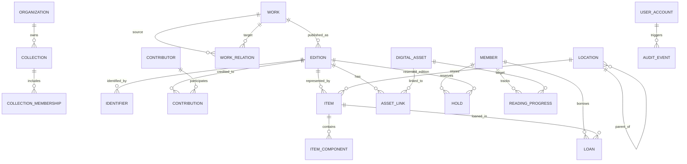
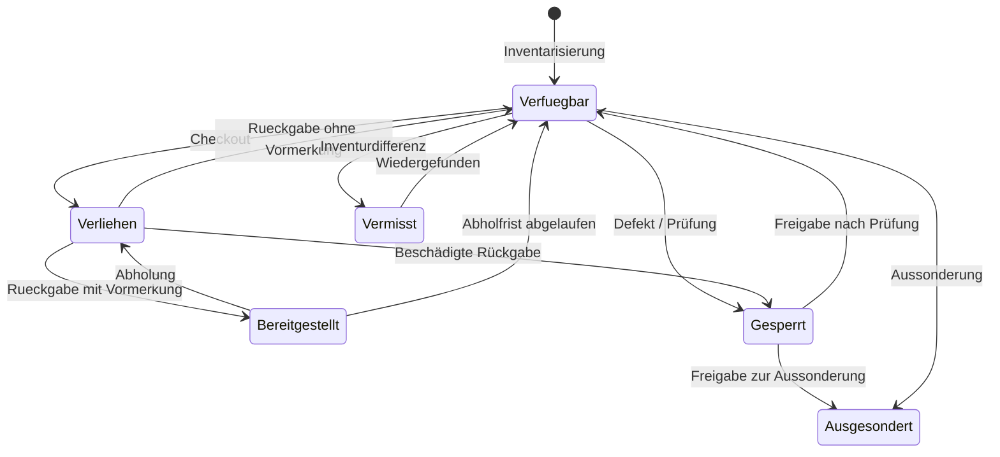
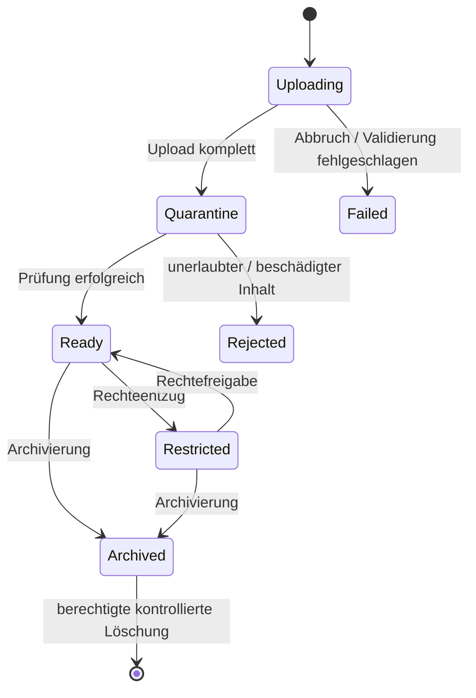
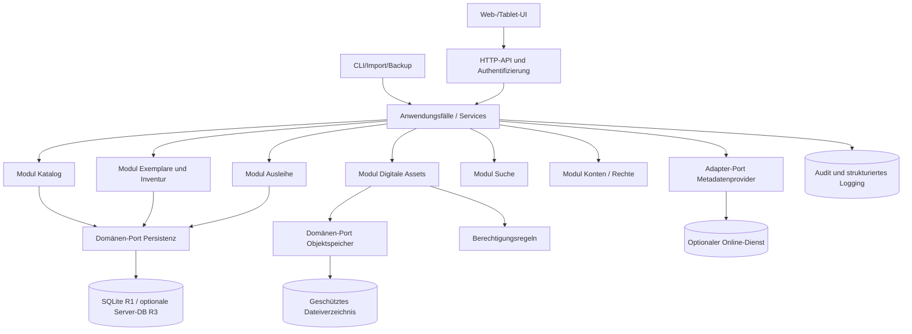

# Pflichtenheft – Offene Multimedia-Bibliotheks- und Sammlungsverwaltung

**Arbeitsname:** OMB – Offene Medienbibliothek (kein festgelegter Produkt- oder Repositoryname)  
**Dokument-ID:** OMB-PFH-001  
**Version:** 1.0 – ausführlicher fachlich-technischer Entwurf  
**Stand:** 17. Oktober 2026  
**Status:** Zur fachlichen Prüfung, noch nicht freigegeben  
**Sprache:** Deutsch  
**Grundlage:** `Open_Source_Bibliotheksverwaltung_Vollstaendiger_Funktionskatalog_2026.md`, Version 2.0 vom 17.10.2026, mit 24 Programmporträts und dem Prüfkatalog F001–F110.  
**Zweck:** Entwurf eines **neuen, eigenständigen, frei lizenzierten Programms** für die integrierte Verwaltung physischer und digitaler Medien. Dies ist **kein** Pflichtenheft für die Weiterentwicklung eines der 24 Fremdprodukte.

> **HARALD-Nachtrag vom 29.10.2026 (noch nicht formal freigegeben):** Für den inzwischen festgelegten Projektnamen HARALD existiert jetzt ein [eigenständiges Lastenheft](Lastenheft_HARALD_2026.md) (HARALD-LH-001). Die hier dokumentierten ursprünglichen Sollanforderungen werden **nicht** rückwirkend in neue Releasezusagen umgewandelt. Bereits konkretisierte individuelle Exemplarzustände sowie die separaten [Self-Service-](SELF_SERVICE_CIRCULATION.md) und [Fremdsystemmigrationsanforderungen](MIGRATION_FROM_OTHER_SYSTEMS.md) werden in den Abschnitten 7.8, 7.9 und 7.12 nachvollziehbar zugeordnet. Die historisch im Dokument genannten alten Projekt- und Entscheidungsstände bleiben als Quellenstand erkennbar.

> **Verbindlichkeit:** Dieses Dokument übersetzt den vorhandenen Funktionskatalog in eine *vorgeschlagene* umsetzbare Lösung. Produktname, Trägerschaft, endgültige Lizenz, Programmiersprache, Teamgröße und Kosten wurden vom Auftraggeber noch nicht festgelegt. Deshalb sind die betreffenden Entscheidungen ausdrücklich als **Planungsannahme**, **Architekturentscheidung (ADR)** oder **offener Freigabepunkt** markiert; sie dürfen nicht stillschweigend als erteilter Auftrag gelten. Der Entwurf ist auf systematische Umsetzung, Testbarkeit und spätere Erweiterung ausgelegt.

---

## Inhaltsverzeichnis

1. [Dokumentlenkung und Beschlusslage](#1-dokumentlenkung-und-beschlusslage)
2. [Ausgangslage, Produktvision und Ziele](#2-ausgangslage-produktvision-und-ziele)
3. [Auswertung der 24 Referenzprogramme](#3-auswertung-der-24-referenzprogramme)
4. [Projektumfang und Releases](#4-projektumfang-und-releases)
5. [Begriffe, Annahmen und Fachregeln](#5-begriffe-annahmen-und-fachregeln)
6. [Benutzergruppen und Anwendungsfälle](#6-benutzergruppen-und-anwendungsfälle)
7. [Funktionale Anforderungen](#7-funktionale-anforderungen)
8. [Informationsmodell und Datenarchitektur](#8-informationsmodell-und-datenarchitektur)
9. [Systemarchitektur und Technologieentscheidungen](#9-systemarchitektur-und-technologieentscheidungen)
10. [Schnittstellen, Formate und Interoperabilität](#10-schnittstellen-formate-und-interoperabilität)
11. [Oberflächen-, Bedien- und Barrierefreiheitskonzept](#11-oberflächen--bedien--und-barrierefreiheitskonzept)
12. [Sicherheit, Datenschutz und rechtliche Leitplanken](#12-sicherheit-datenschutz-und-rechtliche-leitplanken)
13. [Qualitätsanforderungen und messbare Kennzahlen](#13-qualitätsanforderungen-und-messbare-kennzahlen)
14. [Testkonzept und Abnahmeszenarien](#14-testkonzept-und-abnahmeszenarien)
15. [Installation, Betrieb, Migration und Wartung](#15-installation-betrieb-migration-und-wartung)
16. [Roadmap, Arbeitspakete und Lieferobjekte](#16-roadmap-arbeitspakete-und-lieferobjekte)
17. [Risiken, Abhängigkeiten und Gegenmaßnahmen](#17-risiken-abhängigkeiten-und-gegenmaßnahmen)
18. [Rückverfolgbarkeit zu F001–F110](#18-rückverfolgbarkeit-zu-f001f110)
19. [Freigabekriterien, offene Entscheidungen und Definition of Done](#19-freigabekriterien-offene-entscheidungen-und-definition-of-done)
20. [Quellen, Standards und Referenzen](#20-quellen-standards-und-referenzen)
21. [Anhänge](#21-anhänge)

---

# 1. Dokumentlenkung und Beschlusslage

## 1.1 Dokumentenhierarchie

- **Funktionskatalog:** Beschreibt Funktionen existierender Programme; ist Quelle und Ideensammlung, *kein* bestätigter Kundenauftrag.
- **Lastenheft:** Würde die vom Auftraggeber ausdrücklich gewünschten Ziele, Rahmenbedingungen und Prioritäten festlegen; lag **zum ursprünglichen Dokumentstand (17.10.2026)** nicht gesondert vor. **HARALD-Nachtrag:** Das [Lastenheft HARALD vom 29.10.2026](Lastenheft_HARALD_2026.md) bildet inzwischen die konkret geäußerten Nutzerbedarfe als vorgeschlagenen, noch zu genehmigenden Stand ab.
- **Dieses Pflichtenheft:** Legt die **vorgeschlagene fachliche Umsetzung**, den Soll-Funktionsumfang, das Datenmodell, die Schnittstellen und die Verifikation fest.
- **Architekturentscheidungen (ADRs):** Halten spätere bindende technische Beschlüsse mit Gründen, Alternativen und Folgen fest.
- **Test- und Abnahmeprotokoll:** Beweist gegen konkrete, versionierte Anforderungen, was implementiert wurde.

**Nicht behauptet wird**, dass 24 Referenzprogramme denselben Funktionsumfang oder dieselben Lizenzen haben. Der Entwurf übernimmt *Ideen und Anforderungen*, nicht fremde Quelltexte oder Benutzeroberflächen. Lizenz- und Markenfragen sind gesondert zu prüfen.

## 1.2 Kennzeichnung von Anforderungen

- **MUSS (M):** Verpflichtend für den angegebenen Release; Fehlen verhindert dessen Freigabe.
- **SOLL (S):** Hohe Priorität; Abweichung muss dokumentiert und akzeptiert werden.
- **KANN (K):** Erweiterung, kein Blocker für vorherige Releases.
- **AUS (X):** Bewusst außerhalb des derzeitigen Umsetzungsumfangs.
- **R1:** Erstes produktiv nutzbares Release – lokaler und kleiner Mehrbenutzerbetrieb; Kern der physischen und digitalen Medienverwaltung.
- **R2:** Komfortfunktionen, digitale Nutzung, OPAC und Integrationen.
- **R3:** Erweiterte Bibliotheksprozesse, übergreifender Betrieb und spezialisierte Standards.

Beispiel: **`CAT-006 | M | R1`** bezeichnet eine im ersten Release verpflichtende Kataloganforderung. **Keine Funktion** darf aufgrund ihrer Erwähnung in diesem Dokument automatisch als R1-Pflicht interpretiert werden.

## 1.3 Anforderungen und Nachweis

Jede Anforderung erhält eine **stabile ID**, Priorität, Zielrelease, einen beobachtbaren Sollzustand und ein Abnahmekriterium. Komponententests, Integrationstests und End-to-End-Tests verweisen auf diese IDs. Änderungen erfolgen über ein dokumentiertes Change-Verfahren. Der Git-Commit, das Datenbankschema und die getestete Programmversion müssen reproduzierbar einem Dokumentenstand zugeordnet werden können.

## 1.4 Grundentscheidungen als Entwurf

| Kennung | Vorgeschlagene Entscheidung | Begründung / Status |
|---|---|---|
| D-01 | Erst **Multimedia-Katalog und kleine Bibliothek**, nicht Hochschul-ILS oder weltweiter Verbund | Realistische Kernentwicklung; zur Freigabe |
| D-02 | Einheitliches Modell für Werke, Ausgaben, Exemplare, digitale Assets | Verhindert strukturellen Medienbruch; empfohlen |
| D-03 | **Lokal und selbst gehostet**, ohne Pflichtkonto eines Cloudanbieters | Datenhoheit und langfristige Nutzbarkeit; empfohlen |
| D-04 | **Modularer Monolith** mit sauberen Schnittstellen, kein Microservice-Zwang | Testbarkeit bei überschaubarem Betrieb; empfohlen |
| D-05 | Webfähige Verwaltungsoberfläche und dokumentierte lokale API; Desktop-Client optional | Windows/Linux und mobile Browser abdecken; empfohlen |
| D-06 | Zunächst eine Organisation, mehrere Sammlungen/Standorte; echter Mehrmandantenbetrieb später | Spart frühzeitige Komplexität; empfohlen |
| D-07 | Für R1 **lokale SQLite-Datenbank** und transaktionssicheres Dateisystem; PostgreSQL-Adapter als späterer Ausbau | Einfache Installation; Performance-/Concurrency-Grenzen prüfen |
| D-08 | Digitalen **Besitz, Katalogeintrag, Datei und Nutzungslizenz** getrennt modellieren | Verhindert unzulässige Verleih- und DRM-Annahmen |
| D-09 | Kein verpflichtender eigener Video-/Musik-Streamingserver in R1 | Medienkatalogisierung ≠ Medienwiedergabe |
| D-10 | Technologiestack und freie Softwarelizenz werden als ADR explizit entschieden | Noch keine Benutzerfreigabe |

---

# 2. Ausgangslage, Produktvision und Ziele

## 2.1 Ausgangslage

Der analysierte Markdown-Katalog beschreibt 24 Anwendungen, die sich auf professionelle Ausleihsysteme, kleinere Bibliotheken, Desktop-Sammlungen und E-Book-/Hörbuch-Server verteilen. Diese Spezialisierung führt zu einer Lücke: Wer **gedruckte Bücher, Filme auf DVD/Blu-ray/UHD-Blu-ray, Musik- und Hörbuch-CDs sowie EPUB, PDF und digitale Hörbücher** zusammenführen möchte, benötigt häufig mehrere Programme und führt Bestandsdaten doppelt. Weitere Probleme sind unklare Unterscheidung zwischen Werk und Exemplar, nur teilweise exportierbare Metadaten, wenig flexible eigene Felder und unterschiedliche Ausleihmodelle.

## 2.2 Produktvision

Ein offenes, dauerhaft selbst betreibbares Programm ermöglicht das **einmalige Erfassen, organisierte Aufbewahren, Suchen, Inventarisieren, Ausleihen und – soweit technisch und rechtlich möglich – digitale Nutzen** sämtlicher relevanter Medien einer privaten oder kleinen institutionellen Bibliothek. Es bleibt offline funktional und lässt sich durch austauschbare Importer, Clients und optionale Bibliotheksmodule erweitern.

## 2.3 Primäre Zielgruppen

1. **Privatpersonen/Sammler:** viele Medienformate, genaue Editions- und Zustandsangaben, Standorte, Wunschlisten und gelegentliches Verleihen.
2. **Familien/Wohngemeinschaften:** gemeinsam verwendbarer Bestand mit getrennten Benutzern und individuellen Merklisten.
3. **Vereine, kleine Schul- oder Fachbibliotheken:** Inventarnummern, Leser, Ausleihe, einfache Regeln, Inventur, Berichte.
4. **Administratoren/Self-Hoster:** Installation ohne Zwangscloud, API, Backups, transparente Konfiguration, Log- und Updateverfahren.
5. **Entwickler und Integratoren:** stabile Domänenmodelle, offene Daten, dokumentierte Adapter-/Plugin-Schnittstellen.

Große wissenschaftliche Einrichtungen mit vollständiger Erwerbung, nationaler Verbundkatalogisierung und komplexem ERM sind **keine primäre Zielgruppe von R1**.

## 2.4 Geschäftliche und fachliche Erfolgsziele

| Ziel-ID | Ergebnis | Messung für R1/R2 |
|---|---|---|
| Z-01 | **Ein Bestand für verschiedene Medienarten** | Sechs repräsentative Testmedien lassen sich nebeneinander katalogisieren und filtern (R1) |
| Z-02 | **Edition und physisches Stück getrennt** | Zwei Buchkopien mit derselben ISBN haben unterschiedliche Exemplar-IDs und Ausleihstatus (R1) |
| Z-03 | **Lokale Datenhoheit** | Neuinstallation, Export und Restore ohne externen Dienst gelingen (R1) |
| Z-04 | **Praktische Ausleihe** | Scanner-/Tastatureingabe, Ausgabe, Verlängerung, Rückgabe, Reservierung (R1/R2) |
| Z-05 | **Metadaten ohne Lock-in** | Vollständiger JSON-Export plus einfache CSV-Sichten; wiederimportierbare Entitäten (R1) |
| Z-06 | **Robuster Digitalbestand** | EPUB/PDF/M4B als geschützte Assets, Hashvergleich, getrennte Zugriffe (R1) |
| Z-07 | **Lesen und Hören** | Browser-Reader/Player mit individuellem Fortschritt (R2) |
| Z-08 | **Technisch erweiterbar** | Beispieladapter und Verträge ohne Kernänderung einbindbar (R2) |
| Z-09 | **Rechtssicheres Verhalten** | Kein DRM-Umgehen und kein unberechtigtes öffentliches Dateisharing (alle Releases) |

## 2.5 Nichtziele

R1 wird **kein** vollständiger Ersatz für FOLIO, Koha oder Evergreen in Großbibliotheken; kein Digital-Rights-Management-System zur rechtlichen Lizenzvergabe; kein Streamingdienst für geschützte Filme; kein Blu-ray/DVD-Ripper; kein Metadatendienst mit garantiert unbeschränktem Drittanbieterzugriff; kein kommerzielles ERP, kein Inkassosystem, keine Fernleihe zwischen Institutionen. Solche Bereiche sind als explizit ausgeschlossen oder als späteres Sonderprojekt dokumentiert.

---

# 3. Auswertung der 24 Referenzprogramme

Die folgende Tabelle dokumentiert **alle** im Ausgangs-Markdown genannten Programme und die konkret zu übernehmenden *Funktionsideen*. Eine Übernahme bedeutet Umsetzung derselben **fachlichen Fähigkeit**, nicht Kopieren fremden Codes, Marken, Masken oder geschützter Inhalte.

| Nr. | Referenzprogramm | Relevante Vorbilder für das Pflichtenheft | Entscheidung |
|---:|---|---|---|
| 01 | **Koha** | MARC-orientierte Katalogisierung, Exemplare, regelbasierte Ausleihe, OPAC, Inventur | Kernlogik jetzt; Standards und OPAC gestuft |
| 02 | **Evergreen ILS** | komplexere Vormerkungen, mehrteilige Bestände, Standortlogik | Einfache Vormerkung R1/R2; Verbund später |
| 03 | **FOLIO** | Trennung bibliografischer Instanz, Bestand und Item; modulare Integrationen, E-Ressourcen | Datenmodell und Schnittstellen übernehmen; ERM aus R1 ausklammern |
| 04 | **SLiMS** | Barcode-Ausleihe, Mitglieder, Bestandsprüfung, einfache Installation | Für R1 übernehmen |
| 05 | **RERO ILS** | API-basiertes System, bibliografische Standards, Normdaten | API R1, normierte Datenaustauschformate R3 |
| 06 | **PMB** | Dokumentation, Periodika, OPAC, Volltextansätze | OPAC R2; Periodika R3 |
| 07 | **InvenioILS** | JSON-/API-orientierte Fachobjekte, suchbare Bestände | Strukturprinzip übernehmen |
| 08 | **ABCD** | konfigurierbare Dokumenttypen, Dokumentationsdatenbanken | benutzerdefinierte Felder R2 |
| 09 | **Next-L Enju Leaf** | recherchierbarer Katalog, Ausleihe, Benutzerorganisation | Einfache Kernabläufe übernehmen |
| 10 | **BiblioteQ** | lokale DB, physische Multimedia-Exemplare, Desktop-Bedienung | Kernmedienverwaltung R1; Desktop später |
| 11 | **OpenBiblio** | überschaubare Bibliotheks- und Lesermodule | Einfache Rollen und Ausleihe R1 |
| 12 | **OpenLibry** | schnelle ISBN-Erfassung, Scanner, geringe Einstiegshürde | Bedienkonzept und Stapelerfassung R1 |
| 13 | **Tellico** | flexible Sammlungen, detaillierte Metadaten, lokale Datenhoheit | Sammlungen und Felder R1/R2 |
| 14 | **GCstar** | unterschiedliche Medienklassen und Sammlungsmetadaten | Gemeinsam nutzbare Medientyp-Taxonomie R1 |
| 15 | **Data Crow** | eigene Felder/Module, flexible Metadaten, Sammlungsverwaltung | Erweiterbares Modell R1, Feldeditor R2 |
| 16 | **Shelf** | Bücher/Filme/Musik/Hörbücher in einem Katalog; Scan und Metadaten | zentrale Produktfunktion R1 |
| 17 | **uBiblio** | einfaches persönliches Leih-/Buchverwaltungssystem | Minimalabläufe und Konten R1 |
| 18 | **Calibre** | E-Book-Dateien, Formate, Metadaten, Konvertierung, Exporte | Asset-Verwaltung R1; Konvertierung optional R3 |
| 19 | **Calibre-Web** | Webzugriff, persönliche Regale, OPDS und Lesefunktionen | Webkatalog R1, OPDS/Reader R2 |
| 20 | **BookOrbit** | E-Books, digitale Hörbücher, Kapitel, Fortschritt | getrenntes Digitalmodul R2 |
| 21 | **BookLore** | komfortable Metadaten und persönliche digitale Bibliothek | Metadaten-/Regalideen R2 |
| 22 | **Kavita** | Comic-/Manga-Serien, Reader, Fortschritt | optionaler Comic-Reader R2/R3 |
| 23 | **Komga** | Comic-Archive, OPDS, Reader-/Geräteintegration | spezialisierte Adapter R2/R3 |
| 24 | **Inventaire** | Teilen, Wunschlisten, Sichtbarkeitsstufen, gemeinsamer Katalog | Merklisten R2; öffentliche soziale Plattform nicht R1 |

**Konsolidierung:** Ähnliche Funktionen aus verschiedenen Produkten werden nur **einmal** spezifiziert. Die Herkunft wird im Traceability-Anhang dokumentiert. Die 110 F-Punkte aus dem Ausgangsdokument werden am Ende vollständig klassifiziert.

---

# 4. Projektumfang und Releases

## 4.1 Release-Schnitt

| Release | Zweck | Enthaltene Fähigkeiten | Absichtlich noch nicht enthalten |
|---|---|---|---|
| **R0 – Fundament** | Entwicklungs- und Testbarkeit | Repository, Lizenzentscheidung, CI, migrationsfähige DB, Domänenobjekte, API-Grundgerüst, Basis-UI, Konfigurationsschema | produktiver Ausleihbetrieb |
| **R1 – Kernprodukt** | Wirklich nutzbarer Multimedia-Katalog | Werke/Ausgaben/Exemplare, Bücher, DVD/Blu-ray, Musik- und Hörbuch-CD, digitale Assets, Standorte, Suche, manuelle Erfassung, CSV/JSON Import/Export, Nutzer/Rollen, Ausleihe/Rückgabe, einfache Reservierung, Inventur, Backup/Restore, Datenschutz-Basis | digitaler Reader/Player, vollwertiges MARC/ERM |
| **R2 – Komfort & Digital** | Gute alltägliche Benutzbarkeit | externe Metadatenadapter, Cover, erweiterte Suche/Facetten, fortgeschrittene Vormerkung, Merkliste, OPAC, EPUB/PDF-Reader, MP3/M4B-Player, Wiedergabefortschritt, OPDS, offene Plugins, Benachrichtigungen | Verbundfernleihe, Haushaltsbuch/ERP |
| **R3 – Professionalisierung** | Erweiterte Einrichtungen und Standards | MARC21/SRU/Z39.50, Normdaten, Periodika, einfache Erwerbung, LDAP/OIDC, Mehrstandort-Transporte, PostgreSQL-Betrieb, Barcode-Druck, SIP2/RFID (nach Bedarf), Geräteintegrationen | flächendeckende kommerzielle Lizenzabwicklung |
| **Außerhalb der Planung** | bewusst ausgenommen | DRM-Entschlüsselung, Blu-ray-/DVD-Ripping, unlizenzierte Verbreitung, automatisches Abgreifen verbotener Metadatenquellen, komplizierte Fernleihnetze | keine Umsetzung ohne neues Lastenheft |

**Release-Regel:** R1 muss von der Erstinstallation bis zur Sicherung und Wiederherstellung **alleine sinnvoll verwendbar** sein. R2/R3 können Funktionen ergänzen, dürfen das Datenmodell nicht rückwirkend brechen.

## 4.2 Muss-Funktionspakete von R1

- Stammdaten, Werk-/Ausgabe-/Exemplartrennung, Nummern und Beziehungen.
- Spezifische Felder für physische Bücher, DVD/Blu-ray/UHD, Audio-CD und Hörbuch-CD sowie generische Digitalmedien.
- Einzel- und Stapelerfassung mit Eingabeprüfungen, später wiederholbarem Import.
- Hierarchische Orte, physische Bestandteile und Zustandskontrolle.
- Vollständige Grundausleihe inklusive Reservierung, Rückgabe und Sperrregeln.
- Suche, Filter, Dashboard, Bestands- und Inventuransichten.
- Mehrbenutzer- und Zugriffskonzept, sichere Dateizugriffe, Auditprotokoll.
- Portabler Export, konsistentes Backup, Restoretest und Migrationsfähigkeit.

## 4.3 Leistungs- und Umfangsannahmen

**Planungsziel R1:** 100.000 Werke, 200.000 Ausgaben, 300.000 physische Exemplare, 100.000 digitale Assets (Metadaten), 50 gleichzeitige angemeldete Nutzer **als Zielwerte für Leistungstests**, nicht als bereits bewiesene Kapazität. Für den lokalen SQLite-Modus sind **bis fünf gleichzeitig schreibende Anwender** als primäres Einsatzszenario vorgesehen; Belastbarkeit und Locking werden gemessen. Größere Einrichtungen verwenden nach R3 eine unterstützte Serverdatenbank. Dateivolumen wird nicht allein aus Datensatzzahlen abgeleitet.

---

# 5. Begriffe, Annahmen und Fachregeln

| Begriff | Verbindliche Bedeutung |
|---|---|
| **Werk** | Inhaltliches/geistiges Objekt, z. B. Roman, Film, Album, Hörbuchfassung. Adaption kann eigenes Werk sein. |
| **Ausgabe/Edition** | Bestimmte Publikation eines Werks: Sprache, Verlag, Label, Veröffentlichungsjahr und Format. |
| **Exemplar** | Ein konkretes physisches Stück oder ausleihbares physisches Set mit eigener Inventar-ID. |
| **Teil/Komponente** | CD, Disc, Booklet, Beilage oder Band, der zu einem Set/Exemplar gehört. |
| **Asset** | Konkrete digitale Datei mit Prüfsumme und Storage-Referenz, keine frei zugängliche URL per Definition. |
| **Lizenz/Recht** | Dokumentierte Berechtigung einer Organisation/eines Nutzers für Speicherung, Lesen, Download oder Weitergabe. |
| **Sammlung** | Logische Ordnung eines Bestands; unabhängig vom physischen Lagerort. |
| **Standort** | Räumliche Hierarchie, z. B. Standort → Raum → Regal → Fach. |
| **Identifikator** | ISBN, ISSN, EAN/UPC, MusicBrainz-ID oder interne ID; Kennzeichner mit Typ und Gültigkeitsbereich. |
| **Inventarbarcode** | Eindeutiges **Exemplar**kennzeichen; nie synonym mit einer ISBN. |
| **Verfügbarkeit** | Resultat aus Status, Standort, Leihregeln und aktivem Ausleihvorgang. |
| **Reservierung/Vormerkung** | Wartender Anspruch auf eine ausleihbare Ausgabe oder ein bestimmtes Exemplar. |
| **OPAC** | Öffentlicher Recherchekatalog ohne zwangsläufigen Downloadzugriff auf Dateien. |
| **Adapter** | Austauschbare Implementierung einer Schnittstelle, z. B. für ISBN-Metadaten. |
| **Offline** | Lokale Kernverwaltung arbeitet ohne Internet; kein Versprechen, dass Online-Metadatenanbieter offline verfügbar sind. |

## 5.1 Nicht verhandelbare Fachinvarianten

1. Die **interne ID** ist unveränderlich; angezeigte Identifikatoren dürfen wechseln und können mehrfach zugeordnet sein, sofern die Regeln es zulassen.
2. Ein aktiver Leihvorgang referenziert **genau ein ausleihbares Exemplar**; ein Exemplar darf nie zwei gleichzeitig aktive Leihvorgänge haben.
3. Eine Ausgabe kann null, ein oder viele Exemplare und null, ein oder mehrere digitale Assets besitzen.
4. Eine EAN/UPC/ISBN kann eine **Ausgabe kennzeichnen**, ist aber nicht global garantiert eindeutig oder fehlerfrei. Konflikte werden sichtbar aufgelöst.
5. Ein mehrteiliges Set besitzt **eine oder mehrere** Komponenten; Ausleihe des Sets darf nicht versehentlich einzelne Komponenten ein zweites Mal verleihen.
6. Der Status eines Exemplars ist nicht frei neben der Ausleihtabelle fortzuschreiben: Die Regeln verhindern Widersprüche oder berechnen Verfügbarkeit aus autoritativen Zuständen.
7. Speichern einer digitalen Datei gibt **kein** Recht zu deren Weitergabe. Digitale Zugriffe werden ausschließlich nach gültigen Zugriffsregeln gewährt.
8. Suche, Export, API und OPAC dürfen Berechtigungsprüfungen **niemals umgehen**.
9. Identitäten, Rechte und Nutzungsdaten sind voneinander getrennt; persönliche Ausleihhistorien haben definierte Aufbewahrungsregeln.
10. Ein Import überschreibt keine bestätigten lokalen Korrekturen ohne Voransicht, ausdrückliche Zuordnungsregel oder Genehmigung.
11. Löschungen referenzierter Datensätze müssen abgefangen werden (Sperre, kontrollierte Kaskade oder revisionsfähige Aussonderung).
12. Backup und Restore bilden Datenbank, konfigurierte Assets und sicherheitsrelevante Konfiguration als **konsistenten Stand** ab.

---

# 6. Benutzergruppen und Anwendungsfälle

## 6.1 Rollen

| Rolle | Zweck | Standardrechte |
|---|---|---|
| **Systemadministrator** | Einrichtung, Backups, Benutzerverwaltung und Sicherheitskonfiguration | Technik administrieren; Medienzugriff nur nach separater Berechtigung, soweit organisatorisch möglich |
| **Bibliotheksleitung / Sammlungsinhaber** | fachliche Regelsetzung, Bestand, Rechtevergabe | Vollständige fachliche Verwaltung im eigenen Bestand |
| **Katalogisierer** | Medien, Werke, Ausgaben, Exemplare bearbeiten | Katalog lesen/bearbeiten, kein globales Sicherheitsmanagement |
| **Ausleihpersonal** | Leser, Ausleihe, Rückgabe, Reservierung | Nur notwendige Personendaten, keine Serveradministration |
| **Leser / Mitglied** | verfügbare Medien suchen, eigene Entleihungen sehen | Eigene Daten und freigegebene Katalogteile |
| **Gast** | falls freigegeben: anonym recherchieren | ausschließlich veröffentlichte, nicht personenbezogene Felder |
| **Integrationsclient** | Automatisierte Jobs | klar begrenzte Serviceberechtigungen und eigene Identität |

In privaten Einbenutzerinstallationen dürfen die ersten drei fachlichen Rollen zusammenfallen; technische Sicherheitsregeln müssen dennoch gelten.

## 6.2 Ausgewählte Use Cases

**UC-01: Ein gedrucktes Buch mit zwei Exemplaren erfassen.** Vorbedingungen: angemeldeter Katalogisierer, Bibliothek angelegt. Ablauf: ISBN eingeben → lokale Dublettenprüfung → Ausgabe anlegen/zuordnen → Autor/Rolle/Verlag ergänzen → zwei Exemplare mit eigenen Barcodes und Standorten anlegen → Speichern. Ergebnis: ein bibliografischer Eintrag, zwei unabhängig entleihbare Exemplare. Fehlersituationen: ungültige Prüfziffer, Konfliktbarcode, fehlender Standort.

**UC-02: DVD und Blu-ray desselben Films trennen.** Ablauf: gemeinsames Filmwerk (oder explizite Werkbeziehung) → DVD-Ausgabe mit EAN, FSK und Tonsprachen → Blu-ray-Ausgabe mit eigener EAN, Region und Extras → je ein Exemplar. Ergebnis: gemeinsame Werkrecherche, editionsspezifische Suche und getrennte Ausleihe.

**UC-03: Hörbuch-CD-Box verleihen.** Ablauf: Ausgabe mit Sprecher, gekürzt/ungekürzt, Disc-Anzahl → Setexemplar mit Discs 1–6, Hülle/Booklet → beim Verleihen Vollständigkeit anzeigen → an Leser ausleihen → beim Zurückgeben Bestandteile prüfen und dokumentieren. Fehlersituation: Disc fehlt; Rückgabe kann als „unvollständig“ erfasst und in Klärung gegeben werden.

**UC-04: Datenträger scannen und schnell ausleihen.** Scanner liefert Barcode als Tastatureingabe → Nutzer auswählen/scannen → Exemplar scannen → Regelwerk prüft Leihbarkeit/Sperre/Vormerkungen → Leihvorgang atomar speichern → Fälligkeit anzeigen. Doppelscan darf nicht zu doppelter Ausleihe führen.

**UC-05: E-Book importieren.** Benutzer wählt rechtmäßig vorhandene EPUB-Datei → System prüft Dateityp, Größe und Hash → Metadaten werden vorgeschlagen → Ausgabe zuordnen → digitales Asset mit restriktiven Rechten speichern → Export/Backup umfassen die Datei. Das bloße Hochladen macht die Datei nicht öffentlich.

**UC-06: Medien suchen.** Eingabe „Dune“ + Filter „Blu-ray“ und „Deutsch“ → Ergebnis nach Ausgaben, verfügbare Exemplare und Speicherort → Alternativtitel werden erkannt → für nicht berechtigte Leser wird kein vertraulicher Datensatz ausgegeben.

**UC-07: Inventur im Regal.** Inventurlauf für bestimmten Standort öffnen → Barcodes scannen → Soll-/Ist-Differenzliste erzeugen → unbestätigte Stücke markieren → keine automatische unwiderrufliche Löschung → Lauf abschließen und Bericht exportieren.

**UC-08: Fremdmetadaten importieren.** ISBN/EAN scannen → Adapterquelle anfragen, wenn Onlinezugang und Einwilligung/Konfiguration bestehen → Treffer mit Herkunft, Lizenz und Datum zeigen → Feldvergleich → manuell bestätigen → Provenienz speichern; bei Ausfall offline manuell weiterarbeiten.

**UC-09: Vollständiges System wiederherstellen.** Administrator erstellt konsistente Sicherung → kopiert sie auf andere Maschine → Restore auf frischem System → Medien, Benutzer, aktive Ausleihen, Assets und Berechtigungen werden gegen Prüfsummen und Tests kontrolliert.

**UC-10: Digital lesen/hören (R2).** Berechtigter Nutzer öffnet EPUB oder M4B → Server autorisiert die konkrete Ressource → Reader/Player zeigt Inhalt/Kapitel → Fortschritt wird benutzergebunden gespeichert → zweites Gerät kann fortsetzen. Ein unberechtigter Direktlink muss abgewiesen werden.

## 6.3 Ausnahmepfade

Besondere Testfälle: leere Internetverbindung, nicht erreichbare Metadatenquelle, ungültige ISBN, Barcode-Duplikat, EAN für verschiedene Editionen, korruptes EPUB, beschädigte oder fehlende Disc, bereits entliehenes Exemplar, Leser mit Sperre, abgelaufene Reservierung, gleichzeitige Ausleihversuche, Dateisystem voll, Backupunterbrechung, Serverneustart während Import und Benutzerlöschung mit noch offenen Leihvorgängen. Diese Pfade werden nicht als „unwahrscheinlich“ ausgelassen.

---
# 7. Funktionale Anforderungen

**Tabellenaufbau:** `ID | Prio/Release | Verpflichtendes Verhalten | Abnahme / beobachtbares Ergebnis`. Alle in diesem Abschnitt mit **M** gekennzeichneten Anforderungen sind im genannten Release verbindlich, vorbehaltlich der Freigabe dieses Pflichtenhefts. Der Abnahmetest ist Teil der Anforderung, kein unverbindliches Beispiel. Fehlerfälle und Berechtigungsprüfungen gelten zusätzlich gemäß Kapiteln 12–14.

## 7.1 Systeminitialisierung, Organisation und Konfiguration

| ID | Prio/Release | Umsetzungsvorgabe | Abnahmebedingung |
|---|---|---|---|
| SYS-001 | M/R1 | Neuinstallation legt eine Organisation, Administratorkonto, Standardmedientypen und Basissystemparameter an. | Ersteinrichtung ist ohne fremden Cloudzugang vollständig. |
| SYS-002 | M/R1 | Installation kann vollständig ohne Internet arbeiten; Metadatenabruf ist optional. | Netz trennen; Anlegen, Suchen, Ausleihen und Export gelingen. |
| SYS-003 | M/R1 | Organisation erhält stabile ID, Anzeigename, Zeitzone, Sprache und Währung. | Änderung des Namens verändert IDs und Ausleihfristen nicht. |
| SYS-004 | M/R1 | Medienarten, Zustände, Statuscodes und Leihregeln besitzen versionierte Defaultwerte. | Neue Installation und Migration liefern dieselbe Semantik. |
| SYS-005 | M/R1 | Konfiguration wird validiert; unbekannte oder ungültige Werte werden mit Kontext zurückgewiesen. | Fehlerhafte Konfigurationsdatei bewirkt keinen stillen unsicheren Betrieb. |
| SYS-006 | M/R1 | Konfiguration enthält keine fest einkompilierten Zugangsdaten; Geheimnisse liegen separat. | Suche im Quellrepository findet keine produktiven Tokens/Passwörter. |
| SYS-007 | M/R1 | Datum/Uhrzeit werden intern zeitzonenfest gespeichert; Oberflächen verwenden lokale Formate. | Sommerzeitwechsel verändert absolute Leihereignisse nicht. |
| SYS-008 | S/R2 | Unterschiedliche Sammlungen können eigene Sichtbarkeit und Standardattribute erhalten. | Privatsammlung bleibt für Gast und fremden Leser unsichtbar. |
| SYS-009 | K/R3 | Mehrere unabhängige Organisationen lassen sich logisch/physisch mandantensicher trennen. | Cross-Tenant-Abfragen liefern keine Daten. |
| SYS-010 | M/R1 | Automatisierte Datenbankmigrationen mit Schema-Versionsprüfung; inkompatibles Schema führt zum sicheren Startabbruch. | Upgrade und Testrollback sind dokumentiert. |

## 7.2 Werk, Ausgabe, Identifikatoren und Beziehungen

| ID | Prio/Release | Umsetzungsvorgabe | Abnahmebedingung |
|---|---|---|---|
| CAT-001 | M/R1 | **Werk**, **Ausgabe**, **Exemplar** und **Asset** bilden unterschiedliche Entitäten. | Zwei Ausgaben können dasselbe Werk referenzieren; zwei Exemplare dieselbe Ausgabe. |
| CAT-002 | M/R1 | Jedes Objekt besitzt UUID oder äquivalent stabilen technischen Schlüssel, unabhängig von externen Kennungen. | ISBN-/Barcodekorrektur ändert keinen Fremdschlüssel. |
| CAT-003 | M/R1 | Werk hat Haupttitel, alternative Titel, Originaltitel, Inhaltstyp und optionale Beschreibung. | Suche zeigt Alternativtitel und Haupttitel konsistent. |
| CAT-004 | M/R1 | Eine Ausgabe speichert Medienformat, Erscheinungsdatum/-jahr, Ausgabe-/Auflagenangabe, Land, Sprache und Herausgeber/Verlag/Label. | DVD- und Blu-ray-Ausgaben derselben Geschichte bleiben verschieden. |
| CAT-005 | M/R1 | Pro Ausgabe lassen sich mehrere typisierte Identifikatoren mit optionalem Herausgeber/Land/Quelle hinterlegen. | ISBN und EAN werden gleichzeitig gespeichert und gesucht. |
| CAT-006 | M/R1 | ISBN-10/13 werden normalisiert und anhand ihrer Prüfziffer geprüft; EAN-13 und UPC-A werden validiert, ohne jede fremde Kennung als ISBN zu interpretieren. | Korrekte und falsche Prüfziffern werden unterschieden. |
| CAT-007 | M/R1 | Autoren, Schauspieler, Komponisten, Sprecher usw. werden als **Mitwirkende mit Rollen** modelliert, nicht als ein unstrukturiertes Feld. | Eine Person kann Autor und Sprecher in unterschiedlichen Datensätzen sein. |
| CAT-008 | M/R1 | Beliebig viele Urheber- und Beteiligungsbeziehungen je Werk/Ausgabe mit Sortierreihenfolge. | Mehrere Autoren, Übersetzer und Schauspieler lassen sich speichern. |
| CAT-009 | M/R1 | Werke und Ausgaben können Beziehungen besitzen: gehört zu Reihe, andere Fassung, enthält, basiert auf, Adaption von, Fortsetzung. | Roman, Hörbuch und Verfilmung werden verknüpft, nicht fälschlich verschmolzen. |
| CAT-010 | M/R1 | Reihen/Serien unterstützen Band-/Staffelnummer und benutzerdefinierte Sortierfolge. | Folge 10 erscheint nach Folge 9; Band 1.5 bleibt darstellbar. |
| CAT-011 | M/R1 | Genres/Schlagwörter sind mehrfach zuweisbar und zentral administrierbar; Synonyme werden getrennt gepflegt. | Filter nach Genre findet alle passenden Formate. |
| CAT-012 | M/R1 | Cover und Abbildungen werden über Assetreferenzen mit Herkunft und Nutzungsstatus gespeichert. | Externer Coverlink-Ausfall zerstört den Katalogeintrag nicht. |
| CAT-013 | M/R1 | Bibliografische Datensätze können korrigiert, versionsmarkiert und kontrolliert zusammengeführt werden. | Merge erhält Exemplare, Assetbezüge und relevante Beziehungen. |
| CAT-014 | M/R1 | Verdächtige Dubletten werden durch Schlüssel und Ähnlichkeit angezeigt; Zusammenführung erfolgt nicht blind. | Zwei verschiedene Editionen mit gleichem Titel werden nicht automatisch vereinigt. |
| CAT-015 | M/R1 | Änderung an katalogisierten Daten erzeugt nachvollziehbare Änderungsmetadaten: Zeitpunkt, Akteur, Art. | Werktiteländerung ist im Audit auffindbar. |
| CAT-016 | M/R1 | Löschung von Werk/Ausgabe mit aktiven Exemplaren, Assets oder Leihvorgängen wird kontrolliert verhindert. | API und Oberfläche liefern denselben Konfliktstatus. |
| CAT-017 | S/R2 | Freie benutzerdefinierte Metadatenfelder mit Typ, Validierung und Sichtbarkeit. | Neues Feld „Signatur des Sammlers“ ohne DB-Codeänderung nutzbar. |
| CAT-018 | S/R2 | Mehrsprachige Titel, Transliterationen, kontrollierte Namensvarianten. | Suche nach Schreibvariante findet zugeordneten Titel. |
| CAT-019 | K/R3 | Authority-/Normdaten-Referenzen (z. B. GND, VIAF) für Personen und Körperschaften. | Externe Norm-ID wird ohne Verlust lokal gespeichert. |
| CAT-020 | M/R1 | Datensätze können mit Quellenangabe manuell erstellt werden; Online-Datenquellen sind nicht verpflichtend. | Offline-Neuanlage aller sechs Beispielmedien erfolgreich. |

**Fachliche Konkretisierung:** Ein Film, der auf einem Roman basiert, ist in der Regel **ein anderes Werk**; eine Blu-ray-Veröffentlichung des Films ist eine **Ausgabe dieses Filmwerks**. Ein gekürztes Hörbuch kann als eigene Werkfassung oder verknüpfte Ausgabe modelliert werden. Das Modell muss beide Konzepte unterstützen, damit keine automatischen falschen Identitätsannahmen entstehen. Für Serien-, Episoden- und Sammelausgaben werden Beziehungen gerichtet und typisiert gehalten, mit einem Zyklencheck dort, wo eine strikte Hierarchie erforderlich ist.

## 7.3 Gedruckte Medien: Buch, Comic, Zeitschrift, Dokument

| ID | Prio/Release | Umsetzungsvorgabe | Abnahmebedingung |
|---|---|---|---|
| BOK-001 | M/R1 | Bücher besitzen ISBN, Untertitel, Autoren/Übersetzer, Verlag, Auflage, Erscheinungsort/-jahr, Sprache und Seitenzahl. | Zwei Auflagen unterscheiden sich bibliografisch. |
| BOK-002 | M/R1 | Hardcover, Taschenbuch, Sammelband, Comic/Manga, Fachbuch und Noten können als typisierte Publikation erfasst werden. | Filter und Anzeige zeigen Untertypen. |
| BOK-003 | M/R1 | Buchreihen, Bandnummern, Sammelbände und Einzelwerke werden miteinander verknüpft. | Ein Sammelband zeigt seine enthaltenen Werke. |
| BOK-004 | M/R1 | Freitextbeschreibung, Inhaltsverzeichnis (Metadaten), Stichwörter und Klassifikation können erfasst werden. | Suche berücksichtigt dafür freigegebene Textfelder. |
| BOK-005 | M/R1 | Signatur, Schutzumschlag/Beilagen, Exlibris und Erhaltungszustand werden beim **Exemplar** erfasst. | Zwei Exemplare derselben Auflage haben verschiedene Zustände. |
| BOK-006 | M/R1 | ISSN und Einzelhefte sind katalogisierbar, ohne dass automatisch ein Abonnement geführt werden muss. | Heft „10/2026“ ist eigener bestandsführbarer Datensatz. |
| BOK-007 | S/R2 | Comics und Manga haben Serie, Kapitel, Band-/Ausgabennummer, Zeichenrichtung und alternative Titel. | Sortierung einer 20-bändigen Reihe korrekt. |
| BOK-008 | K/R3 | Zeitschriftenabonnements mit erwarteten Heften, Eingang, Reklamation und gebundenen Jahrgängen. | Fehlendes Heft wird gegenüber Erwartungsplan gemeldet. |
| BOK-009 | K/R3 | Mehrstufige Klassifikationsschemata und professionelle bibliografische Normdaten. | Importierter Klassifikationscode bleibt normtreu. |
| BOK-010 | M/R1 | Ausgabe und Exemplar erlauben eigene Notizen; vertrauliche Notizen bleiben außerhalb des Gastkatalogs. | Gast erhält keine internen Erwerbungsnotizen. |

## 7.4 Filmmedien: DVD, Blu-ray, UHD-Blu-ray und Video

| ID | Prio/Release | Umsetzungsvorgabe | Abnahmebedingung |
|---|---|---|---|
| VID-001 | M/R1 | DVD-Video, Blu-ray, Ultra HD Blu-ray und sonstige physische Videoformate sind eigene Medienformate. | Derselbe Titel lässt sich in allen drei Discformaten anlegen. |
| VID-002 | M/R1 | Erfassung von Originaltitel, lokalisierter Titelvariante, Produktionsjahr und Ausgabeveröffentlichungsjahr. | 1982 produzierter Film und Blu-ray 2025 werden sauber getrennt. |
| VID-003 | M/R1 | Regie, Drehbuch, Darsteller, Produktionsfirmen und weitere Credits als Rollenrelationen. | Suche nach Darsteller findet alle passenden Werke. |
| VID-004 | M/R1 | EAN/UPC, Label/Studio, Edition, Land, Laufzeit, Genre, FSK/Alterskennzeichnung und Editionszusätze. | Director's Cut und Kinofassung bleiben getrennt. |
| VID-005 | M/R1 | Mehrere Audio-/Tonspuren mit Sprachcode und optional Codec-/Kanalangabe. | Blu-ray mit Deutsch DTS und Englisch PCM darstellbar. |
| VID-006 | M/R1 | Mehrere Untertitelsprachen, Hörfilm-/Untertitelhilfen und optional Bildseitenverhältnis. | Filter „deutsche Untertitel“ liefert passende Edition. |
| VID-007 | M/R1 | Discregion, technische Bildauflösung und bekannte Wiedergabebeschränkungen sind **Dokumentationsfelder**. | Anzeige enthält Region; System startet keinen Kopierschutz-Bypass. |
| VID-008 | M/R1 | Boxsets mit Disc-Zahl, Einzelteilen, Bonusmaterial und vollständigem Soll-Inhalt. | 4-Disc-Edition prüfbar; Disc 3 als fehlend markierbar. |
| VID-009 | M/R1 | Filmreihen, TV-Staffeln, Serienfolgen und Boxinhalte über Hierarchien/Beziehungen. | Staffel und zugehörige Episoden sind navigierbar. |
| VID-010 | S/R2 | Externe Filmmetadatenquelle über Adapter mit Feldkonfliktprüfung. | Import wird vor Übernahme angezeigt und ist abbrechbar. |
| VID-011 | S/R2 | Suche nach FSK, Land, Sprache, Untertiteln, Regie, Darstellern, Medium und Edition. | Kombination „UHD“, „deutsche Tonspur“, FSK 12 lieferbar. |
| VID-012 | K/R3 | Erweiterte Sammlerdetails: Disc-Pressung, Verpackungsvariante, technischer Videocodec, HDR/Dolby-Vision, Tonmischung. | Benutzerdefinierte Edition kann technische Werte enthalten. |

**Abgrenzung:** Physische DVD-/Blu-ray-Verwaltung liefert **keine** in der Anwendung integrierte Wiedergabe verschlüsselter Discs, keine Disc-Kopie und kein digitales Nutzungsrecht. Externe Player dürfen nur freiwillig über erlaubte Dateiverweise oder dokumentierte lokale Aktionen angebunden werden.

## 7.5 Musik: Audio-CD, Vinyl, Kassette und digitale Audiodateien

| ID | Prio/Release | Umsetzungsvorgabe | Abnahmebedingung |
|---|---|---|---|
| MUS-001 | M/R1 | Audio-CD und mehrere weitere Trägertypen (Vinyl, Kassette) als eigenständige Ausgaben. | Ein Album kann CD- und Vinyl-Editionen besitzen. |
| MUS-002 | M/R1 | Album-/Release-Titel, Interpret, Albuminterpret, Komponist, Dirigent, Ensemble, Label, Land und Erscheinungsjahr. | Rollen einer Klassikaufnahme können differenziert gesucht werden. |
| MUS-003 | M/R1 | EAN/UPC, Katalognummer, Disc-Anzahl, Edition, Pressungs-/Remasterhinweis. | Remaster wird nicht mit Originalpressung vermischt. |
| MUS-004 | M/R1 | Disc- und Tracklisten mit Discnummer, Tracknummer, Titel, Laufzeit und optional ISRC. | Doppel-CD zeigt beide Discs und Reihenfolge korrekt. |
| MUS-005 | M/R1 | Disc-/Track-Mitwirkende mit Rolle; Compilations mit mehreren Interpreten. | Zwei Interpreten auf unterschiedlichen Tracks abbildbar. |
| MUS-006 | M/R1 | Genre, Stil, Sammlungszustand, Verpackung und Booklet. | Sammlerauswertung filtert nach Genre und Zustand. |
| MUS-007 | S/R2 | Speicherung von MusicBrainz Release/Release-Group/Recording-IDs als typisierte Identifikatoren. | Verschiedene Pressungen werden getrennt. |
| MUS-008 | S/R2 | MusicBrainz-Metadatenadapter mit Quellen-/Lizenzangabe, Rate-Limit und benutzergesteuerter Übernahme. | Beim Anbieter-Ausfall kann manuell erfasst werden. |
| MUS-009 | S/R2 | Digitale Musikdateien werden als eigenständiger Assettyp mit technischen Metadaten geführt. | FLAC und MP3 besitzen Dateihash und eigenen Assetdatensatz. |
| MUS-010 | K/R3 | Optionale Integration eines externen Musikplayers/Medienservers über dokumentierten Adapter. | Kein direkter Audiozugriff ohne berechtigten Assetzugang. |

## 7.6 Hörbuch, Hörspiel und mehrteilige Audio-Sets

| ID | Prio/Release | Umsetzungsvorgabe | Abnahmebedingung |
|---|---|---|---|
| AUD-001 | M/R1 | Physische Hörbuch-CD, Hörspiel-CD und digitale Hörbuch-/Hörspielausgaben sind explizite Inhalts-/Formatkombinationen. | Hörbuch-CD wird nicht als Musik-CD fehlklassifiziert. |
| AUD-002 | M/R1 | Buchautor, Sprecher/Erzähler, Regie, Audioverlag, Gesamtspielzeit, Sprache und Erscheinungsjahr. | Getrennte Suche nach Autor und Sprecher möglich. |
| AUD-003 | M/R1 | Kennzeichnung **gekürzt/ungekürzt**, Lesung/Hörspiel, Band/Reihe und Altersangabe. | Gekürzte und ungekürzte Fassungen bleiben unterscheidbar. |
| AUD-004 | M/R1 | Mehrfach-CDs einschließlich Hülle, Beilagen und nummerierten Discs als ausleihbares Set. | Fehlende Disc verhindert „vollständig zurückgegeben“. |
| AUD-005 | M/R1 | Stücklistenprüfung beim Verleihen/Rückgeben kann als Ergebnis „vollständig/fehlt/beschädigt“ gespeichert werden. | Ausleihe mit dokumentiert fehlender Beilage führt zu Hinweis. |
| AUD-006 | M/R1 | Kapitel-/Track-Struktur kann als Katalogmetadatum erfasst werden. | Hörbuch mit 27 Kapiteln ist strukturiert dargestellt. |
| AUD-007 | S/R2 | M4B, MP3 und gängige unterstützte Audiodateien werden mit Dateimetadaten und Kapitelstruktur importiert. | Import erkennt Laufzeit und Kapitel, soweit im Format vorhanden. |
| AUD-008 | S/R2 | Authentifizierte Wiedergabe in kompatiblen Browsern, ohne unbefugte Direktlinks. | Benutzer ohne Recht erhält 403/404, keine Datei. |
| AUD-009 | S/R2 | Hörposition pro Benutzer und Asset mit sinnvoller Konfliktauflösung zwischen Geräten. | Gerät B setzt Wiedergabe ungefähr an gespeicherter Position fort. |
| AUD-010 | K/R3 | Offline-Hören mit explizitem Nutzungsrecht und nachvollziehbarer Download-/Cache-Strategie. | Entzug eines künftigen Zugriffs verhindert neuen Download. |

## 7.7 Digitale Medien, Dateispeicher, Zugriffe und Reader

| ID | Prio/Release | Umsetzungsvorgabe | Abnahmebedingung |
|---|---|---|---|
| DIG-001 | M/R1 | EPUB, PDF, MP3, M4B, gängige Bilder und sonstige explizit freigegebene Formate können als Dateien importiert werden. | Alle sechs Testmedien einschließlich EPUB und M4B haben gültige Datensätze. |
| DIG-002 | M/R1 | Datei wird **nicht** unmittelbar aus beliebigem Webpfad ausgeliefert; Zugriff nur über prüfende Servicekomponente. | Direkter Zugriff auf Storage-Verzeichnis scheitert. |
| DIG-003 | M/R1 | SHA-256 oder äquivalenter moderner Hash, Größe, MIME-Typ, Originalname, Erstell-/Importzeit und Storage-ID werden erfasst. | Nach Upload stimmt erneut berechneter Hash mit Datenbankeintrag überein. |
| DIG-004 | M/R1 | Dateiidentifikation verwendet Inhalt-/Signaturprüfung soweit möglich, nicht ausschließlich Dateiendung oder Client-MIME. | Umbenannte ausführbare Datei wird nicht als harmloses PDF akzeptiert. |
| DIG-005 | M/R1 | Dateigröße, Typenliste, Uploadkontingente und Speicherplatzgrenzen sind konfigurierbar. | Überschreitung führt zu sauberem Fehler ohne halbe Datei. |
| DIG-006 | M/R1 | Asset kann zu einer oder mehreren Ausgaben zugeordnet werden, ohne Dateien zwangsläufig zu duplizieren. | EPUB+PDF derselben Ausgabe als zwei Assets; beide exportierbar. |
| DIG-007 | M/R1 | Digitale Asset-Versionen und physische Dateien werden unabhängig von Ausleihobjekten und Lesezuständen verwaltet. | Austauschen eines beschädigten EPUB löscht nicht die Buchausgabe. |
| DIG-008 | M/R1 | Zugriffsklassen **privat**, **sammlungsintern**, **berechtigte Mitglieder**, **explizit öffentlich** mit Default „privat“. | Neuer Upload ist für Gäste nicht abrufbar. |
| DIG-009 | M/R1 | Rechtebeschreibung erfasst Lizenz-/Rechtsstatus und Herkunft, ohne daraus automatisiert Downloadrechte abzuleiten. | Asset mit unbekannter Lizenz bleibt nichtöffentlich. |
| DIG-010 | M/R1 | Quarantäne/Fehlerstatus für unvollständige, fehlerhafte oder verdächtige Dateien. | Korrupter Import erscheint nicht als abrufbares erfolgreiches Asset. |
| DIG-011 | M/R1 | Backup/Restore umfassen digitale Assets, ihre Metadaten und Verknüpfungen. | Nach Restore Hash und Rechte identisch. |
| DIG-012 | M/R1 | Dateilöschung erfolgt referenzsicher und wird gegenüber laufenden Downloads sowie Backups koordiniert. | Entfernen einer Ausgabe löscht nicht benötigtes Asset einer zweiten Ausgabe. |
| DIG-013 | S/R2 | EPUB-Reader im Browser mit Inhaltsverzeichnis, Schriftgröße, Lesezeichen und persönlichem Fortschritt. | Leseposition bleibt nach Anmeldung auf zweitem Gerät erhalten. |
| DIG-014 | S/R2 | PDF-Anzeige mit blätter-/seitenweiser Navigation und Berechtigungsprüfung. | Seite 10 nach Browserneustart wieder anwählbar. |
| DIG-015 | S/R2 | Comic-Archiv CBZ als eigene Digitalausgabe; Bildfolge und Dateisicherheit beachten. | CBZ-Seiten werden in richtiger Reihenfolge gelesen. |
| DIG-016 | S/R2 | Download/Streaming verwenden denselben Berechtigungsdienst; optional kontrollierte HTTP-Range-Requests für Audio. | Bereichsanforderung ohne Recht wird abgewiesen. |
| DIG-017 | S/R2 | Lesezeichen, Markierungen und private Annotationen gehören zum Benutzer, nicht zum globalen Katalog. | Benutzer A kann Notiz von B nicht lesen. |
| DIG-018 | S/R2 | OPDS-Ausgabe liefert nur Metadaten/Assets, die der anfragende Benutzer wirklich sehen/erwerben darf. | Anonymer OPDS-Feed enthält keine private Datei-URL. |
| DIG-019 | K/R3 | Formatkonvertierung nur über optionales isoliertes Werkzeug mit expliziten Voraussetzungen, unverändertem Original und Protokoll. | Konvertierungsfehler zerstört Originaldatei nicht. |
| DIG-020 | K/R3 | Reader- und Gerätesynchronisation (z. B. KOReader/Kobo) über gesonderte, versionierte Adapter. | Ein deaktivierter Adapter beeinträchtigt Grundkatalog nicht. |
| DIG-021 | K/R3 | Optionales Offline-Lesen im Browser-/Geräteclient mit ausdrücklich freigegebenem lokalem Cache, Größen- und Löschregeln. | Nach erlaubter Offline-Bereitstellung kann ein EPUB ohne Servernetz geöffnet werden; nicht autorisierte neue Downloads bleiben gesperrt. |
| DIG-022 | K/R3 | Zusätzliche E-Book-/Comicformate wie MOBI, AZW3 oder CBR nur mit gesondert geprüften Parsern und ohne DRM-Umgehung. | Import-/Anzeigeprofil benennt unterstützte Varianten; fehlerhafte Archive bleiben isoliert. |

**Verpflichtende Abgrenzung der Ebenen:** `Katalogeintrag` → `Edition` → `digitales Asset` → `Datei` → `Zugriffsentscheidung` → `Download/Reader/Player`. Die Existenz einer Datei ist **niemals** eine automatische Freigabe. DRM-geschützte Inhalte dürfen bibliografisch nachgewiesen werden; eine Entschlüsselung oder Umgehung von Schutzmaßnahmen ist keine Produktfunktion.

## 7.8 Exemplare, Bestandskomponenten, Standorte und Eigentum

| ID | Prio/Release | Umsetzungsvorgabe | Abnahmebedingung |
|---|---|---|---|
| LOC-001 | M/R1 | Jedes physische Exemplar besitzt einmalige interne ID, Inventarnummer/Barcode, Ausgabereferenz und aktuellen Zustand. | Derselbe Barcode darf nicht zwei aktiven Exemplaren gehören. |
| LOC-002 | M/R1 | Standardzustände: verfügbar, verliehen, reserviert/bereitgestellt, beschädigt, verloren, gesperrt, ausgesondert. | Nur erlaubte Übergänge möglich; Kontextregeln gelten. |
| LOC-003 | M/R1 | Standorte bilden eine Hierarchie Organisation → Sammlung/Standort → Raum → Regal → Fach; Einträge dürfen leer oder tiefer sein. | Verschieben eines Regals verschiebt Sichtbarkeit der darunterliegenden Fächer. |
| LOC-004 | M/R1 | Physischer Eigentümer, Beschaffungsdatum/-preis, Währung, Herkunft und optional Lieferant werden pro Exemplar geführt. | Gleiche Ausgabe mit unterschiedlichen Kaufpreisen möglich. |
| LOC-005 | M/R1 | Exemplar besitzt Zustand, Schadensart, Vollständigkeit, Prüfdatum und optionale interne Bemerkungen. | Defekte Blu-ray bleibt suchbar, ist aber gesperrt ausleihbar. |
| LOC-006 | M/R1 | Sets können Kinderbestandteile wie Disc, Booklet, Beilage oder Band mit Pflicht-/Optionalkennzeichen haben. | Vollständigkeit als Soll-Ist-Liste auswertbar. |
| LOC-007 | M/R1 | Ausleihbarkeit ist auf Set- oder Teilebene **eindeutig konfiguriert**, Standard ist unteilbares Set. | Set und Teil können nicht versehentlich gleichzeitig separat verliehen werden. |
| LOC-008 | M/R1 | Standortwechsel wird mit Ziel, Zeitpunkt, Benutzer und Begründung protokolliert. | Historie enthält alten und neuen Ort. |
| LOC-009 | M/R1 | Aussonderung besitzt Grund, Datum, Verantwortlichen; nichtausleihbarer historischer Datensatz bleibt für Berichte erhalten. | Aktive Ausleihe verhindert Aussonderung ohne geregelte Rückabwicklung. |
| LOC-010 | M/R1 | Inventarnummer darf per konfigurierbarem Nummerngenerator entstehen; Vorschau und Kollisionsprüfung. | Zwei parallele Anlagevorgänge erzeugen unterschiedliche Nummern. |
| LOC-011 | M/R1 | Status „vermisst“ oder „nicht auffindbar“ muss per Inventur gesetzt werden können, ohne Datensatzlöschung. | Exemplar bleibt in Verlustbericht enthalten. |
| LOC-012 | S/R2 | Ein Exemplar kann mehreren logischen Sammlungen zugeordnet werden, besitzt jedoch genau einen autoritativen physischen Standort. | Virtuelle Liste „Lieblingsfilme“ verändert Regalort nicht. |
| LOC-013 | K/R3 | Transportaufträge zwischen Standorten mit Abgabe, Eingang, Verantwortlichen und Laufstatus. | Zwischenstandorttransfer lückenlos nachvollziehbar. |
| LOC-014 | K/R3 | Eigentum/Besitz und Leihort für institutionelle Sammlungen getrennt. | Eigentümerbibliothek kann von derzeitiger Abholbibliothek abweichen. |

### Konkretisierung zu BOK-005, LOC-001/002/005/009 und CIR-005/008/009: Exemplarzustand bei Rückgabe und Aussonderung

Mehrere **physisch identische Bücher derselben Ausgabe** bleiben fachlich **getrennte Exemplare**. Zustand, Schaden, Verfügbarkeit, Standort, individuelle Prüfhistorie und Aussonderung sind Eigenschaften beziehungsweise Vorgänge des einzelnen `PhysicalItem`, **nicht** des `Work` oder der `Edition`. Eine ISBN dient daher niemals zur Auswahl des zurückgegebenen Stücks; der Vorgang muss das konkrete Exemplar über Inventar-ID/Barcode identifizieren.

- **Zustand und Verfügbarkeit trennen:** Der physische Erhaltungszustand (z. B. gut, abgenutzt, beschädigt, nicht mehr benutzbar) ist unabhängig vom operativen Status (z. B. verfügbar, verliehen, gesperrt, ausgesondert). Die genannten Zustandsbezeichnungen sind fachliche Beispiele; die endgültige abgestufte Werteliste, ihre Übersetzung und erlaubte Übergänge sind vor der Implementierung festzulegen. Ein abgenutztes, aber noch nutzbares Buch muss nicht automatisch ausgesondert werden.
- **Rückgabeprüfung pro Barcode:** Das Rückgabeformular zeigt das identifizierte Exemplar und dessen bisherigen Zustand; Mitarbeitende können einen aktuellen Zustand, Schadensmerkmale und eine kurze interne Bemerkung erfassen. Eine Zustandsänderung ist mit Datum/Zeit, berechtigter handelnder Person und Anlass (z. B. Rückgabe/Inventur) revisionsfähig zu dokumentieren. Die Aktualisierung betrifft ausschließlich dieses Exemplar. Bei gravierenden Schäden wird die erneute Ausleihe bis zur Entscheidung gesperrt.
- **Konsistente Buchung:** Rückgabe, eventuell festgestellter Zustand und daraus resultierende Sperre müssen bei gemeinsamem transaktionalem Speicher als eine fachliche Einheit verbucht werden. Ein Fehler darf weder die Ausleihe schließen und das gesperrte Exemplar gleichzeitig als verfügbar zählen noch einen Schaden nur teilweise persistieren. Bei getrennten Speichern ist ein gleichwertig abgesicherter Workflow nachzuweisen.
- **Aussonderung nur des einzelnen Exemplars:** Ein berechtigter Vorgang dokumentiert Grund (z. B. Verschleiß), Zeitpunkt und Verantwortliche; ein noch aktiv verliehenes Exemplar darf ohne geregelte Rückabwicklung nicht ausgesondert werden. Das Exemplar bleibt als historischer Datensatz nachvollziehbar, wird nicht mehr als ausleihbarer Bestand gezählt, und seine Inventar-ID darf nicht unbemerkt wiederverwendet werden. Werk, Ausgabe und sämtliche anderen Exemplare einschließlich ihrer eigenen Ausleihvorgänge bleiben unverändert.
- **Datenschutz und Anzeige:** Öffentliche Katalogansichten erhalten nur freigegebene Zustands-/Verfügbarkeitsinformationen. Interne Schadensnotizen, Personendaten und Prüfprotokolle unterliegen Berechtigungen und Aufbewahrungsregeln.

**Verbindliches Abnahmeszenario für die bestehenden Anforderungen:** Eine Ausgabe besitzt die Exemplare `INV-101`, `INV-102` und `INV-103`. Bei Rückgabe von `INV-102` wird nur dieses Exemplar als beschädigt und gesperrt geführt, während `INV-101` weiterhin ausleihbar bleibt. `INV-103` wird später nach dokumentierter Freigabe als verschlissen ausgesondert und erscheint nicht mehr in der Anzahl ausleihbarer Exemplare. Alle drei Exemplar-Identitäten und ihre relevante Historie bleiben nachvollziehbar; Werk und Ausgabe werden nicht gelöscht. Ein Rollback- und ein unberechtigter Aussonderungsversuch verändern keinen Bestand.

**Implementierungsstand:** Diese Anforderungen sind bereits in der ursprünglichen R1-Spezifikation angelegt; die vorstehende Konkretisierung präzisiert Abnahme und Benutzerführung. Der derzeitige experimentelle C++/SQLite-Katalog erfasst individuelle Barcodes und Standorte, **noch nicht** Exemplarzustand, Rückgabe, Historisierung oder Aussonderung.

## 7.9 Ausleihe, Rückgabe, Fristen, Vormerkungen und Ausnahmefälle

| ID | Prio/Release | Umsetzungsvorgabe | Abnahmebedingung |
|---|---|---|---|
| CIR-001 | M/R1 | Leser/Leihnehmer können aus vorhandenen Mitgliedskonten ausgewählt werden; anonyme Gäste entleihen nicht. | Ohne berechtigtes Leihkonto keine Ausleihe. |
| CIR-002 | M/R1 | Neues Leihereignis speichert Exemplar, Leser, Ausleiher, Zeitpunkt, Fälligkeitsdatum und Regelversion. | Vorgang ist vollständig protokolliert. |
| CIR-003 | M/R1 | Je Exemplar ist höchstens **eine aktive Ausleihe** möglich, auch bei gleichzeitigem Zugriff. | Paralleler Doppel-Checkout: genau eine Buchung erfolgreich. |
| CIR-004 | M/R1 | Standardleihdauer abhängig von Medienart und optional Benutzergruppe; Ausnahmen nur berechtigt. | DVD 7 Tage, Buch 28 Tage konfigurierbar. |
| CIR-005 | M/R1 | Ausleihe von gesperrtem, beschädigtem, verlorenem oder ausgesondertem Exemplar ist unmöglich. | API liefert geschäftlichen Konflikt statt Statuswechsel. |
| CIR-006 | M/R1 | Ausleihlimit je Lesergruppe und maximal gleichzeitig ausgeliehene Teile/Exemplare. | Überschrittenes Limit verhindert weitere Ausleihe. |
| CIR-007 | M/R1 | Ausgabe und Rückgabe sind per Tastatur oder tastaturähnlichem Barcodescanner bedienbar. | Barcode-Eingabe löst eindeutigen Vorgang aus. |
| CIR-008 | M/R1 | Rückgabe beendet aktive Ausleihe atomar und aktualisiert die verfügbare Anzahl. | Zweite identische Rückgabe führt zu erklärbarer Meldung, nicht zu negativer Menge. |
| CIR-009 | M/R1 | Rückgabeformular bietet Set-Vollständigkeits- und Zustandsprüfung; Mängel sperren bis Klärung. | Fehlende Disc wird protokolliert und Exemplar nicht verfügbar. |
| CIR-010 | M/R1 | Verlängerung prüft Limits, Status und aktive Vormerkungen. | Vorgemerkte DVD kann nicht regelwidrig verlängert werden. |
| CIR-011 | M/R1 | Autorisierte Mitarbeitende können Fristabweichungen mit Grund dokumentieren. | Override wird im Audit sichtbar. |
| CIR-012 | M/R1 | Einfache Vormerkung einer Ausgabe oder eines speziellen Exemplars für Leser. | Reservierter Titel erscheint im Leserbereich; Leihkonflikte verhindert. |
| CIR-013 | M/R1 | Vormerkung besitzt Erstellzeit, Ablauf oder Bedienstatus; keine automatische Endlossperrung. | Abgelaufene Vormerkung gibt Exemplar frei. |
| CIR-014 | M/R1 | Lesersperren, Exemplarblockaden und ausstehende Pflichten gehen in die Regelprüfung ein. | Gesperrter Leser kann nicht ausleihen. |
| CIR-015 | M/R1 | Überfällige Vorgänge sind mit Fälligkeitsdatum, Tagen und Status filterbar; manuelle Erinnerung möglich. | Tagesliste aller überfälligen Leihen reproduzierbar. |
| CIR-016 | M/R1 | Historisierte Leihereignisse werden datensparsam nach konfigurierbarer Aufbewahrungsregel behandelt. | Gelöschte Nutzerhistorie lässt keine unnötigen Leserbezüge stehen. |
| CIR-017 | S/R2 | FIFO-Vormerkungswarteschlange mit nachvollziehbaren Ausnahmen und Bereithaltestatus. | Erste gültige Vormerkung wird bei Rückgabe bedient. |
| CIR-018 | S/R2 | Benachrichtigung über Frist, Bereitstellung und Überfälligkeit über austauschbare Kanäle; Versand standardmäßig deaktiviert. | Ohne konfigurierte Maildaten kein Versandversuch. |
| CIR-019 | S/R2 | Lesende können eigene Ausleihen, Verlängerbarkeit und Vormerkungen im Portal sehen. | Andere Leser sehen keine personenbezogenen Einzelvorgänge. |
| CIR-020 | S/R2 | Bereithaltefrist und optionaler Abholort; Ablauf räumt Reservierung regelkonform auf. | Ablaufereignis wird einmalig verarbeitet. |
| CIR-021 | K/R3 | Gebühren- und Schadenersatzfälle mit einstellbarer Gebührenordnung; getrennte Finanzbuchhaltung. | Für identische Leihe reproduzierbare Gebührenberechnung. |
| CIR-022 | K/R3 | Mahnstufen mit Vorlagen, Wartefristen und Opt-in-/Datenschutzregeln. | Eskalation folgt definierter Ordnung, keine Massenmail aus Versehen. |
| CIR-023 | K/R3 | Fernleihe und Standorttransporte nur als separate fachliche Erweiterung. | Kernregeln bleiben ohne Modul vollständig gültig. |

**Kritische Umsetzung:** Checkout/Check-in, Vormerkungszuweisung und Verlängerung müssen **transaktionssicher** sein. Der Status der Ausgabe wird nicht als manipulierbarer Zähler geführt; „verfügbare Exemplare“ wird aus Exemplarstatus und aktiven Vorgängen ermittelt oder transaktionssicher materialisiert. Wiederholte Netzwerk-/Scannereingaben sind durch **Idempotenzschlüssel** oder semantische Konflikterkennung zu behandeln.

### HARALD-Nachtrag 2026-10-29: Online-Checkout, Self-Check-in und Selbstbedienung (vorgeschlagen)

**Bedarf:** [Lastenheft LH-SS-01–05](Lastenheft_HARALD_2026.md) sieht Selbst-Ausleihe und Selbst-Rückgabe ohne unmittelbar anwesendes Personal **in einer späteren Version** vor. Die vollständigen fachlich-technischen Anforderungen stehen unter [SSC-001–012 / SSC-AT-01–10](SELF_SERVICE_CIRCULATION.md). Sie sind **R2-Kandidaten**, keine stillschweigend neu freigegebenen R1-MUSS-Anforderungen.

- **Self-Checkout:** Kiosk-/Web-/Mobilclients dürfen ein konkretes inventarisiertes Exemplar nur für ein authentifiziertes berechtigtes Mitglied und nach einer glaubwürdigen Übergabe-/Übernahmebedingung verleihen. ISBN und Kenntnis eines Barcodes allein sind keine Legitimation.
- **Self-Check-in:** Rückgabeankündigung, belegte physische Annahme und abgeschlossene Zustandskontrolle sind fachlich getrennte Ereignisse. Ein Webklick allein beendet keine reale physische Ausleihe; ein angenommenes, noch nicht geprüftes Medium darf nicht erneut ausgeliehen werden.
- **Einheitliche Regeln:** Die Clients teilen sich die bestehenden Anwendungsfälle/Transaktionen, rollen- und objektbezogene Berechtigungen und die Invariante „höchstens eine aktive Ausleihe je Exemplar“. Doppelscan/Timeout/Offlinebetrieb dürfen keine widersprüchlichen Buchungen verursachen.
- **Quittung und Frist:** Der bestätigte Vorgang und der nachweisbare Annahmezeitpunkt müssen verständlich bezeichnet und nachvollziehbar gespeichert werden; nachträgliche Prüfung darf eine belegte fristgerechte Einlieferung nicht verfälschen.

**Abnahme – Entwurf:** Ein Bibliotheksmitglied darf ein fremdes Mitglied nicht vertreten und ein nur aus der Ferne bekanntes Exemplar nicht verleihen. Zwei konkurrierende Ausleihen ergeben höchstens einen aktiven Loan. Eine reine Online-Rückgabeankündigung verändert die physische Verfügbarkeit nicht. Ein tatsächlich angenommenes beschädigtes Exemplar ist vor erneuter Ausgabe geschützt; andere Exemplare derselben Ausgabe bleiben unberührt.

**Implementierungsstand:** Nicht implementiert. Die staff-gestützte Grundausleihe und die Berechtigungs-/Zustandsmodule sind Voraussetzungen.


## 7.10 Benutzer, Authentifizierung, Autorisierung und Datenschutzfunktionen

| ID | Prio/Release | Umsetzungsvorgabe | Abnahmebedingung |
|---|---|---|---|
| IAM-001 | M/R1 | Benutzer haben stabile ID, Anzeigename, Kontostatus und optional minimale Kontaktdaten. | Leserkonto ohne unnötige Pflichtfelder möglich. |
| IAM-002 | M/R1 | Rollenbasierte Rechte pro fachlichem Bereich; Standard „alles verboten, außer explizit erlaubt“. | Leser kann keine Inventarobjekte verändern. |
| IAM-003 | M/R1 | Passwortspeicherung mittels etabliertem passwortspezifischem Hashverfahren mit individuellem Salt und zeitgemäßem Kostenfaktor. | Keine Klartext-/reversible Passwortspeicherung. |
| IAM-004 | M/R1 | Anmelde-/Abmeldeprozess, Sessionablauf, Sperrung und Rate-Limits. | Abgelaufene Session berechtigt nicht zu Dateiabruf. |
| IAM-005 | M/R1 | Personenbezogene Daten im Leserkonto werden nach Datensparsamkeit getrennt von bibliografischen und statistischen Daten gespeichert. | Allgemeine Bestandsliste enthält keine privaten Leserattribute. |
| IAM-006 | M/R1 | Jeder Zugriff auf eigene Leih- und Fortschrittsdaten ist benutzergebunden. | Manipulierter Leser-Identifier führt zu 403/404. |
| IAM-007 | M/R1 | Adminkonto darf Sicherheitsfunktionen nicht unbemerkt deaktivieren; kritische Einstellungen werden protokolliert. | Rollenänderung ist im Sicherheitslog sichtbar. |
| IAM-008 | M/R1 | Export einer Person sowie kontrollierte Löschung/Anonymisierung nach fachlichen Sperrfristen. | DSAR-Test: definierte Daten werden gefunden und entfernt/anonymisiert. |
| IAM-009 | M/R1 | Gastzugriffe und öffentliche Katalogfelder werden explizit freigeschaltet; Standard ist privater Bestand. | Frische Installation veröffentlicht keine Medienliste im Internet. |
| IAM-010 | M/R1 | Dienst-/API-Konten besitzen getrennte Berechtigungen und widerrufbare Credentials. | Widerrufenes Token kann keinen Export starten. |
| IAM-011 | S/R2 | Leserausweisnummern/Barcodes mit Ablauf-/Statusprüfung. | Leserbarcode öffnet nur für berechtigte Mitarbeiter das passende Konto. |
| IAM-012 | S/R2 | Optionaler zweiter Faktor insbesondere für administrative Zugänge. | Admin-MFA kann aktiviert und mit Recovery-Prozess genutzt werden. |
| IAM-013 | K/R3 | OIDC- und LDAP-Anbindung als Adapter, ohne externe Anmeldung zur Pflicht zu machen. | Lokale Konten funktionieren weiterhin unabhängig. |
| IAM-014 | K/R3 | Organisationen definieren Datenschutz-Aufbewahrungsrichtlinien für Historie, Logs und Benachrichtigungen. | Automatische Löschläufe haben Vorschau/Protokoll. |

## 7.11 Suche, Filter, Navigation und OPAC

| ID | Prio/Release | Umsetzungsvorgabe | Abnahmebedingung |
|---|---|---|---|
| SEA-001 | M/R1 | Zentrale Suche über Titel, alternative Titel, Urheber, ISBN/ISSN, EAN/UPC, Inventarbarcode und Schlagwörter. | Je Suchfeld ist ein Treffer mit Testbestand nachweisbar. |
| SEA-002 | M/R1 | Normalisierte Suche behandelt Groß-/Kleinschreibung und übliche Unicode-Varianten konsistent. | „Müller“ und passende Normalformen erscheinen nachvollziehbar. |
| SEA-003 | M/R1 | Filter nach Medienart, Standort, Sprache, Jahr, Genre und Verfügbarkeit. | Verknüpfte Filter liefern deterministisches Ergebnis. |
| SEA-004 | M/R1 | Ergebnisansicht unterscheidet Werk, Ausgabe und Exemplar mit Status und Standort. | „Ein Film, zwei Discformate“ ist in der UI erkennbar. |
| SEA-005 | M/R1 | Seitenweise Suche, Sortierung und stabile Sortierschlüssel. | 50.000 Treffer blockieren UI nicht durch Komplettladen. |
| SEA-006 | M/R1 | Berechtigungsfilter gelten vor Auslieferung der Suchergebnisse, nicht nur beim Anklicken. | Gast sieht keine privaten Titel oder Cover. |
| SEA-007 | S/R2 | Facettierte Suche und Suchvorschläge mit dokumentierten Gewichtungen. | Filterzähler entsprechen sichtbaren Datensätzen. |
| SEA-008 | S/R2 | Tippfehlertoleranz, Alias-/Synonymsuche und Relevanzsortierung. | Definierte Vertipper im Testkorpus führen zu sinnvollen Treffern. |
| SEA-009 | S/R2 | Öffentlicher OPAC für **explizit publizierte Metadaten** mit optionalem Leserkonto. | Anonym kann keine vertrauliche Erwerbungsnotiz sehen. |
| SEA-010 | S/R2 | Gespeicherte Suchen, Merklisten und virtuelle Regale pro Benutzer. | Eine Merkliste ist exportierbar und privat. |
| SEA-011 | K/R3 | Volltextsuche innerhalb rechtmäßig indexierbarer Dokumentinhalte, opt-in pro Asset. | Vertrauliche Dokumente gelangen nicht in Gastindex. |
| SEA-012 | K/R3 | Frei konfigurierbare Suchprofile und Bibliografiesichten. | Admin definiert Suche mit nur freigegebenen Feldern. |

## 7.12 Metadatenimport, Quellenadapter und Datenmigration

| ID | Prio/Release | Umsetzungsvorgabe | Abnahmebedingung |
|---|---|---|---|
| IMP-001 | M/R1 | Manuelle Erfassung ist immer möglich, auch ohne Onlinequelle. | Offline vollständig nutzbar. |
| IMP-002 | M/R1 | CSV- und JSON-Import für katalogisierbare Entitäten mit Vorschau und Typprüfung. | Fehlerhafte Zeilen werden einzeln ausgewiesen. |
| IMP-003 | M/R1 | Importvorgang speichert Datei-/Quellkennung, Zeitpunkt, Mappingversion, Ergebnis und Fehlermeldungen. | Derselbe Import kann diagnostiziert werden. |
| IMP-004 | M/R1 | Vor dem endgültigen Import erfolgt Feldmapping, Dublettenprüfung, Konfliktanzeige und explizite Bestätigung. | Import kann ohne DB-Änderung abgebrochen werden. |
| IMP-005 | M/R1 | Batch-Import läuft in nachvollziehbaren Transaktionen oder klaren Teilbatches; Wiederaufnahme ist möglich. | Abbruch in Zeile 500 führt nicht zu unsichtbaren Dubletten. |
| IMP-006 | M/R1 | Für große Imports gibt es Dry-Run, Fehlerreport und Quarantäne fragwürdiger Datensätze. | Falsche ISBN wird protokolliert statt still übernommen. |
| IMP-007 | M/R1 | Exportiert werden Werke, Ausgaben, Exemplare, Komponenten, Standorte, Beziehungen, Kennungen und – berechtigungsabhängig – Leihdaten. | Wiederimport rekonstruiert Referenzen und Anzahl. |
| IMP-008 | M/R1 | Vollständiger maschinenlesbarer Austausch erfolgt über versioniertes JSON-Paket samt Manifest und Schema. | Roundtrip: semantisch identische IDs/Beziehungen. |
| IMP-009 | M/R1 | CSV-Sichten für Medien- und Bestandslisten sind UTF-8-konform und dokumentieren Trennzeichen/Zeichensatz. | Umlaute, Anführungszeichen, Zeilenumbrüche überstehen Export. |
| IMP-010 | M/R1 | Quelle und Änderungsprovenienz externer Werte werden protokolliert; lokale Werte werden nicht ungefragt überschrieben. | Lokale Titelkorrektur bleibt bei erneuter Synchronisation. |
| IMP-011 | S/R2 | Adapter für mindestens eine offene ISBN-Metadatenquelle mit Timeouts, Retry/Backoff und lokalen Cache-Regeln. | Serverausfall hindert manuelle Erfassung nicht. |
| IMP-012 | S/R2 | Filmadapter (z. B. TMDb, nur nach Prüfung von Nutzungsbedingungen und API-Zugriff). | Attributionspflichten und API-Token werden respektiert. |
| IMP-013 | S/R2 | Musikadapter (z. B. MusicBrainz) mit Datenmodell für Release/Release Group. | Zwei Pressungen bleiben getrennte Ausgaben. |
| IMP-014 | S/R2 | Externer Metadatenabruf zeigt Feldvergleich und „nicht übernehmen“-Option. | Benutzer kann nur Cover und Erscheinungsjahr akzeptieren. |
| IMP-015 | S/R2 | Drittanbieter-Zugangsdaten werden verschlüsselt/geschützt konfiguriert, nicht geloggt. | Importlog enthält kein Secret. |
| IMP-016 | K/R3 | MARC21/MARCXML/ISO-2709-Import und -Export nach klar definiertem Feldmapping. | Referenz-MARC-Datensätze roundtrip-getestet. |
| IMP-017 | K/R3 | SRU/Z39.50 als separate Katalogisierungsadapter. | Protokollfehler verändert keinen bestehenden Datensatz. |
| IMP-018 | K/R3 | Normdatenrecherche, kontrollierte Schlagwortvergabe und Herkunftsrechte. | Importierte GND-ID bleibt auffindbar. |
| IMP-019 | K/R3 | Importkonnektoren für Calibre/Tellico/Koha nur mit nachvollziehbarer Zuordnung und Testdaten. | Importvergleich meldet nicht übertragene Felder. |
| IMP-020 | M/R1 | Exporte enthalten **keine** Zugangsdaten und standardmäßig keine personenbezogenen Daten außerhalb des notwendigen, berechtigten Exportauftrags. | Gast-/Katalogexport enthält keine Leseradressen. |

**Importstrategie:** Ingest → Syntaxprüfung → Normalisierung → Schema-/Domänenvalidierung → Dubletten-/Konfliktanalyse → Vorschau → autorisierte Übernahme → Audit. Jeder Schritt schreibt ein eindeutiges Ergebnis. Konnektoren gehören hinter Ports/Adapter-Schnittstellen, damit API-Änderungen eines Metadatenanbieters den bibliografischen Kern nicht destabilisieren.

### HARALD-Nachtrag 2026-10-29: Umzug aus anderer Bibliothekssoftware (vorgeschlagen)

**Bedarf:** Der Betreiber möchte seinen bisherigen Katalog einschließlich **aller einzelnen physischen Exemplare** ohne erneute Handeingabe nach HARALD übertragen können; siehe [Lastenheft LH-MI-01–07](Lastenheft_HARALD_2026.md). Dies konkretisiert die **bereits bestehenden R1-Anforderungen IMP-002–010**. Die gesonderte [Fremdsystemmigration MIG-001–012 / MIG-AT-01–12](MIGRATION_FROM_OTHER_SYSTEMS.md) definiert die Prüf- und Konfliktszenarien.

- **Früher Basispfad (R1/M9):** versionierter HARALD-JSON-Austausch sowie dokumentierter CSV-/UTF-8-Import mit Feldmapping, Dry-run, Dubletten- und Verlustbericht, Quell-ID-Provenienz, transaktionalen Batches und Nachkontrolle.
- **Objektidentität:** Werk → Ausgabe → **jedes Exemplar** samt Inventarnummer, Zustands-/Verfügbarkeitsinformationen und Standort. Fremde IDs sind quellenqualifiziert zuzuordnen; gleiche ISBN oder Titeltexte erlauben **keine** automatische Zusammenführung.
- **Zusätzliche Daten:** Mitglieder, laufende Leihen, Vormerkungen und private digitale Assets werden nur bei fachlicher Eindeutigkeit, autorisierter Übernahme, Rechte-/Datenschutzprüfung und belegbarer Integrität migriert. Passwort-/Tokenübernahme und Phantom-Verfügbarkeit sind ausgeschlossen.
- **Später:** geführter grafischer Assistent (R2-Kandidat) sowie quellspezifische Adapter und MARC21/MARCXML entsprechend IMP-016/019 (weiterhin R3-Kandidaten). Hersteller-/Systemkompatibilität darf nur nach echtem Test behauptet werden.
- **Cutover:** Originaldaten bleiben bis zum verifizierten Zielvergleich gesichert; es muss ein kontrolliertes Umschalt-/Rollbackkonzept geben. **Fremdsystemmigration** ist nicht dasselbe wie HARALD-interner Backendwechsel, Schema-Upgrade oder Backup-Restore.

**Abnahme – Entwurf:** Ein Import mit drei Exemplaren derselben Ausgabe erhält drei verschiedene Inventarobjekte. Dry-run schreibt keine Fachdaten; Barcodekollisionen werden angezeigt, ein fehlerhafter Batch rollt konsistent zurück, wiederholter Import erzeugt keine Dubletten, ein Vollständigkeits-/Verlustbericht ermöglicht eine kontrollierte Freigabe.

**Implementierungsstand:** Der aktuelle C++/SQLite-Prototyp implementiert noch keinen produktiven CSV-/JSON-Import oder eine Fremdsystemmigration.


## 7.13 Inventur, Berichte, Erwerbungsgrunddaten

| ID | Prio/Release | Umsetzungsvorgabe | Abnahmebedingung |
|---|---|---|---|
| INV-001 | M/R1 | Inventurlauf wird auf Standort/Sammlung eingegrenzt und mit Start-/Endzeit und Verantwortlichem protokolliert. | Ein Lauf kann gestartet, fortgesetzt und abgeschlossen werden. |
| INV-002 | M/R1 | Barcodes aus Eingabefeld oder Scanner als Ist-Bestand übernehmen; doppelte Scans sichtbar machen. | Fünfmaliger Scan erzeugt ein Exemplar mit Scananzahl, nicht fünf Exemplare. |
| INV-003 | M/R1 | Fehlende, zusätzliche, falscher Standort und beschädigte Exemplare werden getrennt ausgewiesen. | Prüflauf mit Testdaten erkennt alle vier Kategorien. |
| INV-004 | M/R1 | Inventurdifferenzen werden nicht automatisch durch Löschen „korrigiert“; qualifizierte Bearbeitung mit Grund. | Laufabschluss verändert ohne Freigabe keine Bestandsexistenz. |
| INV-005 | M/R1 | Berichte: Bestand nach Medienart, Standort und Zustand; Zugänge, Ausleihen, Überfälligkeiten und Verluste. | Stichtags-/Zeitraumfilter liefern reproduzierbare Zahlen. |
| INV-006 | M/R1 | Anschaffungspreis und Währung pro Exemplar, einfache Summierung ohne Anspruch auf Buchhaltung. | Sammlungswert wird nach definierter Regel ausgewiesen. |
| INV-007 | M/R1 | Auswertungen folgen Rollenrechten und Datenschutzregeln, insbesondere bei Leserbezügen. | Katalogisierer sieht keinen personalisierten Überfälligkeitsreport ohne Recht. |
| INV-008 | S/R2 | Export von Berichten als CSV/JSON und druckfreundliche Ansicht. | Bericht exportiert dieselben Zahlen wie UI. |
| INV-009 | S/R2 | Qualitätsbericht: fehlende ISBN, unvollständige Komponenten, doppelte Kennungen, ungeprüfte Metadaten. | Regelbasierter Datenqualitätsreport lieferbar. |
| INV-010 | K/R3 | Lieferanten, Erwerbungsvorschläge und Bestellstatus; kein automatischer Zahlungsprozess. | Vorschlag → Bestellung → Eingang dokumentierbar. |
| INV-011 | K/R3 | Budgets und Bestellpositionen für einfache Einrichtungen. | Budgetverbrauch aus genehmigten Bestellungen berechenbar. |
| INV-012 | K/R3 | Periodika-Hefteingang und Reklamationslisten. | Nicht eingegangene Hefte erscheinen in Bericht. |

## 7.14 UX, Barcodes und Bedienwerkzeuge

| ID | Prio/Release | Umsetzungsvorgabe | Abnahmebedingung |
|---|---|---|---|
| UI-001 | M/R1 | Oberfläche auf Deutsch mit vorbereiteter Lokalisierbarkeit, einheitlicher Terminologie. | Keine unübersetzten technischen Schlüssel in Standardwegen. |
| UI-002 | M/R1 | Startübersicht mit Medienzahl, ausgeliehenen Exemplaren, überfälligen Vorgängen und letzten Änderungen. | Zahlen stimmen mit den API-Abfragen überein. |
| UI-003 | M/R1 | Getrennte Masken für Werk, Ausgabe, Exemplar und Digitalasset, mit übersichtlicher übergreifender Detailansicht. | Nutzer erkennt, welche Änderung alle Exemplare betrifft. |
| UI-004 | M/R1 | Tastaturbedienbarkeit, sichtbarer Fokus, Formularfehler direkt am Feld und sinnvolle Tab-Reihenfolge. | Kerngeschäftsgang ohne Maus durchführbar. |
| UI-005 | M/R1 | Barcode-Scanner als HID-Tastaturgerät ohne proprietären Treiber verwendbar. | Scanner kann ein Exemplar suchen und ausleihen. |
| UI-006 | M/R1 | Bestätigungsdialoge bei irreversiblen Vorgängen; Undo/Vorschau wo fachlich sinnvoll. | „Aussondern“ erfordert klare Absicht und Grund. |
| UI-007 | M/R1 | Responsives Layout für typische Desktop-, Tablet- und Smartphone-Browser. | Testbreiten 360, 768 und 1280 CSS-Pixel ohne Verlust kritischer Bedienelemente. |
| UI-008 | M/R1 | Statusmeldungen enthalten Kontext, Handlungsempfehlung und keine vertraulichen Debugdetails. | Fehlende Rechte erklären das Problem ohne Datenabfluss. |
| UI-009 | S/R2 | Kamera-/Handyscan mit ausdrücklicher Berechtigungsfreigabe; manueller Fallback. | Verweigerte Kamerafreigabe verhindert normale Barcodeeingabe nicht. |
| UI-010 | S/R2 | Druck von Etiketten/Inventarbarcodes und ggf. Leserausweisen in frei definierbaren Vorlagen. | Zwei Etikettenformate passen nach Testdruck auf Vorlagen. |
| UI-011 | S/R2 | Individuelle Ansichtsfilter und gespeicherte Arbeitslisten, ohne Datenrechte auszuweiten. | Filter bleibt erhalten, aber nur autorisierte Daten erscheinen. |
| UI-012 | K/R3 | Native Desktopoberfläche optional über dieselbe API und Anwendungslogik; keine Kopie der Geschäftsregeln. | Web und Desktop führen identische Ausleihprüfungen aus. |

## 7.15 Erweiterungsbereiche und bewusste Nichtübernahmen

| ID | Einordnung | Entscheidung und Grund |
|---|---|---|
| ADV-001 | K/R3 | RFID/SIP2 nur für Einrichtungen mit passenden Geräten; Scanner-Unterstützung allein begründet das nicht. |
| ADV-002 | K/R3 | Komplexe Fernleihe, Verbundtransporte und teilspezifische Vormerkungen erst mit eigenem Fachkonzept. |
| ADV-003 | K/R3 | Professionelle Erwerbung, Rechnungen, Budgets und EDI nur nach realem Nutzerbedarf. |
| ADV-004 | K/R3 | ERM für elektronische Fachzeitschriften/Lizenzpakete ist ein eigenständiges großes Modul. |
| ADV-005 | K/R3 | Volltextindexierung innerhalb von Dateien, nur für freigegebene Texte und datenschutzsichere Indexe. |
| ADV-006 | K/R3 | Offene Erweiterungen für Audiobookshelf, Komga, Calibre, BookOrbit etc. nach API-Prüfung. |
| ADV-007 | K/R3 | Teilen, Tauschen, Rezensionen und öffentliche Community-Profile getrennt vom Kern der Bibliothek. |
| ADV-008 | X | Entschlüsseln/Umgehen von DRM oder Regionalcodes; keine Produktfunktion. |
| ADV-009 | X | DVD-/Blu-ray-Ripping und automatische Bereitstellung urheberrechtlich geschützter Kopien. |
| ADV-010 | X | Herstellung oder Verkauf geschützter digitaler Ausleihlizenzen ohne Rechteklärung. |
| ADV-011 | X | Zentraler, verpflichtender Herstellercloud-Dienst oder Zwangsregistrierung beim Produktanbieter. |
| ADV-012 | X | Vollwertige kommerzielle Buchhaltung oder Zahlungsabwicklung im Kernprodukt. |

**Zur Priorisierung:** „K/R3“ bedeutet **bewusst zurückgestellt**, nicht implizit beauftragt. Erweiterungswünsche erhalten ein eigenes Mini-Lastenheft, Sicherheitsprüfung und Akzeptanzkriterien. So bleiben R1 und R2 realistisch.

---
# 8. Informationsmodell und Datenarchitektur

## 8.1 Entwurfsgrundsätze

Die persistente Datenhaltung bildet **fachliche Identitäten und Beziehungen** ab und darf keine UI-spezifischen Objekte speichern. Relationale referenzielle Integrität und die Geschäftsregeln der Anwendung ergänzen einander. Für Listenfelder wie Tonsprachen, Beteiligte oder Tracklisten sind normalisierte Kindtabellen vorgesehen. Flexible Zusatzfelder dürfen die Standardfelder nicht beliebig ersetzen. Generische Schlüssel-Wert-Felder ohne Schema werden für Kernentitäten **nicht** verwendet.

### Vereinfachtes ER-Modell



**Beachtenswert:** Die ER-Darstellung zeigt konzeptionelle Kardinalitäten, keine unmittelbar ausführbare SQL-DDL. Ein `HOLD` kann sich je nach `target_type` auf eine Ausgabe oder ein Exemplar beziehen; die konkrete Implementierung verwendet überprüfbare Fremdschlüssel und verhindert unvollständige bzw. doppelte Ziele. Bei gemeinsam verwendeten digitalen Dateien wird ein `ASSET_LINK` benötigt, damit Beziehungen nicht nur über Dateipfade entstehen.

## 8.2 Domänenobjekte mit Pflichtattributen

| Entität | Minimale fachliche Attribute | Beziehungen / Integrität |
|---|---|---|
| `organization` | id, name, locale, timezone, currency, created_at | besitzt Sammlungen, Nutzerzuordnungen und Regeln |
| `collection` | id, organization_id, name, visibility | logische Ordnung, nicht zwingend Lagerort |
| `work` | id, canonical_title, original_title, content_kind, summary, created_at, version | hat Ausgaben und Werkrelationen |
| `work_relation` | source_work_id, target_work_id, relation_kind | keine Selbstbeziehung, Hierarchien ohne unzulässige Zyklen |
| `edition` | id, work_id, format_code, title, publication_date, language, edition_label, version | hat Kennungen, Beteiligte, Exemplare, Assetlinks |
| `identifier` | id, edition_id, identifier_kind, raw_value, normalized_value, issuer | Normalisierungs- und Dublettenregeln typabhängig |
| `contributor` | id, display_name, sort_name, aliases | keine Personendaten unnötig aus Katalog ableiten |
| `contribution` | id, work_id/edition_id, contributor_id, role, ordinal | mindestens ein genau definiertes Ziel |
| `series` | id, title, kind | Bandreihen, Alben, Staffeln |
| `series_membership` | series_id, target_id/type, order_key, display_number | Sortierung und Typprüfung |
| `item` | id, edition_id, inventory_code, location_id, status, condition, acquisition_date, price, currency | einmaliger interner Inventarbarcode |
| `item_component` | id, item_id, kind, label, ordinal, is_required, condition | Disc/Booklet/Hülle; Status unabhängig vom Set |
| `location` | id, organization_id, parent_id, name, kind | Hierarchie innerhalb einer Organisation |
| `digital_asset` | id, storage_key, sha256, size_bytes, media_type, state, rights_profile_id | Datei-Bytes separat, Zugriff geschützt |
| `asset_link` | edition_id, asset_id, purpose, display_order | Mehrfachzuordnung ohne doppelte Datei |
| `rights_profile` | id, class, license_note, origin, allowed_actions | Default deny; keine Rechte aus Dateiexistenz |
| `member` | id, status, category, expiry_at, minimal_contact | getrennt von `user_account` möglich |
| `user_account` | id, login_name, credential_ref, status | Rollen/Scopes über eigene Tabellen |
| `role_assignment` | account_id, role, organization_id/scope | Autorisierung strikt auf Scope begrenzt |
| `loan` | id, item_id, member_id, started_at, due_at, returned_at, policy_version | höchstens eine aktive Leihe je Exemplar |
| `hold` | id, member_id, edition_id/item_id, status, created_at, expires_at | genau ein Zieldatensatz; Queue-Sortierung |
| `inventory_run` | id, scope_location_id, status, opened_at, closed_at, actor | enthält Prüfpositionen und Abweichungen |
| `inventory_observation` | run_id, item_id, scanned_at, scanner_ref, observation | Doppelbeobachtung auswertbar |
| `reading_progress` | account_id, asset_id, position, updated_at, version | benutzerprivate Information |
| `import_job` | id, source, mapping_version, state, created_by, result_manifest | Dry-run, Fehler, Wiederaufnahme |
| `audit_event` | id, time_utc, actor_id, action, entity_kind, entity_id, outcome, correlation_id | nur notwendige Auditdaten, Zugriff geschützt |

**Fachliche Einschränkung:** Die reinen Kataloginformationen eines Buchautors sind nicht automatisch personenbezogene Kontaktdaten. Zugriff auf `member`- und `user_account`-Daten wird getrennt geschützt. Für Standort- und Sammlungshierarchien wird die Organisation jeder Kante validiert; ein Datensatz darf nicht unter einem anderen Mandanten eingehängt werden.

## 8.3 Schlüssel, Constraints und Indizes

1. Jede Tabelle verwendet stabilen Primärschlüssel, `created_at`, `updated_at` wo sinnvoll und eine Version für konkurrierende Bearbeitung.
2. `item.inventory_code` erhält eine **partielle eindeutige** Einschränkung für aktive Exemplare, bei Bedarf organisationsbezogen; ein archivierter Code darf nie stillschweigend zu einem falschen alten Datensatz umleiten.
3. Aktive Ausleihen erhalten DB-seitige Eindeutigkeit `item_id WHERE returned_at IS NULL` (oder äquivalente Schlüssel-/Transaktionslogik). Das ist für R1 eine zwingende Invariante.
4. `identifier` wird nach Typ und Normalform indexiert; **nicht** pauschal global eindeutig gemacht, weil Metadatenquellen mehrdeutig sein können.
5. `edition(work_id, format_code)`, `item(edition_id, location_id, status)`, `loan(member_id, due_at, returned_at)` und `hold(status, created_at)` erhalten geeignete Suchindizes.
6. Auditprotokolle werden nach Zeit/Objekt/Correlation-ID indexiert, ohne ungeschützte Volltextindizierung sensibler Daten.
7. Für Textsuche wird eine passende lokale FTS-Implementierung verwendet (bei SQLite z. B. FTS5); Index bleibt ein **abgeleitetes** Suchartefakt und kann aus autoritativen Daten neu aufgebaut werden.
8. Inhalte von E-Books werden **nicht automatisch** in öffentliche Suchindizes aufgenommen.
9. Löschkaskaden werden bewusst minimal eingesetzt. Primär gilt „Referenz erhalten oder Löschung mit konkreter Konfliktmeldung verhindern“.
10. DB- und Storage-Migrationen werden versioniert, vor größeren Änderungen durch getesteten Backup-/Restorepfad abgesichert.

## 8.4 Physische und digitale Zustandsmaschinen

### Physisches Exemplar



**Wichtige Ausnahme:** Ein `loan` kann gleichzeitig fachliche Unterzustände wie `overdue` besitzen, die aus der Fälligkeit berechnet werden. „Überfällig“ ist daher **kein konkurrierender Bestandszustand**, sondern eine Eigenschaft der aktiven Leihe. Statusautomaten sollen nicht alle orthogonalen Eigenschaften in einen einzigen Code pressen. Ein Set mit fehlendem Teil kann `gesperrt` und `unvollständig` zugleich sein.

### Digitales Asset



## 8.5 Medienfeldgruppen, Regeln und Prüfungen

### Buch

Pflicht bei der Erfassung: Haupttitel, Format/Inhaltstyp; alle übrigen bibliografischen Angaben optional, damit auch alte Bücher **ohne ISBN** erfasst werden können. Bei vorhandener ISBN erfolgt Prüfziffernkontrolle. Sonstige Felder: Originaltitel, Untertitel, Mehrsprachigkeit, Übersetzung, Band, Reihe, Verlag, Druck, Bindung, Seiten, Format, Abbildungen, Klassifikation, Einband-/Beilagenzustand.

### DVD/Blu-ray/UHD

Werk: Film-/Serientitel, Originaltitel, Produktionsjahr, Regie, Darsteller, Genre. Ausgabe: Datenträgertyp, Releasejahr, EAN/UPC, Edition, Disc-Zahl, Laufzeit, Altersfreigabe, Region, Auflösung, HDR, Sprachen, Tonformate, Untertitel. Exemplar: Barcode, Regal, Hülle, Discs, Zustand. Track-/Episodenliste ist optional strukturiert. Angaben zu Regionalcode und DRM sind **reine Metadaten**.

### Musik

Werk/Releasegruppe: Albumtitel und Beteiligte. Ausgabe: Label, Land, Jahr, EAN/UPC, Katalognummer, Pressung, Remaster, Trägerart. Kindobjekte: Disc- und Tracknummer, Tracktitel, Laufzeit, optionale ISRC, Mehrfachbeteiligte, Genres. Exemplar: Zustand von Datenträger/Hülle/Booklet, Standort, Preis, Inventarbarcode.

### Hörbuch

Werkreferenz zu literarischer Vorlage; Ausgabe mit Sprecher, gekürzte/ungekürzte Fassung, Verlag/Label, Laufzeit, Kapitel, Tonträgertyp, Gesamtzahl Discs. Physische Box: Soll-Inhalt. Digitalasset: MP3/M4B, Größe, Prüfsumme, Kapitelindex, Zugriffsprofil. Dies **sind unterschiedliche Datenebenen**.

### Digitale Bücher und Comics

Ausgabe: bibliografische Angaben plus Format. Asset: konkrete EPUB-/PDF-/CBZ-Datei mit Prüfsumme, Speicher-ID und Lizenzvermerk. Fortschritt/Annotationen gehören zum angemeldeten Benutzer. Mehrere Dateien derselben Ausgabe sind zulässig; Datei- und Editionsversionen werden nicht verwechselt.

## 8.6 Regeln für Identifikatoren

| Typ | Zweck | Regeln |
|---|---|---|
| ISBN-10/13 | Buchausgabe | Trennzeichen bereinigen; Länge und Prüfziffer prüfen; 10↔13-Äquivalenz als Ableitung, nicht blindes Überschreiben |
| ISSN | Zeitschriftenserie | 8-stellige Kontrollziffer inkl. X; Ausgaben-/Heft-ID weiterhin separat |
| EAN-13/UPC-A | Handelsprodukt/Disc-/Medienausgabe | Längen-/Prüfziffernprüfung; Mehrdeutigkeit dokumentieren |
| MusicBrainz | Release, Release Group, Recording, Artist | **ID-Typ mitführen**; nicht alle IDs als Album-ID behandeln |
| DOI | Veröffentlichungen, digitale Objekte | Als getypter externer Schlüssel; keine universelle Pflicht |
| MARC-/GND-ID | Katalog- und Normdatennachweis | Herkunft, Normschema, Identifierraum speichern |
| Inventarbarcode | physisches Exemplar | intern eindeutige Vergabe und wohldefinierte Archivierungsregel |
| SHA-256 | Dateiidentität/Integrität | Hexkodierter Hash über Dateiinhalt, nicht als bibliografischer Identifier |

## 8.7 Datenqualitätsmanagement

- **Pflichtfeldvalidierung** variiert nach Entität, nicht nach zufällig gewählter Eingabemaske.
- **Provenienz:** Importquelle, Abrufzeit, Quellkennung, Lizenz-/Nutzungsbedingungen und lokale Übersteuerungen.
- **Dubletten:** Warnung aufgrund von Kennung, Ähnlichkeit, Medium und Edition; keine automatische globale Gleichsetzung.
- **Konfliktlösung:** „Original beibehalten“, „neuen Wert übernehmen“, „als Alternative speichern“, „Zusammenführen“ mit Vorschau.
- **Versionierung:** Für kritische Änderungen Optimistic Locking durch Versionsnummer oder ETag.
- **Konsistenzprüfung:** Geplante Jobs für fehlende Assetdateien, verwaiste Referenzen, doppelte aktive Leihen, ungültige Standortkanten.
- **Manuelle Wiederherstellung:** Auditdaten ermöglichen Ursache zu finden; tatsächliche Rollbackfähigkeit benötigt Backups/Snapshots und definierte Kompensationsvorgänge.

---

# 9. Systemarchitektur und Technologieentscheidungen

## 9.1 Architekturziel

Ein **modularer Monolith** implementiert die Domäne in getrennten Modulen mit internen Contracts. Eine API und verschiedene Oberflächen sind Adapter desselben Anwendungskerns. Die Anwendung kann lokal auf einem Rechner betrieben werden oder über LAN/VPN mit mehreren Browsern zugänglich sein. **Kein Pflicht-Cloudservice, keine ungeprüften Serverkomponenten für Basisfunktionen.**



## 9.2 Modulgrenzen

| Modul | Verantwortlichkeit | Darf ausdrücklich nicht |
|---|---|---|
| `Core.Domain` | fachliche Objekte, Invarianten, Werttypen, Zustandsübergänge | HTTP, UI-Widgets und konkrete DB-Treiber kennen |
| `Catalog` | Werk, Ausgabe, Identifikatoren, Beteiligte, Beziehungen | Leihvorgang selbstständig buchen |
| `Inventory` | Exemplare, Teile, Standort, Zustand, Inventurläufe | Nutzerrechte an digitalen Dateien vergeben |
| `Circulation` | Regeln, Leihe, Rückgabe, Vormerkung | Exemplarbestand ohne fachliche Transaktion manipulieren |
| `DigitalLibrary` | Assets, Speicherung, Hashes, Reader-/Playerrechte | öffentliche Direktlinks ohne Autorisierung erzeugen |
| `Identity` | Konten, Rollen, Mitglieder, Datenschutz | Bibliografiedaten per zufälligem UI-State schützen |
| `Discovery` | berechtigungsgefilterte Suche und OPAC | vertrauliche Datensätze ungefiltert indexieren/ausgeben |
| `Metadata` | Anbieteradapter, Mapping, Importjobs, Provenienz | lokale Nutzerkorrekturen still überschreiben |
| `Reporting` | Aggregierte Kennzahlen und Export | personenbezogene Daten ohne Recht offenlegen |
| `Operations` | Migration, Backup/Restore, Healthchecks, Logging | fachliche Regeln umgehen |
| `API` | Protokoll, Validierung, Authentifizierung, DTO-Mapping | eigene zweite Geschäftslogik definieren |
| `UI` | Darstellung, Interaktionen, Eingabevalidierung | DB direkt bearbeiten oder privilegierte API-Calls verstecken |

**Abhängigkeitsregel:** Domain → keine Infrastruktur; Application → Domain + Ports; Infrastructure → implementiert Ports; API/UI → Application. Zirkuläre Modulabhängigkeiten werden in Architekturtests untersagt.

## 9.3 Technologiestack: offener Architekturentscheid ADR-001

**Nicht vorgetäuschte Festlegung:** Ein Pflichtenheft sollte das „Wie“ beschreiben; der konkrete Sprach-/Frameworkentscheid ist jedoch angesichts fehlender Vorgaben **noch nicht freigegeben**. Für den Entwurf wird die Implementierung deshalb über überprüfbare Schnittstellen und Laufzeitkriterien spezifiziert, mit folgender Entscheidungsoption:

| Variante | Stärken | Risiken / Bemerkung |
|---|---|---|
| **A: C#/.NET (Backend/Web), SQL, Browser-UI** | Starke Typisierung, sehr gute Test- und Webwerkzeuge, portabler Anwendungskern, unkomplizierte APIs; Self-contained-Paketierung unter unterstützten Zielplattformen möglich | Für BSD ist Laufzeit-/Build-Unterstützung vor Zusage konkret zu testen; „self-contained“ heißt nicht „ohne OS-/native Abhängigkeiten“. |
| **B: C++ mit Qt für Desktop plus getrenntem HTTP-Dienst** | Nativer Desktop, breite Portierbarkeit bei vorhandener Qt-Unterstützung, fein kontrollierbare Abhängigkeiten | Mehr Implementierungsaufwand für Web, Security und API, Qt-Lizenzbedingungen prüfen. |
| **C: Andere freie serverseitige Technologie (z. B. Java/Go/Rust)** | Je nach Sprache einfachere portable Binaries oder Bibliotheksökosysteme | Bibliotheks-, Lizenz- und Wartungsrisiken gesondert bewerten. |

**Entscheidungskriterien:** Windows-11- und Linux-Support, nachgewiesener FreeBSD/OpenBSD-Build (falls gewünscht), offline nutzbare Paketierung, ausgereifte Bibliotheken für EPUB/Audio, SQLite, Sicherheitsupdates, Testbarkeit, Langzeitwartung, Freilizenz und ohne proprietären Cloudzwang. **Kein** bestimmter Stack ist durch dieses Pflichtenheft bereits vorgeschrieben. Unabhängig davon bleibt der **vertragliche API-/Datenformataufbau sprachneutral**.

## 9.4 Datenbanken und Transaktionen

**R1-Referenzmodus:** SQLite mit aktivierter Foreign-Key-Prüfung, WAL-Modus (sofern für das Deployment geeignet), definierter Busy-Timeout-Strategie, versionierten Migrationen und exklusiv kontrollierter Backuperstellung. Dateien werden nicht ungeschützt neben einer live kopierten SQLite-DB eingesammelt. **R3:** PostgreSQL wird als separat getesteter Adapter geprüft. Die Geschäftslogik darf nicht von SQLite-spezifischen SQL-Konstrukten abhängen, sofern Portierbarkeit freigegeben wird.

Beim Leihvorgang wird Exemplarverfügbarkeit innerhalb der Transaktion neu geprüft und der aktive Leihdatensatz atomar angelegt. SQLite-Writes erfordern kurze Transaktionen und Timeout-/Retry-Strategien; der Betrieb mit vielen gleichzeitigen Schreibern wird ausdrücklich **nicht** versprochen.

## 9.5 Dateispeicher

- Standard: lokales, **nicht öffentlich erreichbares** Dateiverzeichnis mit kontrollierten Dateinamen/Storage-IDs.
- Temporäre Uploads werden nach Prüfung atomar in den endgültigen Speicher überführt.
- Pfade stammen **nie ungeprüft aus Nutzereingaben**; `../`, Symlink-Tricks und Race-Conditions werden abgewehrt.
- Vorschaubilder und Suchindex sind neu generierbar, Originaldateien sind unveränderte Master-Dateien.
- Backup enthält ein Storage-Manifest mit Hash, Größe und Asset-ID; restore-seitig werden alle Referenzen überprüft.
- Optionaler Objektspeicher-Adapter wird erst später freigegeben, ohne fachliche DB-IDs zu ändern.

## 9.6 Austauschbarkeit und Erweiterung

**Ports:** `ICatalogRepository`, `IItemRepository`, `ILoanRepository`, `IDigitalAssetStore`, `IMetadataProvider`, `ISearchIndex`, `INotificationSender`, `IClock`, `IIdGenerator`, `IAuditSink`, `IBackupProvider`. Diese Namen sind **illustrativ**; die endgültigen Signaturen werden in API-/Architekturentscheidungen festgelegt. Erweiterungen dürfen ausschließlich dokumentierte Verträge nutzen. Externe Plugins laufen nach Möglichkeit isoliert, bekommen keine standardmäßigen Administrator-/Dateisystemrechte und können deaktiviert werden, ohne den Kernbestand zu beschädigen.

## 9.7 Hintergrundaufgaben

Lokale, geplante Aufgaben: fällige Vormerkungen verarbeiten, Bestands-/Hashprüfung, Suchindex neu aufbauen, Importjobs fortführen, optional Benachrichtigungen versenden, Aufbewahrungsfristen anwenden und Backuppläne durchführen. Jeder Job benötigt Status, letzte Laufzeit, Retry-Grenzen, Fehlergrund, Idempotenz und Administratorsicht. Starten und Stoppen darf keinen unvollständigen Zustand verschweigen.

## 9.8 Versions- und Upgradevertrag

- Semantische Versionierung für öffentliche APIs oder ein dokumentiertes gleichwertiges Schema.
- Breaking Changes nur mit ausgewiesener Migrationsversion/Versionierungsstrategie.
- Datenbankmigrationen sind idempotent bzw. werden exakt einmal ausgeführt und protokolliert.
- Import-/Export-Manifest trägt `schema_version` und `application_version`.
- Downgrade nicht pauschal garantiert: statt implizitem Downgrade muss ein unterstützter **Restore vor der Migration** dokumentiert sein.
- Kompatibilitätsmatrix zwischen Server, Desktop-/Webclient, Datenbankmodus und Plugin-API wird gepflegt.

---
# 10. Schnittstellen, Formate und Interoperabilität

## 10.1 API-Vertrag

Die Programmlogik wird über eine versionierte lokale HTTP-API (Vorschlag: `/api/v1`) zugänglich gemacht. API und UI müssen dieselben fachlichen Anwendungsdienste benutzen; alle Anfragen werden authentifiziert und autorisiert, sofern sie nicht ausdrücklich als anonym freigegeben sind. OpenAPI-Beschreibung und strukturierte Fehlermodelle gehören zum Release. Serverausgaben dürfen keine ungefilterten ORM-Objekte oder internen Dateipfade offenlegen.

### Geplante Ressourcen und Operationen

| Ressource | Beispiele | Rechte / Prüfungen |
|---|---|---|
| `GET /api/v1/works` / `POST /works` | Suchen und anlegen von Werken | Lesen nach Sichtbarkeit; Schreiben nur Katalogisierung |
| `GET /api/v1/works/{id}` | Titel, Relationen, Ausgaben | Private Metadaten serverseitig filtern |
| `GET /api/v1/editions` / `POST /editions` | Ausgabe und externe Kennungen | Identifier und Ausgabeversion validieren |
| `GET /api/v1/items` / `POST /items` | Exemplarbestand | Barcode-Unique und Standort prüfen |
| `PATCH /api/v1/items/{id}` | Zustand/Standort ändern | Optimistic Locking, zulässiger Übergang, Audit |
| `GET /api/v1/search` | kombinierte Suche, Facetten optional | Berechtigungsfilter **vor** Pagination |
| `POST /api/v1/loans` | Exemplar ausleihen | Leihregel, Konto, eine aktive Leihe, Transaktion |
| `POST /api/v1/loans/{id}/return` | Rückgabe | Einmaligkeit, Komponentenprüfung, Idempotenz |
| `POST /api/v1/loans/{id}/renew` | Verlängerung | Vormerkung, Sperre, Verlängerungslimit |
| `GET/POST /api/v1/holds` | Vormerkungen | Berechtigter Leser und Statusregeln |
| `GET/POST /api/v1/inventory-runs` | Inventur starten, Status | Standortrechte und exklusiver Abschluss |
| `POST /api/v1/import-jobs` | Datenimport und Dry-Run | Format-/Größenprüfung; Berechtigung |
| `GET /api/v1/export-jobs/{id}` | Exportstatus/Artefakt | Exportberechtigung, begrenzte Downloadlinks |
| `POST /api/v1/assets` | geprüfter Dateiimport | Typprüfung, Uploadlimits, Quarantäne |
| `GET /api/v1/assets/{id}/content` | geschützte Datei | konkretes Assetrecht, keine Pfaddurchleitung |
| `GET /api/v1/me/loans` | eigene Ausleihen | nur authentifizierte Selbstsicht |
| `GET /api/v1/me/progress` | Lesefortschritt (R2) | strikt nutzer- und assetgebunden |
| `GET /api/v1/health/live` | Liveness | keine sensitiven Systemdetails |
| `GET /api/v1/health/ready` | Readiness | intern administrativ zugänglich |

Die Bezeichnungen sind **Designvorschläge**, keine behaupteten existierenden Endpunkte. Vor Implementierung sind sie als OpenAPI 3.x spezifiziert, auf Konsistenz geprüft und versioniert. Für Listenoperationen gelten Cursor-/Paging-Grenzen sowie deterministische Sortierung. Updates unterstützen eine Entitätsversion oder ETag; veraltete Versionen liefern `409 Conflict` oder `412 Precondition Failed` mit maschinenlesbarem Grund. Fehler sind sprachunabhängig maschinenlesbar und für den Benutzer lokalisierbar.

### Beispiel: Medienausgabe

```json
{
  "id": "0fc8f424-95b4-4eac-b8e2-10e4cda928f5",
  "work_id": "e4784743-c507-4438-a59b-30dd079c8d06",
  "title": "Beispiel-Film – Collector's Edition",
  "format": "blu_ray",
  "publication_year": 2024,
  "identifiers": [{"type": "ean13", "value": "4000000000006"}],
  "media_metadata": {
    "languages_audio": ["de", "en"],
    "subtitle_languages": ["de"],
    "disc_count": 2,
    "region_codes": ["B"]
  },
  "version": 3
}
```

**Hinweis:** Beispielwerte sind synthetische Demonstrationsdaten und kein bibliografischer Nachweis. API-Validatoren überprüfen tatsächlich die passenden Kennungen und Feldformate; Beispielidentifikatoren müssen in Tests stets über die Prüfziffernvalidierung laufen.

### Beispiel: Ausleihkommando

```json
{
  "item_id": "4c85a465-ad4f-4a2b-a7db-a4f60a4f3377",
  "member_id": "2645eed4-3d42-4e8b-941d-0cf9e0713229",
  "idempotency_key": "checkout-20261017-000054"
}
```

Mögliche Antworten: `201 Created` mit `loan_id`, `due_at`, `rule_applied`; `409 Conflict` für ausgeliehen/reserviert/gesperrt, `403` bei fehlender Berechtigung, `422` bei unzulässigen Eingabedaten. Bei Wiederholung desselben erfolgreich verarbeiteten Idempotenzschlüssels wird das ursprüngliche Ergebnis wiedergegeben oder eindeutig auf die bereits erfolgte Buchung verwiesen; ein zweiter Leihvorgang entsteht nicht.

## 10.2 Austauschformate

| Format/Protokoll | Release | Ziel und Konformität |
|---|---|---|
| **UTF-8 CSV** | R1 | einfacher Import/Export, klare Header, RFC-4180-artiges Quoting, Excel-taugliche sichere Ausgabe; keine vollständige Graphmigration |
| **JSON-Paket** | R1 | verlustarme vollständige Migration, versioniertes Schema und Manifest, referenzielle IDs, getrennte Assets |
| **SHA-256-Manifest** | R1 | Integrität von Dateien und Exportarchiv nachvollziehen |
| **OpenAPI/JSON Schema** | R1 | maschinenlesbare, testbare öffentliche Vertragsbeschreibung |
| **OPDS 2.0** | R2 | optionales Entdecken/Beziehen berechtigter digitaler Publikationen, Authkonzept prüfen |
| **Dublin Core** | R3 | standardisierter einfacher bibliografischer Austausch |
| **MARC21 / MARCXML** | R3 | bibliografische Datensätze, sofern erforderlich; standardkonformes Feldmapping |
| **SRU / Z39.50** | R3 | Import/Recherchieren aus Katalogdiensten; eigenständige Adapter |
| **OIDC/LDAP** | R3 | externe Identität für Institutionen, lokale Nutzung bleibt möglich |
| **SIP2/RFID** | R3 | nur wenn reale Geräteintegrationen beauftragt sind |

Importe und Exporte müssen Format-/Schema-Version, fehlende Features und verlustbehaftete Feldabbildungen transparent ausweisen. Ein CSV-Datensatz ist **kein** beweisbarer vollständiger Ersatz für einen JSON-Gesamtexport. Für Bibliotheksstandards werden offizielle Profile und Referenzdaten als Conformance-Tests dokumentiert.

## 10.3 Metadatenquellen

Die Software enthält Adapterverträge und – erst nach rechtlicher/technischer Prüfung – konkrete Adapter für z. B. **Open Library**, **Deutsche Nationalbibliothek/SRU**, **MusicBrainz** und **TMDb**. Diese Dienste unterscheiden sich fundamental bei Schlüsseln, Lizenzen, Abfragebudgets, Tokenanforderungen und Zuverlässigkeit. Darum gelten:

- Dienste sind **optional und einzeln abschaltbar**; ohne Netz bleibt eine vollständige manuelle Erfassung möglich.
- Herkunft, Lizenzhinweise, Abrufzeit und Quell-IDs werden am Importjob dokumentiert.
- Rate Limits, robots-/API-Bedingungen und Benutzeragentanforderungen werden nicht umgangen.
- Ein Anbieterfehler führt zu klarer Statusmeldung; er darf keine lokale Bibliografie oder Transaktion zurückrollen, die bereits erfolgreich abgeschlossen ist.
- Bildrechte und Metadatenrechte werden separat geprüft; automatische Speicherung aller externen Cover ist **nicht** zugesichert.
- Quell-Lizenz und Produktsoftware-Lizenz sind **verschiedene** Themen.

## 10.4 Importpaket und Recovery

Vorschlag für ein vollständiges Austauscharchiv:

```text
omb-export-2026-10-17/
├── manifest.json          # Erstellzeit, Exportprofil, Schema, Inhaltsliste
├── checksums.sha256       # Hashes der zugehörigen Exportdateien
├── works.jsonl            # Werkdaten
├── editions.jsonl         # Editionen mit IDs und Beziehungen
├── identifiers.jsonl      # Kennungen samt Typ und Provenienz
├── contributors.jsonl     # Mitwirkende / Rollen
├── items.jsonl            # Exemplare
├── item_components.jsonl  # Discs / Booklets / Teile
├── locations.jsonl        # Standortbaum
├── relations.jsonl        # Werk-/Serienbeziehungen
├── loans.jsonl            # nur bei berechtigtem privatem Voll-Export
├── holds.jsonl            # nur bei berechtigtem privatem Voll-Export
├── rights.jsonl           # Lizenz-/Zugriffsprofile
├── assets.jsonl           # Asset-IDs und Dateimetadaten
└── objects/               # Dateien nur falls beauftragt und erlaubt
    └── <storage-keys>
```

**Exportprofile:** `public_catalog` (keine Personen, keine privaten Assets), `collection_transfer` (bestandsbezogene Daten mit Berechtigungsprüfung), `full_private_backup` (personenbezogene Datensätze und Geheimnis-/Schlüsselbehandlung nach separatem Verfahren). **Ein JSON-Export ist nicht automatisch ein vollständiges Disaster-Recovery-Backup**: Auth-Schlüssel, Benutzerkonten und konsistente Storage-Snapshots unterliegen dem gesonderten Backup-Vertrag.

## 10.5 Plugin- und Adaptervertrag

Ein Adapter muss mindestens Name, Version, Lizenz, unterstützte API-Version, benötigte Berechtigungen, Konfigurationsschema, Diagnosetests, Timeouts und Deaktivierbarkeit angeben. Fehlverhalten eines externen Dienstes darf Kernprozesse nicht blockieren. Für von Dritten ausgeführte Plugins gilt **kein implizites Vertrauen**: Ausführung mit minimalen Rechten, definierter Netz-/Dateizugriff, überprüfte Signaturen/Checksums von Releases soweit praktikabel, separate Fehlergrenzen. Bei fehlender sicherer Isolierung beschränkt sich R2 auf **integrierte, geprüfte Adapter** statt beliebiger ausführbarer Fremdplugins.

---

# 11. Oberflächen-, Bedien- und Barrierefreiheitskonzept

## 11.1 Informationsarchitektur

**Primärnavigation:** Übersicht → Katalog → Werke/Ausgaben → Exemplare/Standorte → Digitale Bibliothek → Ausleihe → Mitglieder → Inventur → Importe/Exporte → Berichte → Administration. Bereiche werden abhängig von Rollen ausgeblendet **und unabhängig davon im Backend geschützt**. Ein privater Einbenutzermodus zeigt reduzierte Navigation, nicht eine andere Geschäftslogik.

### Beispiel Bildschirm „Ausgabe mit zwei Exemplaren“

```text
┌────────────────────────────────────────────────────────────────┐
│ Katalog > Filme > Beispiel-Film > Blu-ray Collector's Edition   │
├────────────────────────────────────────────────────────────────┤
│ Cover  Werktitel: Beispiel-Film                                  │
│        Medium: Blu-ray   Edition: Collector's Edition           │
│        EAN: ...       Jahr: 2024       Sprache: de/en           │
│        [Ausgabe bearbeiten]  [Exemplar ergänzen]                │
├────────────────────────────────────────────────────────────────┤
│ Exemplar      Standort                  Zustand      Verfügbar  │
│ MED-000371    Wohnzimmer / Regal A      gut          Ja        │
│ MED-000372    Vereinsraum / Regal C     geprüft      Nein      │
├────────────────────────────────────────────────────────────────┤
│ Discs: Disc 1, Disc 2, Booklet                                  │
│ Bezüge: DVD-Ausgabe, Filmreihe                                  │
└────────────────────────────────────────────────────────────────┘
```

Das Mockup beschreibt **Inhalte und Verhalten**, keine Pixelvorgabe. Anforderungen an Bildschirmleser, kleine Displays und Tastaturbedienung gelten auch bei dieser Darstellung.

## 11.2 Interaktionsregeln

1. **Schnellerfassung** ist ein separater Ablauf mit wenigen Feldern; Detaildaten können später ergänzt werden.
2. **Keine unnötigen Pflichtfelder:** Ein Buch ohne ISBN, eine selbstgebrannte private Audioaufnahme oder eine unbekannte DVD müssen katalogisierbar bleiben, soweit rechtmäßig.
3. **Scans erfolgen kontextbewusst:** Bibliografische EAN und Inventarbarcode werden nicht verwechselt. Ambiguitäten führen zur Auswahlliste, nicht zu zufälligem Checkout.
4. **Pflicht-, Warn- und Informationsmeldungen** sind semantisch unterscheidbar und sowohl visuell als auch für assistive Technik verständlich.
5. **Destruktive Aktion** wie Aussonderung, Merge, Massenimport und Benutzerlöschung braucht Voransicht/Bestätigung sowie Auditspur.
6. **Felder speichern ihren Kontext:** Kennungen an der Ausgabe, Schadenszustand am Exemplar, Fortschritt am Benutzer/Asset.
7. **Zustandsänderungen sind erklärt:** Gesperrtes Medium zeigt Sperrgrund und – falls berechtigt – Weg zur Entsperrung.
8. **Batch-Aktionen** liefern Erfolg/Fehler pro Objekt und wiederaufnehmbare Zwischenstände.
9. **Responsive UI:** Scanner-Workflows sind auf Desktop priorisiert; Recherche, Merkliste und Reader unterstützen mobile Formate.
10. **Korrekturfreundlichkeit:** Vorhandene Daten dürfen mit Quellvergleich korrigiert werden, ohne durch späteren Autoimport ungefragt verloren zu gehen.

## 11.3 Barrierefreiheit

Ziel ist **WCAG 2.2 AA für die browserbasierte Kernoberfläche**. Testkonzept: Tastaturnavigation, sichtbarer Fokus, Kontrast, Formularlabels, Fehlermeldungen, Tabellenüberschriften, semantische Landmarks, mobile Vergrößerung und Screenreader-Smoke-Tests. Wenn ein Barcode-Lesegerät fehlt, müssen die Kerngeschäftsgänge auch mit Tastatur und Maus funktionieren. Barrierefreiheit des integrierten PDF-/EPUB-Readers wird gesondert bewertet, da die zugrunde liegenden Quelldateien unterschiedlich zugänglich sein können.

## 11.4 Lokalisierung

UTF-8 durchgängig, Datum/Zeitformat nach Locale, Anzeige der internen UTC-Zeit in lokaler Zeitzone, konfigurierbare Sprache, übersetzbare Fehlerschlüssel, konsistente Schreibweisen („Ausgabe“, „Exemplar“, „Werk“, „Vormerkung“). Deutsche Oberfläche ist R1-Pflicht; englische Sprachdatei und Übersetzungstests sind R2-Soll.

---

# 12. Sicherheit, Datenschutz und rechtliche Leitplanken

## 12.1 Bedrohungsmodell

**Zu schützende Werte:** Bibliografische und private Bestandsdaten, Nutzerkonten, Leserdaten, Ausleihhistorie, möglicherweise urheberrechtlich geschützte Dateien, Zugriffsrechte, API-Tokens, Backups und Auditlogs. **Angreifer/Fehlerquellen:** anonymer Webnutzer, kompromittiertes Mitgliedskonto, bösartiger Upload, fehlerhafter Adapter, versehentliche öffentliche Freigabe, manipulierte Imports, verlorener Backup-Datenträger und berechtigter Benutzer mit zu weitreichenden Rechten.

**Vertrauensgrenzen:** Browser/API; API/Anwendungsdienste; Anwendungsdienste/Datenbank; Anwendungsdienste/Dateisystem; Adapter/externer Online-Dienst; lokale Administration/Backupablage. Jede Grenze braucht explizite Validierung und Autorisierung; der Browser ist keine vertrauenswürdige Instanz.

## 12.2 Konkrete Sicherheitsanforderungen

| ID | Prio/Release | Forderung | Verifikation |
|---|---|---|---|
| SEC-001 | M/R1 | Alle mutierenden API-Endpunkte authentifizieren und rollen-/objektbezogen autorisieren. | Automatische Negativtests für jede Operation. |
| SEC-002 | M/R1 | Zugriff auf digitale Assets bei jedem Download/Range-Request erneut prüfen. | Erratbare Asset-ID verschafft keinen Zugriff. |
| SEC-003 | M/R1 | Keine öffentliche Auslieferung von Originaldateien durch statischen Webserver. | Test einer konstruierten `/storage/...`-URL scheitert. |
| SEC-004 | M/R1 | Eingaben, Dateinamen, Archivpfade und Metadatentexte werden kontextgerecht validiert und ausgegeben. | Traversal-, HTML-/Script- und CSV-Injection-Tests. |
| SEC-005 | M/R1 | Queries werden parametrisiert; kein SQL aus ungeprüften Benutzerstrings. | Codeprüfung + Negativtests. |
| SEC-006 | M/R1 | Passwort-/Tokenwerte erscheinen weder im Log noch im Export. | Testlogsuche nach Canary-Secrets ohne Treffer. |
| SEC-007 | M/R1 | Sitzungscookies `HttpOnly`, `Secure` im TLS-Betrieb, passender `SameSite`-Wert; CSRF-Schutz bei Cookieauth. | Sicherheitstest belegt Schutz gegen CSRF/Sessiondiebstahl. |
| SEC-008 | M/R1 | Brute-Force-Abwehr, Sessionablauf und Tokenwiderruf. | Rate-Limit und Logout wirksam. |
| SEC-009 | M/R1 | Uploadlimits, Inhaltsprüfung, Quarantäne und sichere Entpackverfahren; ZIP-Bombs/Path Traversal abwehren. | Schad-/Grenzdateien bleiben unzugänglich. |
| SEC-010 | M/R1 | Export- und Importrechte sind gesonderte Berechtigungen. | Mitglied kann keinen Personen-Voll-Export starten. |
| SEC-011 | M/R1 | Sichere Standardeinstellungen: localhost oder explizite Netzfreigabe; keine anonyme öffentliche Bibliothek. | Frische Installation ist nicht ungefragt im WAN erreichbar. |
| SEC-012 | M/R1 | TLS wird für entfernte Netzwerkzugriffe vorausgesetzt; Reverse-Proxy-Konfiguration dokumentiert. | Ein unverschlüsselter externer Login wird zurückgewiesen/abgesichert. |
| SEC-013 | M/R1 | Sicherheits- und Fachlogs sind strukturiert, zugriffsgeschützt, datensparsam und gegen Manipulation angemessen geschützt. | Rollen-, Login- und Importereignisse prüfbar. |
| SEC-014 | M/R1 | Backups enthalten potenziell personenbezogene Daten und werden mit Zugriffsrechten, Integritätsprüfung und optional Verschlüsselung geschützt. | Restore erfordert autorisierten Administrator. |
| SEC-015 | M/R1 | Abhängigkeiten werden mit versionsgebundenem Inventar/SBOM und regelmäßiger Schwachstellenprüfung überwacht. | CI weist bekannte Hochrisikolücken aus. |
| SEC-016 | M/R1 | Datenschutzbezogene Löschung/Anonymisierung, Aufbewahrung und Auskunft werden dokumentiert. | Test einer Betroffenenanfrage vollständig nachvollziehbar. |
| SEC-017 | M/R1 | Fehlermeldungen geben keine Stacktraces, Datenbankzugangsdaten oder interne absolute Pfade an unberechtigte Clients aus. | Negative API-Tests enthalten keine intern sensitiven Werte. |
| SEC-018 | M/R1 | Konfigurationsänderungen an Rollen, Berechtigungen, Öffentlichkeit und Auditlog dokumentieren verantwortlichen Akteur. | Änderungen auditierbar und rollensicher. |
| SEC-019 | S/R2 | Optionales Admin-MFA und Schutz gegen Sessionübernahme. | Wiederherstellungsablauf getestet. |
| SEC-020 | S/R2 | Plugins/Adapter nur mit klaren Scopes, begrenztem Dateisystem- und Netzwerkzugriff. | Absichtlich fehlerhafter Adapter kann keine Fremddaten lesen. |
| SEC-021 | K/R3 | Externer Identity Provider nur über standardisiertes OIDC/LDAP-Profil mit dokumentierten Rollenmappingregeln. | Entfernen des IdP macht lokalen Recovery-Admin nicht unmöglich. |
| SEC-022 | M/R1 | Keine Funktionen zum Umgehen digitaler Rechtekontrolle, Discverschlüsselung oder DRM. | Quell-/Paketprüfung und UI ohne solche Funktionen. |

**Sicherheitsreferenz:** Das Testprogramm orientiert sich an den für den Einsatzzweck einschlägigen Anforderungen des OWASP ASVS 5.0; Ziel ist zunächst ein dokumentiertes Basis-Sicherheitsniveau mit expliziten Abweichungen, **keine unberechtigt behauptete Zertifizierung**.

## 12.3 Datenschutz und Löschkonzept

1. **Datenverzeichnis:** Zweck, Rechtsgrundlage, Datenkategorien, Verantwortliche, Zugriffskreise, Löschfristen und Empfänger externer Dienste müssen je Installation konfigurierbar/dokumentierbar sein.
2. **Datensparsamkeit:** Leser werden nicht zur Angabe von Adresse, Geburtsdatum oder Telefonnummer gezwungen, wenn eine kleine private Sammlung diese Daten nicht benötigt.
3. **Nutzungshistorien:** Standardmäßig nur aktive Ausleihe und für den Betrieb nötige Abwicklung; dauerhafte personenbezogene Lesehistorie ist opt-in bzw. bedarf ausdrücklicher fachlicher Grundlage.
4. **Löschung/Auskunft:** Export der zu einer Person gehörenden Daten; abhängige Transaktionen werden gemäß Aufbewahrungsregeln anonymisiert oder bei laufender Ausleihe zunächst gesperrt.
5. **Backups:** Löschkonzept muss ausdrücklich erläutern, wie wiederhergestellte personenbezogene Daten nach einer Wiederherstellung erneut bereinigt werden; Löschaufträge benötigen nachvollziehbaren Prozess.
6. **Statistik:** Wo möglich aggregierte Zahlen; Kleinmengenschutz gegen Rückschluss auf einzelne Leser.
7. **Reader-/Playerfortschritt:** getrennt und privat; andere Mitglieder, normale Katalogisierer und öffentliche APIs erhalten keinen Zugriff.
8. **Öffentlichkeit:** Private Sammlungen und Coverrechte werden nicht allein wegen laufendem Webserver öffentlich.
9. **Auftragsverarbeitung:** Erst bei Einsatz externer Hosting-, Mail- oder Analyseanbieter müssen passende Verträge, Datenschutzhinweise und ggf. Drittlandübermittlungen geprüft werden.

**Rechtlicher Status:** Das Pflichtenheft ist keine Rechtsberatung und bescheinigt keine pauschale DSGVO-Konformität. Der tatsächliche Betreiber bleibt für datenschutzrechtliche Grundlagen, Dokumentation und Konfiguration seiner Instanz verantwortlich; die Software muss eine datensparsame Umsetzung ermöglichen.

## 12.4 Urheberrecht und Metadatenlizenzen

Eigentum an einer DVD, Hörbuch-CD oder einem E-Book begründet **nicht automatisch** die Erlaubnis, Kopien an beliebige Bibliotheksnutzer zu streamen oder digitale Dateien zum Download anzubieten. Die Software dokumentiert Rechtstitel/Provenienz, erzwingt restriktive Defaults und lässt öffentliche Distribution nur nach bewusster Konfiguration zu. Sie umgeht keine wirksamen technischen Schutzmaßnahmen. Externe Cover, Texte und Film-/Musikmetadaten können gesonderte Lizenz-/Attributionsbedingungen besitzen; entsprechende Quellenprüfungen sind Voraussetzung eines aktivierten Adapters.

---
# 13. Qualitätsanforderungen und messbare Kennzahlen

## 13.1 Nichtfunktionale MUSS- und SOLL-Anforderungen

Die Werte sind **vorgeschlagene Akzeptanzschwellen**. Eine Messung gilt nur auf der genannten Referenzumgebung und dem dokumentierten Testdatensatz. Sie sind nicht als bereits erreichte Leistungswerte zu verstehen.

| ID | Prio/Release | Zielgröße | Mess-/Abnahmemethode |
|---|---|---|---|
| NFR-001 | M/R1 | Lokal vollständige Kernfunktion ohne Internet und Herstellerkonto. | Offline-E2E-Test von Install bis Backup. |
| NFR-002 | M/R1 | Referenzhardware: 4 CPU-Kerne, 8 GiB RAM, SSD; Testdaten 100.000 Werke / 200.000 Ausgaben / 300.000 Exemplare. | Versionierter synthetischer Benchmarkkorpus. |
| NFR-003 | M/R1 | Bei 20 parallelen Leseclients p95-Suchantwort ≤ 750 ms für indexierte Standardsuche (ohne Netz/Browser-Rendering). | 15-Minuten-Lasttest nach Warm-up, Ergebnis dokumentiert. |
| NFR-004 | M/R1 | Einzelnen vorhandenen Exemplarbarcode p95 ≤ 300 ms auf Referenzhardware auflösen. | 10.000 gemischte Barcodeanfragen. |
| NFR-005 | M/R1 | Checkout/Check-in p95 ≤ 750 ms bei bis zu fünf konkurrierenden Schreibern, ohne doppelte Leihbuchung. | Konkurrenztest inkl. Fehlerquote und Retry. |
| NFR-006 | M/R1 | Lange Suchergebnisse paginiert, max. 100 Datensätze pro API-Seite als Default. | 100.000 Treffer ohne Komplettausgabe. |
| NFR-007 | M/R1 | Import von 10.000 CSV-Katalogzeilen ≤ 5 Minuten auf Referenzhardware ohne externen Metadatenabruf. | Benchmark mit Mixed-Media-Daten und Fehlersätzen. |
| NFR-008 | M/R1 | Bei fehlerhaftem Upload/Import kein inkonsistenter aktiver Datensatz. | Fault-Injection nach Transaktions- und Storagegrenzen. |
| NFR-009 | M/R1 | Erstellen und Prüfen eines vollständigen Backups sowie Restore auf anderer Maschine dokumentiert. | End-to-End-Restoreprotokoll mit Hashprüfung. |
| NFR-010 | M/R1 | RPO für standardmäßige tägliche **geplante** Sicherung ≤ 24 h; RTO-Ziel ≤ 4 h bei dokumentiertem Referenzdatensatz und funktionsfähiger Ersatzmaschine. | Disaster-Recovery-Übung und Zeitmessung; Betreiberkonfiguration entscheidend. |
| NFR-011 | M/R1 | Alle gespeicherten Texte Unicode/UTF-8-fähig, ohne Datenverlust beim Export/Import. | Umlaut-, Akzent-, CJK- und Emoji-Roundtrip. |
| NFR-012 | M/R1 | Keine unautorisierte Datenoffenlegung über API, Suche, OPAC, Export oder Asset-URL. | Automatisierte Berechtigungsmatrix und Pentest-Smoke-Tests. |
| NFR-013 | M/R1 | Schema-/Datenmigrationen wiederholbar, getestet und mit Backup-/Restorepfad verknüpft. | Upgrade-Matrix von letzter freigegebener Version. |
| NFR-014 | M/R1 | Fehler protokollieren Correlation-ID und standardisierten Fehlercode, ohne Secrets im Client. | Negativtests und Log-Inspektion. |
| NFR-015 | M/R1 | Bereitstellung mindestens auf freigegebenem Windows-11- und Linux-x86-64-Ziel, sofern ADR-001 so beschlossen wird. | Installations-/Upgrade-/Deinstallations-Smoke-Tests auf beiden Systemen. |
| NFR-016 | S/R2 | Kernoberfläche erfüllt WCAG 2.2 AA unter dokumentierten Einschränkungen externer Dateien. | Automatisierte Axe-Prüfung plus manuelle Tastatur-/Screenreaderprobe. |
| NFR-017 | S/R2 | Deutsch vollständig, Englisch als zweite gepflegte UI-Sprache. | Lokalisierungsregressionstest. |
| NFR-018 | M/R1 | Alle Kernfunktionen durch automatisierte Tests einschließlich Fehlerfälle; kein Release mit roten Pflichtprüfungen. | CI-Gate mit pass/fail je Requirements-ID. |
| NFR-019 | M/R1 | Dokumentation, Testdaten und Quellcode unter klaren, kompatiblen Lizenzen frei verfügbar. | Lizenzinventar/SBOM und Veröffentlichung gemäß ADR. |
| NFR-020 | M/R1 | Datensätze können ohne Originalsoftware aus dokumentiertem Exportformat rekonstruiert werden. | Separater Importtest, Schema-Validierung und Datenvergleich. |
| NFR-021 | S/R2 | Erweiterungen können getrennt getestet und deaktiviert werden. | Fehlender oder defekter Provider stoppt keine Grundfunktion. |
| NFR-022 | K/R3 | FreeBSD/OpenBSD-Unterstützung nach echter Build-/Runtime-/Packaging-Validierung. | CI-Matrix und dokumentierte Testinstallation je OS/Architektur. |
| NFR-023 | M/R1 | Audit für sicherheits- und bestandskritische Aktionen vollständig und datensparsam. | Test `Wer? Was? Wann? Erfolg/Fehler?` für relevante Ereignisse. |
| NFR-024 | M/R1 | Deployment benötigt keine permanente Internetverbindung, Lizenztelemetrie oder verpflichtende Aktivierung. | Ausgehender-Netzwerktest bei Offline-Kernbetrieb. |
| NFR-025 | S/R2 | Bei 10-GB-Testdigitalbestand ist Assetintegritätsprüfung wiederaufnehmbar und ressourcenschonend. | Abbruch/Neustart, CPU-/IO-Messung und Hashbericht. |
| NFR-026 | M/R1 | Große Uploads werden speicherschonend gestreamt, nicht vollständig in RAM gepuffert. | Datei > 2 GiB mit begrenztem Speicher als Test, soweit Dateisystem und R1-Uploadlimit dies erlauben. |
| NFR-027 | M/R1 | Maschinenlesbarer Healthcheck und strukturierte Serverlogs unterstützen lokalen Betrieb. | Monitoring-Test ohne Offenlegung sensitiver Felder. |
| NFR-028 | S/R2 | Dokumentierter Softwareupdateprozess inkl. Sicherung, Migrationsprüfung und Rollback via Restore. | Simulierter fehlgeschlagener Updateversuch. |

**Interpretation von Verfügbarkeit:** Für lokale private Installationen ist keine „99,99 % Cloud-SLA“ sinnvoll. Das Produkt muss stabil und wiederherstellbar sein; tatsächliche Betriebsverfügbarkeit hängt von Hardware, Strom, Netz und Betreiberpflege ab. Für einen späteren professionellen Serverbetrieb wird ein eigenes Service-Level-Konzept benötigt.

## 13.2 Kapazitäts- und Datentestklassen

- **S:** 1.000 Werke, 2.000 Ausgaben, 3.000 Exemplare, 500 Assets; Entwicklungs-/CI-Smoke-Daten.
- **M:** 25.000 Werke, 40.000 Ausgaben, 60.000 Exemplare, 5.000 Assets; typische umfangreiche private/kleine Institution.
- **L:** 100.000 Werke, 200.000 Ausgaben, 300.000 Exemplare, 100.000 Asset-Metadatensätze; Obergrenze des R1-Leistungsziels.
- **Digitaldatenspeicher:** eigene Profile 1 GiB, 10 GiB, 100 GiB, abhängig von realem Storage und Backupziel. Eine Zielanzahl von 100.000 Assets ist **keine Zusage**, dass deren Dateiinhalt auf beliebigem Computer Platz findet.

Ein Lasttest muss Testsoftware, Hardware, DB-Modus, Datenvolumen, Netzsituation, Cache, Parallelität und p50/p95/p99 enthalten. Versteckte Auswahl kurzer Testdaten oder bloße Mittelwertangaben gelten nicht als Leistungsnachweis.

## 13.3 Verfügbarkeit, Konsistenz und Wiederanlauf

- **Stromausfall während Ausleihe:** entweder vollständig gebucht oder vollständig nicht gebucht, niemals zwei aktive Leihen.
- **Ausfall während Dateiimport:** kein als „ready“ markiertes fehlendes Asset; Wiederanlauf bereinigt temporäre Dateien.
- **Ausfall zwischen DB und Dateisystem:** transaktionsübergreifender Koordinationsmechanismus (Outbox/Finalisierung/Compensation) dokumentiert und getestet.
- **Ausfall eines Metadatenanbieters:** bestehende Daten bleiben verfügbar und manuelle Katalogisierung funktioniert.
- **Beschädigter Suchindex:** aus autoritativen Daten rekonstruierbar, ohne bibliografischen Verlust.
- **Unterbrochener Backupjob:** fehlerhafter Sicherungsstand wird nicht als erfolgreich markiert.

---

# 14. Testkonzept und Abnahmeszenarien

## 14.1 Teststufen

| Ebene | Schwerpunkte | Release-Gate |
|---|---|---|
| Unit-Tests | IDs, ISBN-/EAN-Prüfung, Leihregeln, Zustandsautomaten, Sortierung, Rechteentscheidung | Alle Pflichttests grün |
| Domain-/Property-Tests | Invarianten bei zufälligen Abfolgen, konkurrierende Statusänderungen, zyklische Beziehungen | Kein verletzbarer Zustandsinvariant |
| Integrations-Tests | SQLite, Migration, Import, geschützter Storage, Suche, Transaktion, Rollback | R1-freigegebene DB-Profile grün |
| API-Contract-Tests | OpenAPI, Fehlercodes, Paginierung, Auth, ETags, DTO-Kompatibilität | Keine undokumentierten Breaking Changes |
| End-to-End-Tests | Vollständiger Ausleihtresen, Medienanlage, Export/Restore, Reader R2 | Kerngeschäftsgänge auf Zielbrowsern |
| Security-Tests | Zugriffskontrolle, Path Traversal, Upload/Archive, XSS, CSRF, Rate Limits, Secret-Leaks | Keine bekannte kritische/hohe unbehobene Lücke im Freigabeumfang |
| Accessibility-Tests | Tastatur, Kontrast, Labels, Screenreader, kleine Displays | R2 AA-Ziel überprüft, R1 Kernabläufe bedienbar |
| Last-/Stresstests | Suche, Scannercheckout, CSV-Import, große Dateien, SQLite-Konkurrenz | Schwellen aus NFR-002 bis NFR-008 |
| Disaster-Recovery-Tests | Backup, Hashes, fremde Maschine, Versionsmigration, Schlüsselkonzept | Restoreprotokoll dokumentiert |
| Akzeptanztests | Reale Beispiele, fachliche Mitarbeit, Negativfälle | Alle R1-MUSS-Anforderungen nachgewiesen |

## 14.2 Mindest-Testdatensatz (Golden Sample)

Es werden konkrete Testmedien mit **synthetischen Bezeichnungen und gültigen Testkennungen** angelegt, damit die Tests keine unklaren urheberrechtlichen Assets benötigen:

1. **Buch A:** Ein Werk, Ausgabe mit ISBN, **zwei** Exemplare in zwei Regalen; eines ausleihbar, eines bereits verliehen.
2. **DVD B:** Filmwerk mit Originaltitel und deutschem Titel, EAN, FSK, zwei Audiosprachen, einer Untertitelsprache.
3. **Blu-ray C:** **Dieselbe Filmgeschichte** als andere Ausgabe mit abweichendem EAN, Region, Bonusdisc, anderer Verpackung.
4. **Musik-CD D:** Doppelalbum mit zwei Discs, mehreren Tracks, zwei Beteiligungsrollen, Label und Katalognummer.
5. **Hörbuch-CD E:** Set aus sechs Discs, Sprecher, Buchautor, gekürzt/ungekürzt, Hülle und Booklet; eine Disc absichtlich als fehlend simulieren.
6. **E-Book F:** Lizenzfreies oder eigens erzeugtes EPUB plus PDF derselben Ausgabe, getrennte Assets, Hashes und private Rechte.
7. **Digitales Hörbuch G:** Eigene Testaufnahme als M4B oder MP3 mit Kapitelmetadaten, privatem Zugriff und Fortschritt (R2).
8. **Comic H:** Eigene Bilder in CBZ, nummerierte Seiten, Serie und Lesefortschritt (R2).
9. **Reader-Konten:** Admin, Katalogisierer, Ausleihpersonal, zwei Leser, Gast, widerrufenes Servicekonto.
10. **Negativdaten:** fehlerhafte ISBN, falsche EAN, Duplikatbarcode, beschädigtes Archiv, manipulierte URL, doppelte Checkouts, fehlende Datei, unbekannte Providerantwort.

## 14.3 Abnahmeszenarien AT-001 bis AT-024

| Test-ID | Szenario / Vorbedingung | Durchführung und Sollresultat | Bezug |
|---|---|---|---|
| AT-001 | Erstinstallation | Offline initialisieren, Admin anmelden, Bestand anlegen | SYS-001/002, NFR-001 |
| AT-002 | Buch mehrfache Exemplare | ISBN erfassen, zwei Inventarbarcodes, unterschiedliche Zustände | CAT-001, LOC-001, BOK-001 |
| AT-003 | DVD vs. Blu-ray | Gemeinsames Filmwerk, zwei Ausgaben mit FSK/Sprachen/Region | VID-001 bis VID-008 |
| AT-004 | Musik-Doppel-CD | Zwei Discgruppen, richtige Trackfolge und Rollen | MUS-002 bis MUS-005 |
| AT-005 | Hörbuchbox | Fehlende Disc in Stückliste vor Rückgabe finden | AUD-004/005, CIR-009 |
| AT-006 | E-Book privat | EPUB/PDF hochladen, Hash prüfen, Direktlink als Gast abweisen | DIG-001 bis DIG-011 |
| AT-007 | Einfacher Checkout | Exemplar an Leser ausleihen, Fälligkeit und Status prüfen | CIR-001/002/004/007 |
| AT-008 | Doppelcheckout | Zwei Clients gleichzeitig dasselbe Exemplar ausleihen | CIR-003, NFR-005 |
| AT-009 | Rückgabe | Erst-, Zweitrückgabe und gesperrte Schadensrückgabe | CIR-008/009 |
| AT-010 | Verlängerung | ohne Vormerkung erlauben, mit Vorrangvormerkung sperren | CIR-010/012 |
| AT-011 | Mitgliederrechte | Leser kann eigene, nicht fremde Leihen abrufen | IAM-002/006, SEC-001 |
| AT-012 | Private Suche | Gast-/Reader-Suchergebnisse enthalten keine privaten Sammlungen | SEA-006, IAM-009 |
| AT-013 | ISBN-Fehler | ungültige Prüfziffer mit fachlicher Meldung | CAT-006 |
| AT-014 | Barcode-Kollision | zweites aktives Exemplar mit identischem Barcode abweisen | LOC-001/010 |
| AT-015 | CSV-Import | Dry-run, Mapping, kontrollierte Teilfehler, Wiederholung | IMP-002 bis IMP-006 |
| AT-016 | JSON-Roundtrip | gesamtes Katalogpaket exportieren/importieren, Beziehungen identisch | IMP-007/008, NFR-020 |
| AT-017 | Inventur | Scans, fehlendes Stück, Standortabweichung, Report | INV-001 bis INV-005 |
| AT-018 | Sicherheitsprüfung Upload | Pfad-Traversal/Archiv-Bombe/gefälschte Endung | DIG-004, SEC-009 |
| AT-019 | Restore | Datenbank+Assets auf Ersatzmaschine mit Prüfsummen wiederherstellen | DIG-011, NFR-009 |
| AT-020 | Offline-Provider | Metadatenservice nicht erreichbar, manuelle Erfassung bleibt möglich | SYS-002, IMP-001 |
| AT-021 | Personenlöschung | personenbezogene Beziehungen prüfen, berechtigt anonymisieren | IAM-008, SEC-016 |
| AT-022 | Lesefortschritt | EPUB-Reader mit zweitem Gerät, kein Zugriff anderer Nutzer (R2) | DIG-013/017 |
| AT-023 | Hörbuchfortschritt | Kapitel/Position und Rechte bei Range-Request (R2) | AUD-007 bis AUD-009, DIG-016 |
| AT-024 | OPAC/OPDS | öffentliche und private Inhalte sauber trennen (R2) | SEA-009, DIG-018 |

### Zusätzlich zwingende Fehlerszenarien

- Zwei parallele Rückgaben desselben Mediums, Prozessabbruch nach Datei-Upload aber vor DB-Commit, Commit trotz vollem Dateisystem, Import unterbrochen nach 499 von 1.000 Datensätzen, Leser mit abgelaufener Mitgliedschaft, ungültiges Datum über Sommerzeitgrenze, beschädigtes Backup, verloren gegangener API-Token, Lesernamen mit Sonderzeichen/Unicode, sehr langer Alternativtitel, Media-Set mit optionalen und notwendigen Teilen, Löschversuch eines verliehenen Exemplars.
- Tests sind reproduzierbar und laufen nicht nur manuell. Mindestens ein Test pro MUSS-Anforderung oder eine dokumentierte Testgruppe mit eindeutiger Abdeckung und eindeutiger Failure-Zuordnung.

## 14.4 Freigabemessung

Eine R1-Abnahme ist **fehlgeschlagen**, wenn eine R1-MUSS-Anforderung ohne genehmigten Change nicht erfüllt ist, ein kritischer Rechtefehler Daten offengelegt hat, Import/Export Bestandsreferenzen verliert, Backup/Restore nicht reproduzierbar ist oder eine doppelte aktive Leihe erzeugt werden kann. Soll-Abweichungen werden als bekannte Einschränkungen mit Impact/Workaround/Owner geführt. Performanceprüfungen werden nicht durch Ausklammern großer Testdatensätze umgangen.

---

# 15. Installation, Betrieb, Migration und Wartung

## 15.1 Bereitstellungsformen

**R1: Lokaler/self-hosted Betrieb.** Ein einzelner Prozess beziehungsweise eine klar definierte Anwendungseinheit hält Weboberfläche, API und Backend bereit. Im Einbenutzermodus bindet der Dienst standardmäßig an `127.0.0.1`; die Freigabe im LAN ist eine **explizite Administrationsentscheidung**, die Authentifizierung und Netzwerk-/TLS-Konfiguration voraussetzt. Cloudzugänge sind optional und nicht Teil der Startvoraussetzungen. Falls eine Plattform einen Systemdienst benötigt, wird dessen Installation und Deinstallation dokumentiert.

**R2:** Containerbasierte Installation (Docker/Podman nach ADR-Entscheid), Reverse-Proxy-Beispiel, persönliche OPAC-/Readerzugänge, Status-/Metrics-Endpunkte, dokumentierte Volumes.

**R3:** Unterstützte Serverdatenbank, Mehrstandorte, institutionelle Identitätsanbindung; BSD-Support nur nach tatsächlicher Laufzeitvalidierung. Keine reine Quelltext-Portabilität als „funktioniert auf FreeBSD“ ausgeben.

## 15.2 Konfigurationsdatei (Schemaentwurf)

```yaml
server:
  bind: "127.0.0.1"
  port: 8080
  public_url: null
  tls_mode: "reverse_proxy_or_local" # externen Zugriff separat absichern
storage:
  database: "data/catalog.sqlite"
  objects: "data/objects"
  temp: "data/tmp"
media:
  max_upload_mib: 2048
  default_visibility: "private"
  accepted_formats: ["epub", "pdf", "mp3", "m4b", "cbz", "jpg", "png"]
library:
  timezone: "Europe/Berlin"
  locale: "de-DE"
  currency: "EUR"
  default_loan_days: 28
external_providers:
  enabled: false
backup:
  schedule: "manual" # Betreiber aktiviert automatischen Job
  destination: null
```

**Sicherheitshinweis:** Diese YAML ist **illustrativ**, noch kein fertiges Konfigurationsschema. Ein `tls_mode` darf nicht dazu führen, dass ein im LAN veröffentlichter Passwortlogin unverschlüsselt akzeptiert wird. Secrets gehören nicht in diese Datei; bei Reverse-Proxies müssen Forwarded-Header-Vertrauen, erlaubte Hosts und öffentliche URL explizit geprüft werden. Ein automatischer Backupjob gilt erst nach konfiguriertem sicheren Ziel als eingerichtet.

## 15.3 Sicherungs- und Wiederherstellungskonzept

Ein vollständiges Backup enthält:

1. Datenbank-Snapshot oder transaktionssicheren DB-Export inkl. Schema- und Migrationsversion.
2. Alle referenzierten digitalen Originaldateien; Vorschaubilder können optional ausgenommen werden, wenn reproduzierbar.
3. Konfiguration und dokumentierte Schlüssel-/Secret-Wiederherstellung **ohne** ungeprüftes Klartextmitsichern in ein öffentliches Archiv.
4. Manifest mit Objektanzahl, Assetgrößen, Dateihashes, Software- und Backupformatversion.
5. Auswertbare Erfolgs-/Fehlermeldung und eine definierte Prüfung des Backup-Artefakts.

**Betriebsfolge:** Konsistenten Snapshot/Backupmodus aktivieren → Datenbank und Dateimanifest erfassen → Assetdateien sichern → Prüfsummen validieren → Manifest finalisieren und Backup atomar als erfolgreich markieren → optional extern verschlüsselt kopieren. **Restore:** Leere Zielinstanz → Versionen/Kompatibilität prüfen → Geheimnisse/Schlüssel bereitstellen → DB und Storage zurückspielen → Integritäts- und Rechteprüfung → Benutzer- und Leihkonsistenz prüfen → Freigabe. Ein Fehler stoppt die Freigabe und hinterlässt keinen heimlich teilweise wiederhergestellten Produktivzustand.

## 15.4 Migration bestehender Sammlungen

Vorgesehene Reihenfolge: Dateninventar und Feldmapping → Testimport auf **Kopie** → Dublettenbericht → Fehlerbereinigung → Freigabe durch Eigentümer → vollständiger Import → Zähl-/Referenzvergleich → Kennungen/Standorte/Leihvorgänge prüfen → Endabnahme. Calibre, Tellico, GCstar, Data Crow, Koha und sonstige Systeme besitzen unterschiedliche Datenmodelle. Deshalb werden zunächst generische CSV/JSON-Mappings bereitgestellt; **produktspezifische Importer gelten erst nach Test mit konkreten Exportformaten** als unterstützt.

**Migration muss erhalten:** Originalquell-ID, Metadatenwerte und Provenienz, Werk-Ausgabe-Exemplar-Beziehungen, Inventarbarcodes, Komponenten, Standorte, Assetbezüge, Rechteprofile und – wenn erlaubt/importiert – offene Ausleihen. Auf nicht übertragbare Felder wird ausdrücklich hingewiesen. Keine stillen Datensatzverluste als „erfolgreiche Migration“ ausgeben.

## 15.5 Update und Rollback

Vor Migration: Versions-/Betriebssystem-/Speicherprüfung, sichere Sicherung, Platzkontrolle, dokumentierter Datenbankstatus. Nach Migration: Smoke-Tests zu Login, Katalogsuche, Checkout, Assetabruf und Export. Bei Fehler: Zurück zur vorigen **kompatiblen Programmversion plus dazugehörigem Backup**; ein bloßer Binary-Downgrade auf migrierte DB wird nicht als sicher angenommen. Sicherheitsupdates haben gesonderte Priorität; Release Notes weisen Breaking Changes, Datenmigrationen und bekannte Einschränkungen aus.

## 15.6 Betriebsdokumentation

Benötigt werden Installationsanleitung pro freigegebener Plattform, Konfigurationsreferenz, Administrationshandbuch, Barcode-/Scannerhinweise, Nutzerhandbuch, Backup/Restore-Runbook, Migrationsleitfaden, API-Dokumentation, Fehlerdiagnose, Datenschutzhinweise, Sicherheitsrichtlinie, Release Notes und ein CONTRIBUTING-Dokument. Alle Dokumente sind im Repository versioniert und stimmen mit ausgelieferter Version überein.

---
# 16. Roadmap, Arbeitspakete und Lieferobjekte

## 16.1 Phasenprinzip

Die Umsetzung soll in **kleinen, überprüfbaren Arbeitspaketen** erfolgen. Ein Milestone umfasst Domänencode, Datenmigration, automatisierte Tests, Dokumentation, API/UI und eine eindeutig benannte Abnahme. Der Entwicklungszweig (`main` oder Feature-Branch), CI-Regeln und Releaseprozess werden als Projektvorgaben festgelegt, **nicht** durch dieses Dokument als bereits existierende Infrastruktur ausgegeben.

| Paket | Inhalt und Abhängigkeit | Fertig, wenn … |
|---|---|---|
| P00 – Projektfundament | Repository, Lizenz, Coding-Standards, CI, Testorganisation, Versionsgebung | CI grün; Release-Artefakt auf Zielplattform reproduzierbar |
| P01 – Identitäten und Katalogschema | Werk, Ausgabe, Mitwirkende, Kennungen, Beziehungen | Migration + CRUD + Prüfziffern- und Referenztests |
| P02 – Physische Exemplare | Inventarbarcode, Standortbaum, Zustand, Setkomponenten | zwei Kopien eines Titels unabhängig führbar |
| P03 – Medienfelder Buch/Film | Buch, DVD, Blu-ray, UHD, Sprachen, FSK, Disc-Details | AT-002 und AT-003 erfolgreich |
| P04 – Medienfelder Musik/Hörbuch | CD, Vinyl, Tracks, Sprecher, mehrteilige Hörbuchboxen | AT-004 und AT-005 erfolgreich |
| P05 – Nutzer- und Rechtegrundlage | Accounts, Rollen, Kategorien, Auth, Sessions, Audit | Negativtests für Konto- und Katalogdaten bestehen |
| P06 – Ausleihe und Vormerkung | Regeln, Transaktionen, Rückgabe, Verlängerung, einfache Reservierung | AT-007 bis AT-011, Paralleltest grün |
| P07 – Digitale Assets | Dateiimport, Hash, Storage, Rechte, Quarantäne | AT-006 und AT-018 ohne Sicherheitsmängel |
| P08 – Suche und Kernoberfläche | globale Suche, Filter, Objektansichten, Schnellerfassung, Scanner | Such-/UI-Tests und Performance-Gate erreicht |
| P09 – Bulk-Import/Export | CSV, JSON, Mapping, Vorschau, Manifest, Roundtrip | AT-015 und AT-016 erfolgreich |
| P10 – Inventur/Berichte | Soll-Ist-Scan, Verluste, Zahlen, Sammlungswert | AT-017 erfolgreich |
| P11 – Betrieb und Abnahme R1 | Backup/Restore, Update, Sicherheitsreview, Lasttest, vollständige Doku | R1-MUSS-Gates und AT-001 bis AT-021 grün |
| P12 – Metadatenadapter R2 | ISBN, Film, Musik; Konfliktansicht und Caching | Provider kann ausfallen ohne Katalogausfall |
| P13 – Leserportal/OPAC R2 | öffentliche Metadaten, eigene Ausleihen, Merkliste, Vormerkungsqueue | Gast- und Benutzerrechte getestet |
| P14 – Reader/Audio R2 | EPUB/PDF, M4B/MP3, Positionen und Kapitel | AT-022 bis AT-024 grün |
| P15 – OPDS/Benachrichtigungen R2 | offenes Digitalprotokoll, Mitteilungen, Leserkommunikation | externe Clients und Rechtefilter getestet |
| P16 – Erweiterbarkeit R2 | sichere Adapter-Schnittstellen, Stresstests, Barrierefreiheit | Providerfehler isoliert, WCAG-Test protokolliert |
| P17 – Institutionelle Module R3 | MARC, SRU, Erwerbung, Periodika, LDAP, PostgreSQL, Hardware | eigenes Abnahmeprofil pro Zusatzmodul |

**Abhängigkeiten:** Der sichere Katalog und die Identitätsschicht müssen vor öffentlichem OPAC, Assetauslieferung und Plugins stehen. Ausleihe baut auf eindeutigen physischen Exemplaren auf. Digitaler Reader/Player baut auf bereits sicherem Asset- und Rechtebackend auf. Spätere Integrationen nutzen versionierte Ports, nicht ad hoc SQL-Updates.

## 16.2 Empfohlene Repository-Struktur (sprachneutral)

```text
repository/
├── README.md
├── LICENSE                       # nach Lizenzentscheidung
├── CHANGELOG.md
├── CONTRIBUTING.md
├── SECURITY.md
├── docs/
│   ├── pflichtenheft.md
│   ├── architecture/
│   │   ├── overview.md
│   │   └── adr/
│   ├── api/
│   ├── user-guide/
│   ├── admin-guide/
│   ├── migration/
│   └── testing/
├── src/
│   ├── domain/
│   ├── application/
│   ├── infrastructure/
│   ├── api/
│   ├── ui/
│   └── adapters/
├── tests/
│   ├── unit/
│   ├── integration/
│   ├── contracts/
│   ├── e2e/
│   ├── security/
│   └── performance/
├── tools/
│   ├── import-export/
│   └── backup-restore/
└── .github/workflows/             # sofern GitHub verwendet wird
```

Jedes neue Paket aktualisiert die Requirement-Abdeckung und die Benutzer-/Administratoranleitung, soweit fachlich betroffen. **Kommentare im Quellcode** sollen *Warum*, Invarianten, harte Randfälle und nicht offensichtliche Algorithmen erklären. Generierte Boilerplate oder triviale Getter benötigen nicht zwingend Kommentarwiederholungen.

## 16.3 Definition of Done pro Arbeitspaket

- Anforderungen/IDs und Akzeptanzkriterien geklärt; abhängige Entitäten und API-Kontrakte dokumentiert.
- Implementierung kompiliert/lintet auf unterstützten Plattformen ohne neue Warnungen von relevanter Schwere.
- Unit- und Integrationstests einschließlich Negativfällen vorhanden; Tests in CI erfolgreich.
- Datenbankschema und Migrationsskripte getestet, bei Migration auch Abbruch-/Restorefall.
- Autorisierung, Datenschutz und Audit für neue Funktionen geprüft.
- Dokumentation, Changelog, API-Schema und Quellkommentare sinnvoll aktualisiert.
- Keine bekannten kritischen Sicherheitslücken und keine unkommentierten Änderungen von Kerninvarianten.
- Funktion im realistischen End-to-End-Ablauf demonstrierbar.

## 16.4 Aufwandssteuerung ohne Scheingenauigkeit

Der Quellkatalog umfasst Funktionen über **jahrzehntelang** gewachsene Systeme. Darum ist eine seriöse Festlegung exakter Commitanzahl oder Kalenderdauer ohne Stack-, Team- und Abnahmeentscheidung nicht möglich. Statt einer erfundenen Schätzung werden die Arbeitspakete in kleine Git-Issues/Meilensteine mit gesonderter Schätzung zerlegt. **R1 ist bewusst eine echte Multimedia-Bibliothek, kein Mini-Prototyp**; Reader/Player und spezialisierte Standards sind nachgelagert, um die Erstversion beherrschbar zu halten.

---

# 17. Risiken, Abhängigkeiten und Gegenmaßnahmen

| ID | Risiko | Auswirkung | Vorbeugung / Reaktion |
|---|---|---|---|
| RSK-01 | Zu großer Umfang durch Nachbau aller 24 Systeme | nie fertiges R1, instabile Qualität | R1/R2/R3-Grenze, Change Control, keine impliziten Zusatzmodule |
| RSK-02 | Unsaubere Werk-/Edition-/Exemplartrennung | falsche Verfügbarkeiten, spätere Migration teuer | frühes Schema/Golden Samples, Modelltests |
| RSK-03 | Gleichzeitige Ausleihe verursacht Doppelbuchungen | echter Bestandsfehler | DB-Constraint, Transaktionen, Concurrency-Tests |
| RSK-04 | Externe Cover und APIs ändern sich | Import fällt aus, Lizenzverstöße möglich | Adapter, Cache, Herkunft, Offline-Fallback |
| RSK-05 | Nicht unterstützte BSD-Laufzeit | Portabilitätsziel verfehlt | ADR und OS-Matrix vor Zusage, CI auf Zielsystem |
| RSK-06 | Dateisystem-/DB-Inkonsistenz | verlorene E-Books/Assets | Uploadstate, Hash, Recoveryjob, konsistente Sicherung |
| RSK-07 | Falsche Freigaberechte | Datenschutz-/Urheberrechtsverletzung | Default deny, Rechteproben an jeder Asset-Route |
| RSK-08 | Komplexes Importmapping | Dubletten und Datenverlust | Vorschau, Dry-run, Provenienz, Testmigration |
| RSK-09 | Bibliografische Standards komplizierter als erwartet | R3-Verzögerung, inkompatible Exporte | offizielle MARC-/SRU-Referenztests, isolierte Adapter |
| RSK-10 | Zu freier Pluginmechanismus | beliebiger Codezugriff und kompromittierte Instanzen | sichere Adapter zuerst, Sandbox nur mit realem Isolationskonzept |
| RSK-11 | Schlechte Scanner-/UI-Ergonomie | Alltagstauglichkeit leidet | frühe Leih-/Rückgabe-Praxistests |
| RSK-12 | Fehlerhafte Rechteannahme für E-Books/Hörbücher | unerlaubtes Teilen | Rechteobjekt, restriktive Defaults, klare Hilfetexte |
| RSK-13 | Aufbewahrung von Leserhistorien ohne Zweck | unnötiger Personenbezug | Privacy by default, Lösch- und Auditkonzept |
| RSK-14 | Unsichere Backupablage | Datenverlust oder Datenabfluss | verschlüsselte Offlinekopie, Restoreübungen, Minimumrechte |
| RSK-15 | Ungeklärte Open-Source-Lizenz/Abhängigkeiten | Lizenzverletzung oder spätere Relizenzierungsprobleme | frühzeitiges ADR, Dependency-Lizenzscan, SBOM |
| RSK-16 | SQLite bei großer Schreibparallelität | Wartezeiten/Locking | R1-Grenzen messen, kurze Transaktionen, R3-Serveradapter |
| RSK-17 | Uneinheitliche Datums-/Zeitzonenbehandlung | falsche Fristen | UTC-Speicherung, Regel-/Zeitzonen-Tests |
| RSK-18 | Reader für unterschiedlich strukturierte EPUB/PDF/M4B | unvollständige Darstellung | Format-Testkorpus, Bibliotheken prüfen, konkrete Formatgrenzen nennen |
| RSK-19 | Verlustfreier Export nur behauptet | Vendor Lock-in trotz Open Source | JSON-Roundtrip + Artefakt-/Beziehungs-/Rechtevergleich |
| RSK-20 | Lange Wartung ohne Release-/Securityprozess | Software veraltet und unsicher | CI, Releasezyklen, SECURITY.md, Sicherheitsupdates dokumentieren |

**Risikoannahmen werden aktiv überprüft**: Eintrittswahrscheinlichkeit, Impact, Verantwortlicher, Trigger, Gegenmaßnahme und Status gehören in das Projekt-Risikoregister. Kein Projekt muss sofort alle 20 Risiken „beseitigen“; kritische Risiken (insbesondere RSK-03, -06, -07, -12, -14) müssen vor R1 kontrolliert sein.

---

# 18. Rückverfolgbarkeit zu F001–F110

## 18.1 Methode

Die nachstehende Matrix übernimmt **sämtliche 110 Prüfpunkte** des Ausgangsdokuments wortsinngemäß, weist sie einem geplanten Release oder einer bewussten Nichtübernahme zu und nennt die dazugehörigen Requirements-IDs. `R1`, `R2`, `R3` bedeuten die **erste** überwiegende Umsetzung; einzelne Teilfunktionen können früher vorbereitet werden. `X` bedeutet ausdrücklich ausgeschlossen. Diese Matrix verhindert, dass eine Quelle „vergessen“ wird, ohne deshalb jede Funktion in R1 hineinziehen zu müssen.

**Grenze der Zuordnung:** Die Quelle F001–F110 ist ein *programmübergreifender Prüfkatalog*, kein bereits beschlossener Produktumfang. Die Klassifikation in diesem Pflichtenheft ist eine **vorgeschlagene Entscheidung** für das neue Produkt, deren Freigabe noch aussteht.

## 18.2 Vollständige Einzelzuordnung

| Quelle | Ausgangspunkt aus Funktionskatalog | Auswahl | Pflichtenheft-Anforderungen | Begründung / Abgrenzung |
|---|---|---|---|---|
| **F001** | Trennung von Werk, Ausgabe/Edition und einzelnem Exemplar. | R1 | `CAT-001` | Werk/Ausgabe/Exemplar strikt getrennt |
| **F002** | Werke mit Übersetzungen, Hörbuch- und Filmadaptionen verknüpfen. | R1 | `CAT-009` | Adaptionen als typisierte Beziehungen |
| **F003** | Mehrere ISBN/EAN/UPC-Identifikatoren pro Ausgabe. | R1 | `CAT-005` | Mehrere Kennungen je Ausgabe |
| **F004** | Eine Ausgabe mit mehreren bestandsgeführten Exemplaren. | R1 | `CAT-001`, `LOC-001` | Mehrere physische Exemplare |
| **F005** | Barcode/Inventarnummer pro Exemplar eindeutig vergeben. | R1 | `LOC-001`, `LOC-010` | Eindeutiger Exemplarbarcode |
| **F006** | Signatur, Eigentümer, Zweigstelle und Standort pflegen. | R1 | `LOC-003`, `BOK-005` | Standorte, Eigentum und Signaturen |
| **F007** | Mehrteilige Sets und individuelle Discs abbilden. | R1 | `LOC-006`, `LOC-007` | Sets mit Komponenten |
| **F008** | Dubletten erkennen und gezielt zusammenführen. | R1 | `CAT-013`, `CAT-014` | Dublettenprüfung und kontrollierter Merge |
| **F009** | Zustand, Defekte und fehlende Teile vermerken. | R1 | `LOC-005` | Zustände, Schäden, Fehlteile |
| **F010** | Aussonderung mit Grund und Verlauf erfassen. | R1 | `LOC-009` | Aussonderung mit Protokoll |
| **F011** | Autoren, Herausgeber, Übersetzer mit Rollen erfassen. | R1 | `CAT-007`, `CAT-008` | Mitwirkende mit Rollen |
| **F012** | Mehrere Verlage, Druck-/Ausgabejahre und Auflagen unterscheiden. | R1 | `CAT-004`, `BOK-001` | Ausgaben/Auflagen und Verlage |
| **F013** | ISBN-10, ISBN-13 und ISSN verarbeiten. | R1 | `CAT-006`, `BOK-006` | ISBN und ISSN |
| **F014** | Buchreihen, Bandnummern und Sammelbände verbinden. | R1 | `CAT-010`, `BOK-003` | Reihen und Sammelbände |
| **F015** | Schlagwörter, Normdaten und Klassifikation pflegen. | R1/R3 | `CAT-011`, `CAT-019` | Schlagwörter R1, Normdaten R3 |
| **F016** | Mehrsprachige Titel und Originaltitel hinterlegen. | R1 | `CAT-003` | Original-/Alternativtitel |
| **F017** | Kapitel-, Inhalts- und Abstract-Informationen erfassen. | R1 | `BOK-004` | Metadaten zu Inhalt/Abstract |
| **F018** | Zeitschriftenhefte und Abonnements dokumentieren. | R1/R3 | `BOK-006`, `BOK-008` | Einzelhefte R1, Abonnement R3 |
| **F019** | Erscheinungsvorhersagen und Hefteingänge verwalten. | R3 | `BOK-008` | Erwartete Hefte/Abos später |
| **F020** | Buchcover, Schutzumschlag und Beilagenbilder speichern. | R1 | `CAT-012` | Cover und Abbildungen mit Herkunft |
| **F021** | DVD, Blu-ray und UHD-Blu-ray als verschiedene Formate pflegen. | R1 | `VID-001` | DVD/Blu-ray/UHD als Formate |
| **F022** | EAN/UPC und edition-spezifische Kennzeichen verwalten. | R1 | `VID-004`, `CAT-005` | EAN/UPC und Edition |
| **F023** | Originaltitel, deutscher Titel und Alternativtitel speichern. | R1 | `VID-002`, `CAT-003` | Original-/Alternativtitel |
| **F024** | Regie, Darsteller, Produktion und Drehbuch als Rollen erfassen. | R1 | `VID-003` | Credits nach Rollen |
| **F025** | Veröffentlichungsjahr und Filmproduktionsjahr unterscheiden. | R1 | `VID-002` | Produktionsjahr und Editionsjahr |
| **F026** | FSK, Land, Genre und Filmlaufzeit speichern. | R1 | `VID-004` | FSK, Genre, Laufzeit usw. |
| **F027** | Tonsprachen, Tonformate und Untertitel auflisten. | R1 | `VID-005`, `VID-006` | Tonspuren/Untertitel |
| **F028** | Regionalcodes und Kopierschutzinformationen dokumentieren. | R1 | `VID-007` | Region/Schutz nur als Metadaten |
| **F029** | Bonusmaterial und zusätzliche Discs als Set erfassen. | R1 | `VID-008` | Bonusdiscs und Bestandteile |
| **F030** | Staffeln, Episoden, Boxsets und Filmreihen verbinden. | R1 | `VID-009` | Staffeln, Episoden, Filmreihe |
| **F031** | Musik-CD, Vinyl, Kassette und digitale Musik getrennt modellieren. | R1/R2 | `MUS-001`, `MUS-009` | Physisch R1, digitale Musik R2 |
| **F032** | Label, Katalognummer und Pressung dokumentieren. | R1 | `MUS-003` | Pressung, Label, Katalognummer |
| **F033** | Interpret, Komponist, Dirigent und Ensemble differenzieren. | R1 | `MUS-002`, `MUS-005` | Musikbeteiligte nach Rollen |
| **F034** | Tracklisten über mehrere Discs abbilden. | R1 | `MUS-004` | Disc-/Track-Hierarchie |
| **F035** | Disc- und Tracknummern mit Dauer speichern. | R1 | `MUS-004` | Disc-/Tracknummer/Laufzeit |
| **F036** | Versionen und Remaster desselben Albums verknüpfen. | R1 | `MUS-003` | Remaster getrennte Ausgabe |
| **F037** | MusicBrainz-IDs und andere Musikkennungen speichern. | R2 | `MUS-007` | Externe MusicBrainz-IDs |
| **F038** | Hörbuchautor, Sprecher und Audioverlag unterscheiden. | R1 | `AUD-002` | Sprecher/Autor/Label getrennt |
| **F039** | Gekürzte und ungekürzte Lesung unterscheiden. | R1 | `AUD-003` | Fassung gekürzt/ungekürzt |
| **F040** | Vollständigkeit von Hörbuchboxen vor Rücknahme prüfen. | R1 | `AUD-004`, `AUD-005` | Vollständigkeit physischer Hörbuchbox |
| **F041** | EPUB, PDF und andere Formate gezielt importieren. | R1 | `DIG-001` | EPUB/PDF/M4B sicher übernehmen |
| **F042** | Mehrere digitale Formate einem Werk zuordnen. | R1 | `DIG-006` | Mehrere Digitalassets an Ausgabe |
| **F043** | Dateispeicher, Backup und Prüfsummen verwalten. | R1 | `DIG-003`, `DIG-011` | Dateihash und Backup |
| **F044** | Dateien mit abweichenden Zugriffsrechten bereitstellen. | R1 | `DIG-008`, `SEC-002` | Gesteuerte Datei-Zugriffsrechte |
| **F045** | Browser-Reader für EPUB und PDF prüfen. | R2 | `DIG-013`, `DIG-014` | EPUB-/PDF-Reader später |
| **F046** | Buchmarkierungen und Notizen getrennt je Nutzer führen. | R2 | `DIG-017` | Benutzereigene Annotationen |
| **F047** | M4B/MP3-Hörbücher importieren und streamen. | R2 | `AUD-007`, `AUD-008` | Audioimport R1 minimal, Streaming R2 |
| **F048** | Hörbuchkapitel, Tracks und Wiedergabeposition speichern. | R1/R2 | `AUD-006`, `AUD-009` | Kapitel R1, Wiedergabeposition R2 |
| **F049** | Offline-Lesen und Offline-Hören unterstützen. | R3 | `DIG-021`, `AUD-010` | Offline-Lesen und -Hören als spätere, lizenzgebundene Module |
| **F050** | DRM-, Nutzungs- und Downloadrechte rechtlich sauber trennen. | R1 | `DIG-009`, `SEC-022` | Rechte/DRM sauber abgrenzen |
| **F051** | Suche nach ISBN/EAN/UPC und Barcode anbieten. | R1 | `SEA-001` | ISBN/EAN/Barcode-Suche |
| **F052** | Volltextsuche in Metadaten und Dokumenten unterscheiden. | R1/R3 | `SEA-001`, `SEA-011` | Metadatensuche R1, Inhaltsvolltext R3 |
| **F053** | Facetten nach Format, Sprache, Jahr und Standort bereitstellen. | R1/R2 | `SEA-003`, `SEA-007` | Basisfilter R1, Facetten R2 |
| **F054** | Tippfehler-, Varianten- und Alias-Suche prüfen. | R2 | `SEA-008` | Alias-/Tippfehlersuche später |
| **F055** | ISBN-Metadaten aus mehreren Quellen übernehmen. | R2 | `IMP-011` | ISBN-Provider optional |
| **F056** | Filmmetadaten etwa aus TMDb importieren. | R2 | `IMP-012` | Filmadapter optional |
| **F057** | Musikmetadaten etwa aus MusicBrainz importieren. | R2 | `IMP-013` | MusicBrainz-Adapter optional |
| **F058** | Normdaten und MARC/SRU/Z39.50 verarbeiten. | R3 | `IMP-016`, `IMP-017`, `IMP-018` | Bibliotheksstandards separat |
| **F059** | Bulk-Import mit Prüf- und Freigabeschritt anbieten. | R1 | `IMP-004`, `IMP-006` | Stapelimport mit Vorschau/Dry-run |
| **F060** | Herkunft und Aktualisierungszeit importierter Daten nachhalten. | R1 | `IMP-003`, `IMP-010` | Importprovenienz |
| **F061** | Benutzergruppen und Leserausweise verwalten. | R1/R2 | `IAM-001`, `IAM-011` | Mitglieder R1, Ausweiskarten R2 |
| **F062** | Leihfristen nach Medien- und Benutzerart konfigurieren. | R1 | `CIR-004` | Medien-/Benutzerbezogene Leihregeln |
| **F063** | Ausleihe und Rückgabe per Scanner ausführen. | R1 | `CIR-007` | Scanner-Ausleihe/-Rückgabe |
| **F064** | Verlängerungen unter Berücksichtigung von Vormerkungen erlauben. | R1 | `CIR-010` | Verlängerung mit Vormerkprüfung |
| **F065** | Vormerkungswartelisten und Abholorte verwalten. | R1/R2 | `CIR-012`, `CIR-017`, `CIR-020` | Basisvormerkung R1, Warteschlange R2 |
| **F066** | Mahnungen und Benachrichtigungen auslösen. | R1/R2 | `CIR-015`, `CIR-018` | Überfällig R1, Benachrichtigung R2 |
| **F067** | Gebühren, Erstattungen und Verluste verwalten. | R1/R3 | `CIR-009`, `CIR-021` | Schaden R1, Gebühren R3 |
| **F068** | Datenschutzfreundliche Lösch- und Aufbewahrungsregeln setzen. | R1 | `IAM-008`, `SEC-016` | Datenschutz/Löschfristen |
| **F069** | Standortübergreifende Transporte protokollieren. | R3 | `LOC-013` | Standorttransporte später |
| **F070** | Ausleihhistorie und Wiederherstellung kontrollieren. | R1 | `CIR-016` | Historie nur zweckgebunden aufbewahren |
| **F071** | Inventur per Barcode mit Soll-Ist-Abgleich durchführen. | R1 | `INV-001`, `INV-002` | Barcode-Inventur |
| **F072** | Verschollene und fehlende Exemplare protokollieren. | R1 | `LOC-011`, `INV-003` | Fehlende Exemplare erfassen |
| **F073** | Bestandsübersichten je Medium und Standort auswerten. | R1 | `INV-005` | Bestandsstatistik |
| **F074** | Ausleihstatistiken nach Zeitraum und Medienart erstellen. | R1 | `INV-005` | Ausleihstatistik |
| **F075** | Kaufpreise, Sammlungswerte und Währungen verwalten. | R1 | `INV-006` | Preise und Sammlungswert |
| **F076** | Lieferanten und Erwerbungsvorschläge erfassen. | R3 | `INV-010` | Lieferanten/Erwerbungsvorschläge |
| **F077** | Bestellungen, Budgets und Rechnungen verarbeiten. | R3 | `INV-011` | Budgets/Bestellungen später |
| **F078** | Periodika- und Bestellreklamationen nachhalten. | R3 | `INV-012` | Periodika-Reklamationen später |
| **F079** | Datenqualität und Dubletten statistisch auswerten. | R2 | `INV-009` | Datenqualitätsberichte später |
| **F080** | Revisionssichere administrative Protokolle prüfen. | R1 | `SEC-013`, `NFR-023` | Auditprotokoll; keine pauschale juristische Revisionssicherheit |
| **F081** | Linux-/BSD-/Windows-Betriebsform verbindlich testen. | R1/R3 | `NFR-015`, `NFR-022` | Windows/Linux geplant, BSD erst nach Porttest |
| **F082** | Offlinebetrieb und Cloudabhängigkeit getrennt prüfen. | R1 | `SYS-002`, `NFR-024` | Offline und keine Zwangscloud |
| **F083** | Benutzerrollen und Administrationsrechte minimieren. | R1 | `IAM-002` | Rollenminimierung |
| **F084** | TLS, Reverse-Proxy und Zugangsschutz härten. | R1 | `SEC-011`, `SEC-012` | TLS und sicherer Reverse-Proxy |
| **F085** | Passwortverwaltung und gegebenenfalls OIDC/LDAP integrieren. | R1/R3 | `IAM-003`, `IAM-013` | Lokale Passwörter R1, OIDC/LDAP R3 |
| **F086** | Datenbank und Dateien konsistent sichern. | R1 | `DIG-011`, `NFR-009` | Konsistente Sicherung DB+Assets |
| **F087** | Ein vollständiges Restore auf anderer Maschine testen. | R1 | `NFR-009` | Restore auf anderer Maschine |
| **F088** | CSV/JSON/XML/MARC-Exporte mit Umlauten validieren. | R1/R3 | `IMP-008`, `IMP-009`, `IMP-016` | CSV/JSON R1, MARC R3 |
| **F089** | API und Automatisierung mit Berechtigungen prüfen. | R1 | `IAM-010`, `SEC-001` | Autorisierte API und Servicekonten |
| **F090** | Mehrsprachigkeit, Zugänglichkeit und mobile Bedienung testen. | R1/R2 | `UI-001`, `UI-004`, `UI-007`, `NFR-016` | Mobile Bedienung R1, WCAG-AA-Gate R2 |
| **F091** | Lizenz und Copyright-Hinweise je Modul prüfen. | R1 | `NFR-019` | Lizenz- und Copyrightdokumentation |
| **F092** | Produkt-, Dokumentations- und API-Versionen pinnen. | R1 | `SYS-010`, `NFR-013` | Versionierte Migration und API |
| **F093** | Testfälle für Medien- und Nutzerrechte dokumentieren. | R1 | `NFR-018` | Pflichttests je Requirement |
| **F094** | Fehlerhafte Importdaten rückgängig machen können. | R1 | `IMP-004`, `IMP-005` | Importvorschau und kontrollierter Abbruch |
| **F095** | Import-/Export-Migration ohne Datenverlust beweisen. | R1 | `IMP-008`, `NFR-020` | Verlustarmer JSON-Roundtrip |
| **F096** | Plugins von Kernfunktionen abgrenzen. | R2 | `NFR-021` | Adapter vom Kern trennen |
| **F097** | Externe Online-Dienste und ihre API-Keys dokumentieren. | R2 | `IMP-015` | Provider/Secrets dokumentiert |
| **F098** | Lock-in durch proprietäre Formate prüfen. | R1 | `NFR-020` | Offene Austauschformate statt Lock-in |
| **F099** | Aktivität, Issues und Sicherheitsreaktionen bewerten. | R1 | `SEC-015` | Abhängigkeiten/Sicherheitsreaktionen bewerten |
| **F100** | Dokumentierte Update- und Rollback-Prozedur ausführen. | R1/R2 | `NFR-013`, `NFR-028` | Migration R1, Update-/Rollbackroutine R2 |
| **F101** | Barcode-Scanner und Kameraerfassung gegenüberstellen. | R1/R2 | `UI-005`, `UI-009` | Scanner R1, Kamera R2 |
| **F102** | Drucklayouts für Etiketten und Leser-Ausweise testen. | R2 | `UI-010` | Etiketten/Leserausweise drucken |
| **F103** | RFID und SIP2 separat prüfen. | R3 | `ADV-001` | RFID/SIP2 optional |
| **F104** | Echtzeit-Verfügbarkeiten im OPAC bereitstellen. | R2 | `SEA-009`, `CIR-008` | OPAC mit aktueller Verfügbarkeit |
| **F105** | Leselisten und Merklisten je Benutzer anbieten. | R2 | `SEA-010` | Persönliche Merklisten |
| **F106** | Rezensionen, Bewertungen und Tags unterscheiden. | R1/R3 | `CAT-011`, `ADV-007` | Tags R1, Rezensionen/soziale Funktionen später |
| **F107** | Offene Kataloglinks und OPDS getrennt verwalten. | R2 | `DIG-018` | OPDS und Kataloglinks separat |
| **F108** | Gerätesynchronisierung mit Kobo/KOReader prüfen. | R3 | `DIG-020` | Kobo/KOReader später |
| **F109** | Serien und Adaptionen im Werkgraph verbinden. | R1 | `CAT-009` | Serien und Adaptionen verknüpfen |
| **F110** | Zusätzliche Audiobookshelf- oder Comicserver integrieren. | R3 | `ADV-006` | Audiobookshelf-/Comicserveradapter später |

## 18.3 Ergebnis der Auswahl

Die Matrix ordnet **110 von 110** Quellpunkten eindeutig eine Architekturentscheidung oder ein konkretes Requirement zu. Verteilung nach *erstem bzw. gestuftem* Ziel: **R1: 68**, **R1/R2: 9**, **R1/R3: 8**, **R2: 15**, **R3: 10**. Diese Zählung ist eine **Planungs- und Traceability-Angabe**, keine Implementierungs- oder Teststatistik.

Die Referenzprogramme werden vollständig in Kapitel 3 genannt. **Nicht übernommen** werden insbesondere die unzulässigen bzw. ausdrücklich ausgeschlossenen Funktionen ADV-008 bis ADV-012. Eine bewusst spätere Implementierung ist in der Matrix als R2/R3 gekennzeichnet, nicht als „vergessen“.

---

# 19. Freigabekriterien, offene Entscheidungen und Definition of Done

## 19.1 Zur Freigabe vor Beginn der Umsetzung

Die folgenden Punkte sind **keine nachträglichen Rückfragen**, sondern ein offener Entscheidungsbedarf, der transparent in diesem Pflichtenheft dokumentiert bleibt:

| ADR / Punkt | Entscheidung | Vorgeschlagene Voreinstellung | Folgen bei anderer Wahl |
|---|---|---|---|
| ADR-001 | Programmiersprache/Framework | Technologieoffene Architektur; C#/.NET und C++/Qt ernsthaft vergleichen | Releasepipeline, native Laufzeiten, BSD-Support und Teamkompetenz ändern sich |
| ADR-002 | Produktlizenz | OSI-kompatible Lizenz nach Prüfung (z. B. MIT, Apache-2.0, GPLv3 oder AGPLv3); **noch nicht gewählt** | Kompatibilität mit Abhängigkeiten, Einbettung und SaaS-Nutzung |
| ADR-003 | UI-Modell | Browser-/LAN-Oberfläche zuerst; Desktop-Client optional | Ein reiner Desktop-Ansatz wäre anders zu paketieren und hätte anderen Mehrbenutzerbetrieb |
| ADR-004 | R1-Datenbank | SQLite lokal; PostgreSQL später | Unterscheidung lokaler Kleinstbetrieb/Mehrschreiberbetrieb |
| ADR-005 | Freigabegrenze der digitalen Bibliothek | R1 sichere Dateiablage, R2 Reader/Player | Schnellere R1-Abnahme vs. frühe Wiedergabe |
| ADR-006 | Zielbetriebssysteme | Windows und Linux in R1; FreeBSD/OpenBSD als **Prüfziel**, nicht als unbelegte Zusage | CI-, Runtime-, Paketierungs- und Bibliotheksanforderungen |
| ADR-007 | Betreiberprofil | Privatpersonen, Familie, kleine Einrichtung | Größere Institution würde frühere MARC-/ERM-/Mehrmandantenfunktionen fordern |
| ADR-008 | Standardmäßige Nutzerverwaltung | Lokale Konten und RBAC; externer Identity Provider später | Abhängigkeit von LDAP/OIDC, Betriebsaufwand |
| ADR-009 | Rechtliche Medienbereitstellung | Restriktive Standards, kein automatisches öffentliches Teilen | Öffentliches digitales Leihmodell braucht eigenständige juristische/Fachprüfung |
| ADR-010 | Organisation/Branding/Repositoryname | Arbeitsname „Offene Medienbibliothek“ | Logo, Markenschutz, Paketnamen, Domains |
| ADR-011 | Unterstützung externer Plugins | Gepflegte Provider-Adapter zuerst, Sandbox-Konzept vor Fremdcode | Sicherheits- und Wartungsaufwand |
| ADR-012 | Asset-Speichergrenzen | Lokales Dateisystem R1; Objektspeicher optional | Restoreverfahren und Datei-Commit-Protokoll |

Ein ADR enthält: Kontext, Alternativen, Entscheidung, Begründung, Konsequenzen, Entscheidungsdatum, verantwortliche Personen und Referenz auf betroffene Requirements. **Bis zur Entscheidung** gilt die im Pflichtenheft genannte Referenzarchitektur als Planungsgrundlage, nicht als verbindlich zugesagter Produktstack.

## 19.2 Formale R1-Freigabebedingungen

R1 wird nur freigegeben, wenn:

1. Alle **M/R1**-Anforderungen aus Kapitel 7, die Sicherheits-MUSS-Anforderungen aus Kapitel 12 und die R1-NFRs aus Kapitel 13 implementiert, getestet und dokumentiert sind.
2. Fachliche Grundinvarianten aus Kapitel 5 auch unter konkurrierenden API-Aufrufen bestehen.
3. Die Golden-Sample-Medien vollständig erfassbar und die Abnahmeszenarien **AT-001 bis AT-021** erfolgreich sind; R2-Tests sind als spätere Gates getrennt.
4. Ein vollständiger **JSON-/Asset-Export** sowie ein Backup und Restore auf einer anderen Maschine mit Checksum-Kontrolle nachweislich funktionieren.
5. Privater Katalog, Rollen, Assets und Readerdaten nicht durch Webadressen, manipulierte Objekt-IDs, Suche oder Exporte unberechtigt offengelegt werden.
6. Die Installation mindestens auf den in ADR-006 freigegebenen Systemen dokumentiert und als Paket testbar ist.
7. Keine bekannten **kritischen oder hohen ausnutzbaren Sicherheitsmängel** im Freigabeumfang offen sind; Abweichungen werden vor Release bewertet.
8. Die Open-Source-Lizenz einschließlich Drittanbieter- und Quelldatenlizenzen dokumentiert ist.
9. R1 ohne externen Identitäts-, Bibliografie- oder Cloudservice nutzbar ist.
10. README, User Guide, Admin Guide, API-Spezifikation, Backup-/Restore-Runbook, Changelog und Release Notes konsistent vorliegen.
11. Offene R2-/R3-Funktionen klar als **nicht implementiert** ausgewiesen und nicht im Produkttext als verfügbar beworben werden.

## 19.3 Freigabeverfahren

**Fachliche Prüfung:** Die vorgeschlagene Zielgruppe bestätigt, dass Medienarten, Leihregeln und Betreibermodell ausreichen. **Technische Prüfung:** Architektur, Sicherheit, Laufzeiten, Backup und Schnittstellen bestehen Review. **Juristisch-lizenzrechtliche Prüfung:** Rechte an Fremdmetadaten, Coververwendung, Softwareabhängigkeiten und digitale Zugriffe sind bewertet. **Endabnahme:** Testprotokoll referenziert Git-Commit/Releaseversion, Betriebssysteme, Datensatzversionen, Abweichungen und Entscheider.

## 19.4 Änderungskontrolle

Jeder neue Wunsch erhält: eindeutige Änderung-ID, Ursache, betroffene Requirements/Tests/Module, Priorität, Releaseziel, Sicherheits-/Lizenzwirkung, Migrationsaufwand und Beschluss. Zusätzliche Funktionen aus Koha, FOLIO, Calibre oder anderen Referenzsystemen gelangen **nicht allein wegen ihrer Existenz** in die Umsetzung. Neue Medienformate sollen grundsätzlich als neue Katalog-/Assettypen möglich sein, ohne dass eine Datenmigration für alle vorhandenen Bücher notwendig wird.

## 19.5 Empfohlener erster Umsetzungsschritt

Als erster eigentlicher Entwicklungsschritt wird **P00 + ein vertikaler Durchstich aus P01/P02** empfohlen: lokal startbare Anwendung, ein Werk, eine Ausgabe, zwei physische Exemplare mit eindeutigen Barcodes, persistenter SQLite-Speicherung, einfacher Webmaske/API, Migrationsmechanismus, Backup-Prototyp und automatisierten Tests. Das ist **noch nicht R1**, aber beweist früh das wichtigste Datenmodell und seine Austauschbarkeit.

---

# 20. Quellen, Standards und Referenzen

## 20.1 Verwendete Hauptquelle

**Ausgangsdokument (im selben Chat erzeugt):**

`Open_Source_Bibliotheksverwaltung_Vollstaendiger_Funktionskatalog_2026.md`  
Version 2.0, Stand 17.10.2026. Enthalten: 24 Programmprofile, allgemeine Funktionskategorien, Medienvergleich, Datenmodelloptionen, Quellenverzeichnis sowie **F001–F110**. Vorliegendes Pflichtenheft wurde aus diesem Material neu zusammengestellt, priorisiert und als eigenes Fach-/Technikkonzept erweitert.

**Interpretationsregel:** Aussagen über Drittprodukte sind mit dem konkreten Stand des Funktionskatalogs verbunden. Sie sind **keine Zusicherung**, dass ein unverändert bestimmtes Fremdprodukt in einer späteren Version jede beschriebene Funktion besitzt. Vor echter Fremdsystemintegration ist dessen Dokumentation/Version zu prüfen.

## 20.2 Referenzprogramme und Projektseiten – alle 24

| Programm | Einstieg / Projektseite |
|---|---|
| Koha | https://koha-community.org/ |
| Evergreen ILS | https://evergreen-ils.org/ |
| FOLIO | https://folio.org/ |
| SLiMS | https://github.com/slims/slims9_bulian |
| RERO ILS | https://github.com/rero/rero-ils |
| PMB | https://www.sigb.net/ |
| InvenioILS | https://inveniosoftware.org/products/ils/ |
| ABCD | https://abcd-devcom.github.io/docs/ |
| Next-L Enju Leaf | https://github.com/next-l/enju_leaf |
| BiblioteQ | https://github.com/textbrowser/biblioteq |
| OpenBiblio (deutsche Fortführung) | https://openbiblio.de/ |
| OpenLibry | https://github.com/jzakotnik/openlibry |
| Tellico | https://tellico-project.org/ |
| GCstar | https://gcstar.gitlab.io/gcstar_docs/en/ |
| Data Crow | https://datacrow.org/de/ |
| Shelf | https://github.com/dgahagan/shelf |
| uBiblio | https://github.com/seanboyce/ubiblio |
| Calibre | https://calibre-ebook.com/ |
| Calibre-Web | https://github.com/janeczku/calibre-web |
| BookOrbit | https://github.com/bookorbit/bookorbit |
| BookLore | https://github.com/booklore-app/booklore |
| Kavita | https://github.com/Kareadita/Kavita |
| Komga | https://github.com/gotson/komga |
| Inventaire | https://inventaire.io/ |

## 20.3 Offizielle Standards und Sicherheitsreferenzen

- **MARC 21 – bibliografische Daten, Holdings und Authority:** Library of Congress, https://www.loc.gov/marc/bibliographic/ ; https://www.loc.gov/marc/holdings/ . Der Standard unterscheidet verschiedene Datensatztypen; das Projekt darf „MARC-kompatibel“ nicht schon bei einfacher CSV-Ausgabe behaupten.
- **SRU – Search/Retrieval via URL:** Library of Congress, https://www.loc.gov/apis/additional-apis/search-retrieval-via-url/ ; die konkrete Protokollversion ist bei Integration festzulegen.
- **OPDS 2.0 – Open Publication Distribution System:** https://specs.opds.io/opds-2.0 ; ein OPDS-Feed ist nicht automatisch ein DRM-fähiges Leihsystem.
- **OWASP ASVS 5.0:** https://owasp.org/www-project-application-security-verification-standard/ ; strukturierte Anforderungen für Webanwendungssicherheit, keine pauschale Zertifizierung.
- **WCAG 2.2:** https://www.w3.org/TR/WCAG22/ ; Zielkriterien für Weboberfläche und Assistenztechnik.
- **OpenAPI Specification:** https://spec.openapis.org/oas/latest.html ; API-Vertragsbeschreibung, Version im Projekt pinnen.
- **RFC 8259 (JSON):** https://www.rfc-editor.org/rfc/rfc8259 ; Austauschdaten.
- **RFC 4180 (CSV):** https://www.rfc-editor.org/rfc/rfc4180 ; Orientierung für Exportquoting; CSV-Profile zusätzlich dokumentieren.
- **GDPR/DSGVO, offizielle EU-Fassung:** https://eur-lex.europa.eu/eli/reg/2016/679/oj ; datenschutzrechtlicher Rahmen, Betreiberpflichten bleiben bestehen.
- **SQLite dokumentierte Backup-API:** https://www.sqlite.org/backup.html ; für verlässlichen Snapshotbetrieb unter laufender Anwendung.

**Quellenstatus:** Die externe Recherche diente der korrekten Einordnung wichtiger Standards. Laufende Versionsnummern von Frameworks, Lizenzdetails der 24 Fremdprogramme und externe API-Verträge müssen bei Umsetzung durch technische ADRs und Tests neu validiert werden. Das Pflichtenheft **beabsichtigt keine wortgetreue Übernahme** fremder Dokumentation oder Schnittstellen ohne Kompatibilitätsprüfung.

---

# 21. Anhänge

## Anhang A – Gesamtübersicht der umzusetzenden Medienarten

| Medientyp / Untertyp | R1-Katalog/Bestand | R2 digitale Nutzung | Hinweise |
|---|---|---|---|
| Gedrucktes Buch / Taschenbuch / Hardcover | **Ja** | E-Book als gesondertes Asset möglich | ISBN optional, Mehrfachkopien |
| Comic / Manga / Noten | **Ja** | Comicreader für CBZ vorgesehen | Reihen/Bände abbilden |
| Zeitschrift / Einzelheft | **Ja, einfach** | optional | Abonnementverwaltung R3 |
| DVD-Video | **Ja** | **Nein**, keine Disc-Wiedergabe | Tonspuren, FSK, Region, Teile |
| Blu-ray | **Ja** | **Nein**, keine Disc-Wiedergabe | editionsspezifische Metadaten |
| UHD-Blu-ray | **Ja** | **Nein**, keine Disc-Wiedergabe | technische Metadaten |
| Musik-CD | **Ja** | optionale digitale Datei separat | Mehrfach-CD, Trackliste |
| Vinyl / Kassette | **Ja** | optionale digitale Datei separat | weitere Trägerformate |
| Hörbuch-CD / Hörspiel-CD | **Ja** | digitale Audioversion separat | Sprecher, Kapitel, vollständiges Set |
| E-Book (EPUB/PDF) | **Ja, Datei + Rechte** | **Reader R2** | mehrere Dateiformate je Ausgabe |
| Digitales Hörbuch (MP3/M4B) | **Ja, Datei + Rechte** | **Player R2** | Kapitel und individueller Fortschritt |
| Digitalcomic (CBZ) | **Ja, Asset** | **Reader R2** | sicherer Archivimport |
| Digitale Musik (MP3/FLAC) | **Ja, Katalog/Asset bei freigegebenem Typ** | externer Player optional | kein vollständiger Musikstreamingserver R1 |
| Spiele / Software / Archivobjekte | **über generische Ausgabe erweiterbar** | gesonderter Bedarf | keine spezialisierten Spiel-/Softwaremodule R1 |

**Lesart:** „Ja“ bei DVD/Blu-ray bedeutet **Katalog, Inventar und physische Ausleihe**, nicht Abspielen, Kopieren oder Streamen der Disc.

## Anhang B – Beispiele für gültige Leihregeln

```text
REGEL-001  Benutzergruppe: Leser         Medium: Buch             28 Tage
REGEL-002  Benutzergruppe: Leser         Medium: DVD/Blu-ray       7 Tage
REGEL-003  Benutzergruppe: Leser         Medium: Musik-CD         14 Tage
REGEL-004  Benutzergruppe: Leser         Medium: Hörbuch-CD       14 Tage
REGEL-005  Benutzergruppe: Mitarbeiter   Medium: Buch             42 Tage
REGEL-006  Benutzergruppe: beliebig      Medium: Präsenzbestand   nicht ausleihbar
REGEL-007  Benutzergruppe: beliebig      Medium: beschädigt       nicht ausleihbar
```

Die Werte sind **Beispielkonfigurationen**, keine universellen gesetzlichen Leihfristen. Priorität der Regeln: ausdrückliche Sperre → Gültigkeit von Leser und Exemplar → konkrete Medien-/Lesergruppenregel → erlaubte Ausnahme mit dokumentiertem Grund. Bei kollidierenden Regeln gilt die explizit konfigurierte, deterministisch auflösbare Priorität.

## Anhang C – Fehlerkategorien der API

| Fehlercode (Vorschlag) | HTTP-Klasse | Bedeutung |
|---|---|---|
| `VALIDATION_FAILED` | 422 | Eingabedaten verstoßen gegen fachliche oder formale Regel |
| `UNAUTHENTICATED` | 401 | keine oder ungültige Session |
| `FORBIDDEN` | 403 | angemeldet, aber nicht berechtigt |
| `NOT_FOUND` | 404 | nicht vorhanden oder geschützt, ohne Existenz preiszugeben |
| `CONFLICT_ITEM_ON_LOAN` | 409 | Exemplar bereits aktiv verliehen |
| `CONFLICT_INVENTORY_CODE` | 409 | Inventarnummer wird bereits verwendet |
| `VERSION_CONFLICT` | 409/412 | Bearbeitung basiert auf altem Stand |
| `LOAN_POLICY_DENIED` | 409/422 | Regelverstoß, z. B. Mitglied gesperrt |
| `ASSET_NOT_READY` | 409 | Datei in Quarantäne/Prüfung |
| `IMPORT_VALIDATION_FAILED` | 422 | Importprüfung fehlgeschlagen; Fehlerreport verfügbar |
| `RATE_LIMITED` | 429 | Anfrage-/Anmeldegrenze erreicht |
| `STORAGE_UNAVAILABLE` | 503 | Speicher temporär nicht verfügbar |

Fehlercodes sind bewusst **maschinenlesbar, stabil und ohne vertrauliche Informationen**. Jede Fehlerantwort trägt eine Correlation-ID zur Diagnose und optional einen lokalisierten Hilfetext. Eine verwirrende Mischung aus 409/422 für denselben Fall soll vor öffentlicher API-Freigabe eindeutig festgelegt werden.

## Anhang D – Prüfliste für Architekturentscheidungen

- [ ] Wurde die **Lizenz** festgelegt und auf Abhängigkeiten abgestimmt?
- [ ] Wurde der **Technologiestack** anhand echter Windows-/Linux-/BSD-Zielsysteme bewertet?
- [ ] Sind Domänenkern, Datenbank und Oberfläche tatsächlich getrennt?
- [ ] Ist das erste Exemplar unabhängig von Werk und Ausgabe modelliert?
- [ ] Kann ein Hörbuch-CD-Set vollständig und unvollständig zurückgegeben werden?
- [ ] Sind E-Book-Datei, Recht, Ausgabe und persönlicher Fortschritt getrennte Objekte?
- [ ] Kann ein Import vor dem Schreiben geprüft und bei Fehlern fortgesetzt werden?
- [ ] Sind Katalogexport und Disaster-Recovery-Backup begrifflich/technisch getrennt?
- [ ] Haben Mitglieder- und Datei-APIs konsequente Berechtigungstests?
- [ ] Gibt es einen Releasetest mit sechs Medienarten und echten Fehlerszenarien?
- [ ] Ist das Backup auf einem **anderen** System restauriert worden?
- [ ] Ist die Lizenz-/Quellenlage von Filmcovern und externen Metadaten geklärt?
- [ ] Sind alle 110 Quellpunkte in Kapitel 18 klassifiziert?
- [ ] Werden zurückgestellte Funktionen nicht voreilig als umgesetzt dargestellt?

## Anhang E – Zusammenfassung der fachlichen Kernarchitektur

**Grundmodell:** `Werk → Ausgabe → {physische Exemplare mit Bestandteilen, digitale Assets mit Rechten}`.  
**Grundprozesse:** `Erfassen → Prüfen → Suchen → Inventarisieren → Ausleihen/Rückgeben → Berichten → Exportieren/Sichern`.  
**Digitale Erweiterung:** `Berechtigte Ausgabe → Reader/Player → privater Fortschritt`.  
**Technisches Prinzip:** `Domäne → Anwendungsfälle → Ports/Adapter → Speicherung/API/UI`, kein Geschäftsregelduplikat in Oberflächen.  
**Betriebsprinzip:** lokal/offline zuerst, selbst gehosteter Mehrbenutzerbetrieb optional, herstellerunabhängige Migration.  
**Freigabeprinzip:** prüfbare MUSS-Anforderungen, klare Releasegrenzen, dokumentierte Architekturentscheidungen.

---

**Ende des Pflichtenhefts – Entwurf 1.0, Stand 17.10.2026.**  
**Nächste redaktionelle Version:** Nach Freigabe der ADRs, Festlegung einer tatsächlichen Open-Source-Lizenz und Bestätigung der Zielgruppe werden die bisherigen Planungsannahmen in verbindliche Projektentscheidungen überführt. Danach kann R0/P00 umgesetzt werden.
